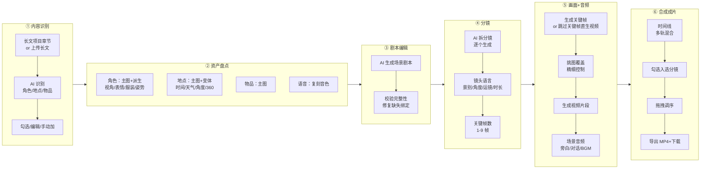
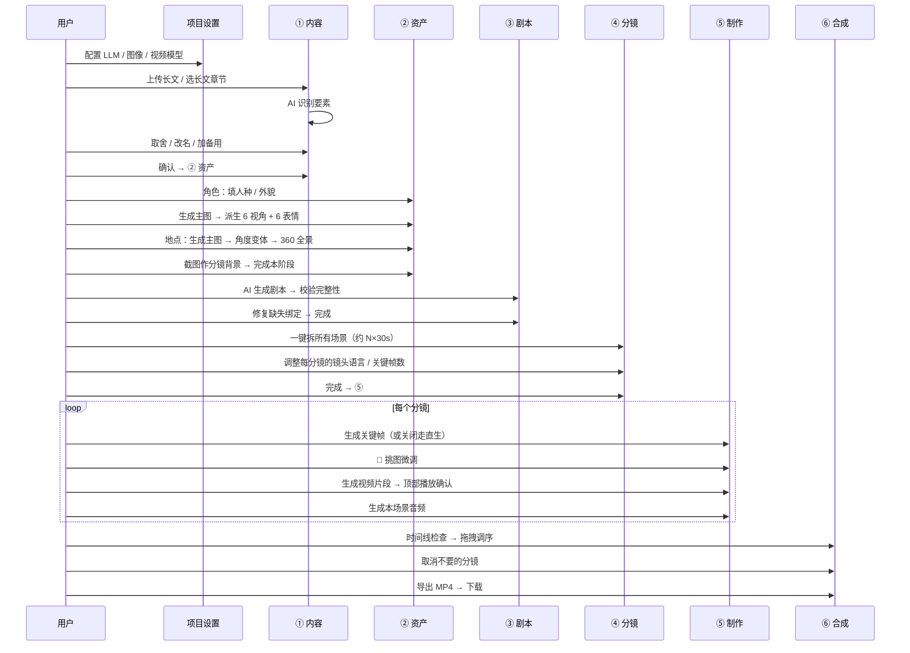

# 剧集制作 · 完整使用手册

> 适用版本：feat/episode-production-redesign 分支（2026-05-07 之后）
> 目录：① 内容识别 → ② 资产盘点 → ③ 剧本编辑 → ④ 分镜 → ⑤ 画面+音频 → ⑥ 合成成片

---

## 0. 整体流程



每个剧集制作都按这 6 步推进；**每一步都依赖上一步的输出**（资产没准备好就拆不出有效分镜，分镜没图就出不了视频）。下面按工作流逐步说明。

---

## 1. 进入剧集制作

### 1.1 创建项目和剧集

1. 主菜单点 **「剧集制作」** → 进入项目列表
2. 「+ 新建项目」创建一个项目（项目相当于"一部剧"，含多集）
3. 项目卡上点击进入 → 「+ 新建剧集」（一个项目含 N 集，每集独立工作流）

**剧集来源（创建剧集时二选一）：**

| 来源 | 适用 | 数据 |
|---|---|---|
| 📚 长文项目 | 已经在长文模块写了大纲 | 选 outlineId（长文章节）→ 自动绑定该章节的角色 / 地点 |
| 📝 上传长文 | 直接给一段 500–15000 字的故事 | 粘贴文本 → 创建后立即 AI 识别角色 / 地点 / 物品 |

> 💡 上传长文模式适合"快速把一段故事变剧"；长文项目模式适合多集系列剧（共用一套世界设定）。

### 1.2 上次选中的剧集会自动恢复

每次进入项目工作台，自动选回**上次选过的剧集**。多集项目里切到某一集后离开/刷新/重启进程，再回来仍在那一集。

> 数据存在浏览器 localStorage（key: `ep-production:last-selected-episode`），按项目分桶。

### 1.3 项目设置（必做一次）

进入剧集工作台后，右上角点 **「项目设置」**：

- **剧本生成模型**（必填）：用于 ① 识别要素 / ③ 生成剧本 / ④ 拆分镜 / ⑤ 关键帧 prompt 等所有 LLM 调用
- **图像生成模型**（必填）：用于主图 / 派生图 / 360 全景生成
- **视频生成模型**（必填）：用于 ⑤ 视频片段生成

> ⚠️ 没配 LLM 模型时，AI 识别 / 生成会报"未指定模型，请在配置中选择一个模型"。先配再用。

---

## 2. ① 内容识别 stage

### 2.1 顶部信息

```
[① 内容识别] [📝 上传长文] [✨ AI 识别要素]
3 角色 · 0 地点 · 0 物品（已确认 3）· 约 5459 字
```

- **类型 tag**（标题栏右侧）：`📚 长文项目` / `📝 上传长文`，标记本剧来源
- **副标题**：实时显示已识别 / 已确认数 + 长文字数
- 来源在创建剧集时定下，stage 内不可切换；要换来源 → 新建一集

### 2.2 原文片段

只读显示已上传的长文，**实体高亮**：识别出来的角色 / 地点 / 物品名字会自动高亮（鼠标悬停显示该实体的描述）。

**编辑原文**：点 **「编辑」** → 切换到 textarea 模式 → 改动后 **「保存」**（500–15000 字校验）。
- 保存后会重新计算高亮（新加的实体名字也会高亮）
- 改完原文不会自动重新识别要素，要点下面单类型「重新识别」按钮

**「✨ 重新 AI 分析」** 按钮：等同点上方"重新识别全部"。

### 2.3 识别要素清单（角色 / 地点 / 物品 三列）

每列：
- **重新识别**（仅当前类）：只重跑该类型的 AI 识别，**不影响其他两类**（避免你已经手动改过角色却被全量识别覆盖）
- **+ 手动加**：弹 dialog 直接录入一个角色 / 地点 / 物品

每条 entity 卡片：
- **复选框**：勾选 = 进入剧集（被后续步骤引用）；取消勾选 = 不进入但保留记录
- **来源 tag**：`linked_lw`（来自长文项目）/ `standalone`（本剧独立）
- 操作：改 source / 编辑 / 移除

### 2.4 完成识别 → 确认进入 ②

底部 banner 显示已确认数。改动后必须先 **「保存改动」** 才能 **「确认要素 → ② 资产」**。确认后剧集状态从 `pending` 变为 `asset_prep`。

---

## 3. ② 资产盘点 stage

资产是最终视频里"能看到 / 听到"的所有东西的图谱。一个剧集对应：
- N 个角色（每个角色：主图 + 视角 / 表情 / 服装 / 姿势变体）
- N 个地点（每个地点：主图 + 时间 / 天气 / 角度变体 + 360 全景）
- N 个物品（每个物品：主图）
- N 个语音（系统音色或复刻音色）

### 3.1 资产盘点界面（主区）

```
② 资产盘点
8 角色 · 3 地点 · 2 物品 · 0 语音 · 已就绪 2/13
[跳过空缺（11）] [✨ 一键生成所有缺失主图（11）] [完成本阶段 →]
```

**资产卡（角色 / 地点 / 物品）显示**：
- 缩略图区：**有主图 → 真实主图缩略**；无主图 → ⚠ 占位
- 主图状态 tag：`主图 ✓` / `缺主图`
- 卡片**没有"生成主图 / 图谱 / 设定"按钮**——所有操作进编辑界面做（保持卡视觉聚焦）

点击资产卡 → 进入对应类型的**编辑界面**。

### 3.2 角色编辑界面

#### 3.2.1 顶部

```
< 返回盘点  老者 [linked_lw / standalone]  [主图齐备]   [↺ 拉取最新基础值] [保存]
```

#### 3.2.2 设定卡（左侧 360px）

按节展开：

| 节 | 字段 |
|---|---|
| ① 身份 | 姓名 / 别名 / 定位 / 性别 / 年龄 / **人种**（东亚/南亚/东南亚/中亚/欧洲/非洲/南美） |
| ② 外貌 | 自由文字（来自长文 hint） |
| ③ 服装 | 默认 + 备选数组 |
| ④ 声音 | **音色**（语速 / 音调 / 情感按场景在分镜阶段配置，不在这里） |
| ⑤ 形象库 | portrait_id 绑定 |

> ⚠️ "语速 / 音调 / 情感"被故意从这里删除——同一角色不同场景这些会变（紧张时语速快、伤心时语调低），放在分镜阶段按场景设。

> 💡 **人种**字段会进入 AI 主图 prompt（中英双写："东亚（East Asian, Han Chinese facial features）"），保证 AI 不会把中国老人画成欧洲白人女性。

#### 3.2.3 图谱（右侧 1fr）

`🖼️ 图谱` 标题旁有 **❓ icon**（hover 显示"分镜如何用这些图"的优先级链）。

**主图卡：**
- 缩略图区显示当前主图，双击放大预览
- header 右侧按钮：
  - 缺主图：`✨ 生成主图` + `⬆ 上传`
  - 有主图：`↺ 重生成` + `⬆ 上传替换`
- hover 缩略图 → 右上角 icon：`下载` / `删除`（删除主图会有二次确认）

**4 类变体（视角 / 表情 / 服装 / 姿势）：**
每类一个 panel，header 显示进度 `已生成 N / 总 M`，右侧 `✨ 派生剩余` 按钮（仅缺图时可点）。

| 类目 | 默认变体（中文显示） |
|---|---|
| 视角 | 正面 / 左 3/4 / 右 3/4 / 左侧 / 右侧 / 背面（共 6） |
| 表情 | 中性 / 微笑 / 难过 / 愤怒 / 惊讶 / 思考（共 6） |
| 服装 | 自由（用户加什么显示什么） |
| 姿势 | 站姿 / 行走 / 坐姿 / 指向（共 4） |

> ⚠️ DB 里仍存英文 key（`front / 3q_left / smile / standing` 等）—— UI 显示中文，prompt 拼接走英文 key 与底层 service 对齐。不要改 DB key。

每个变体格子：
- 已有图 → 缩略图 + hover 工具条（下载 / 删除）；**双击放大预览**（带左右翻页）
- 缺图 → 显示 `+`；正在生成时显示 spinner

#### 3.2.4 派生图的硬约束（看不见但起作用）

主图和所有派生图（视角 / 表情 / 服装 / 姿势）都被自动注入：
- 直立全身（**表情**用上半身）
- 纯色背景（无场景）
- 无帽子 / 无首饰
- 与主图保持一致的光照（`match lighting from reference`）
- 无明显阴影

负面 prompt 也压制：cropped / half body / harsh shadow / busy background / hat / jewelry...

> 💡 派生图都会**以主图为参考**（i2i）。所以**先把主图调好**——派生只是基于主图换视角 / 表情 / 服装 / 姿势，构图 / 光照 / 风格都跟主图保持一致。

#### 3.2.5 全局忙状态

任意一个生成动作（生成主图 / 派生 / 上传）启动后：所有按钮 disabled，对应位置显示 spinner，避免并发请求把同一资产搞乱。

### 3.3 地点编辑界面

跟角色界面同结构，差异：

| 维度 | 默认变体 |
|---|---|
| 时间变体 | 早晨 / 中午 / 午后 / 傍晚 / 夜间 / 拂晓 / 黄昏 |
| 天气变体 | 晴 / 阴 / 雨 / 雪 / 雾 / 暴风 |
| 角度变体 | 远景 / 入口 / 内景 A / 内景 B |
| 360 全景 | 独立 panel，可生成 / 上传 |

**地点角度变体**自动锁定：光照不变 / 时间不变 / 天气不变（`only change camera angle`），仅改机位视角。

**360 全景：**
- AI 生成 360 时**以主图为参考**（解决"360 跟主图风格不一致"）
- 也支持上传现成 360 图（jpg/png/webp，比例≈2:1，≤50MB）
- 生成后嵌入 photo-sphere-viewer，可拖拽调视角 → **截图作分镜背景**
- 每张截图 hover 出现：`设为主图` / `删`
  - **设为主图**：把截图升级为该地点的主图，原主图降级为 view 普通图（保留不删）—— 当原主图与 360 风格不一致时直接拨齐

`🌐 360 全景图` 标题旁也有 ❓ icon（hover 显示"360 在分镜中如何作背景参考"）。

### 3.4 物品编辑界面

跟角色 / 地点同模式，但**目前 picker 不接入物品的图谱编辑**（数据形态待定，留 follow-up）。可生成 / 重生成主图 + 双击预览 + 下载 / 删除。

### 3.5 视频生成的资产引用链

下游 ⑤ 关键帧 / 视频片段生成时按以下优先级引用：

```
该分镜的 panorama_snapshot（最精准 · 来自 360 截图，3D 一致）
  ↓ 没有 ↓
地点 angle_variant（按时间 + 天气 + 视角匹配）
  ↓ 没有 ↓
地点主图（兜底）
```

角色：评分制挑变体（view +4 / expression +3 / outfit +2 / pose +1），找不到匹配走主图。

物品：当前评分用空 dims，**永远兜底主图**（dims 来源待补，留 follow-up）。

---

## 4. ③ 剧本编辑 stage

### 4.1 章节梗概 + 场景列表

```
③ 剧本编辑
3 个场景 · 12 段对白 · 8 段动作 · 引用解析率 100%
[✨ AI 重写场景] [修复缺失绑定] [完成本阶段 → ④ 分镜]
```

- **章节梗概**：来自上一步 ① 识别完后自动生成，可点 `✨ AI 重新生成`
- **场景列表**：每个场景卡可折叠
  - header：场景 N · 📍 地点 · **白天 / 晴**（中文显示，不是 day / sunny）· 出场 @人物
  - body 展开：原文 / 旁白 / 对话 × N / 动作 × N（4 类色彩区分）
- **+ 添加场景**：手动新增场景（弹 prompt 输地点 + 时间）
- **编辑场景**（场景卡上的"编辑"按钮）：仅改地点名（完整 dialog 留 follow-up）

### 4.2 完整性校验

底部 `ScriptCompletenessPanel` 列出违例（角色 / 地点 / 物品 binding 缺失等）：
- 每条违例后面有 **「去绑定资产」** / **「去生成主图」** 等修复按钮
- 点 → 跳到对应位置 + toast 提示

> ⚠️ 旧版本提示文案"在该场景头部点击绑定地点"是错的（剧本界面没有那个按钮）。**正确做法**：点剧本顶部 **「修复缺失绑定」** 按钮 → 后端按名字串自动匹配 ② 资产里同名 binding 自动绑定。匹配不上 → 去 ② 资产新建同名资产 / 或编辑场景把名字改成已有资产名 → 再点「修复缺失绑定」。

### 4.3 隐藏右侧资产侧栏

剧本界面右侧资产侧栏在 ③ 不显示——剧本里 `@角色 / @地点` 已经是引用，侧栏重复且占空间。

---

## 5. ④ 分镜 stage

### 5.1 顶部

```
④ 分镜
3 场景 · 共 15 个分镜 · 当前场景预估 28.5s
[为本场景生成分镜] [✨ AI 一键拆所有场景] [完成本阶段 → ⑤ 制作]
```

### 5.2 场景树（左侧）+ 分镜网格（中间）+ 编辑面板（右侧）

#### 5.2.1 AI 拆分镜

- **「为本场景生成分镜」**：仅对选中场景拆分镜（10–30 秒/分镜，逐个生成）
- **「✨ AI 一键拆所有场景」**：批量拆全场景

> ⚠️ AI 是**逐个分镜串行生成**的，每个 LLM 调用约 10-30 秒。一个场景 5 个分镜 ≈ 1-2 分钟。**按钮文案显示实时进度**："生成中 5/N" / "批量生成 5/N"。新分镜会**逐个**出现在网格里（不需要等整批完）。

> 模型来源：`项目设置 → 剧本生成模型`。没配会提前 toast 提示。

#### 5.2.2 双击分镜卡进 ⑤

任意分镜卡上 **双击** → 直接跳到 ⑤ 画面+音频 stage 对应分镜（省去手动找的步骤）。

#### 5.2.3 编辑面板（选中分镜后展开）

**📖 所属场景剧情**（折叠 panel，默认收起）
- 展开看：原文 / 旁白 / 对话 × N / 动作 × N
- 编辑分镜画面描述时知道"这个分镜要表达什么剧情"

**镜头语言工具栏**（紧凑两行）
| 字段 | 选项 / 说明 |
|---|---|
| 景别 | 远景 / 全景 / 中景 / 近景 / 特写 / 大特写 |
| 角度 | 平视 / 俯拍 / 仰拍 / 鸟瞰 / 蚁视 / 斜角 |
| 运镜 | 固定 / 推镜 / 拉镜 / 摇镜 / 移镜 / 升降 |
| 时长 | el-input-number，**精度 0.1 秒** |

**关键帧数**（1-9 按钮组）：
- 推荐 5 帧（按运镜复杂度选）
- 改完保存 → 弹确认对话框"是否立即按新数量重新生成？"
  - 选「立即重生」→ 直接清旧帧重生
  - 选「稍后再说」→ 仅保存数量

**画面描述**：textarea，AI 生成关键帧时用。

**镜头内角色（独立配置）**：5 列网格
- 每行：@角色 / 位置 / 表情 / 朝向 / 动作
- 角色名解析 4 级 fallback：
  1. characterName 直接是字符串就用
  2. characterId === binding.id 严格匹配
  3. LLM 自由填的"老者"/"elder_01" → 按 standaloneName / overrideName 模糊匹配
  4. 都对不上至少显示 LLM 字符串本身（不再 `?`）
- **「编辑分镜内角色（详细 dialog）」** 完整对话框

### 5.3 隐藏右侧资产侧栏

④ 分镜界面也不显示侧栏——分镜卡 + 编辑面板已自含角色配置。

---

## 6. ⑤ 制作（画面+音频）stage

### 6.1 顶部 / 场景树 / 分镜列表（同 ④ 布局）

### 6.2 视频播放器（最顶部）

只要分镜已有 `videoPath`（之前生成过的也算），**面板顶部自动显示一个 video 播放器**，点播放即可看。生成新视频后自动切。

```
[16:9 视频]
本分镜视频  images/2026/05/07/sb_xxx.mp4
```

双端 URL 兼容（PC `local-video://` / Web `/assets/`）。

### 6.3 镜头语言（同 ④，可在此再调）

**关键帧数前面有复选框**：
- ✅ 勾选（默认）= 走关键帧流程：先生成 N 张关键帧 → keyframesToVideo
- ☐ 取消 = 跳过关键帧，直接用画面描述 + 引用资产 text2video / image2video
  - 关键帧 panel 整体折叠 + 1-9 按钮 disabled
  - 提示语切换："已关闭：本分镜将直接用画面描述 + 引用资产生成视频"

> 💡 简单单一镜头（无运动 / 无场景切换）选关闭，节省一轮关键帧生成。复杂运镜（推镜 / 摇镜）走关键帧。

### 6.4 关键帧序列 panel

- 时间轴 bar：标尺 + START / END / 中间 percent
- 关键帧网格（按 frame_index 升序）
- 每帧 cell 含：
  - 16:9 缩略图
  - **双击放大预览**（含左右翻页 + 计数 + 该帧基于的所有 reference 大缩略图网格）
  - hover 显示 `🔁 重生此帧` / `🔍 查看大图`
  - 时间戳：`#1 · 开始 · 0%`（按 frameRole 颜色编码：start=绿/end=红/middle=黄/extra=蓝）
  - **基于以下资产**列表（虚线分隔）：缩略图 + emoji 类型 + 资产名（hover 显示完整元信息）
  - **🎯 挑图** 按钮：弹 picker dialog 让用户为每个出场资产手动指定具体的 asset_image
- **两个 cell 之间** 出现 `+` 虚线按钮：在该帧后插入一帧（frameRole='extra'，timePercent 取相邻两帧中点）
- 顶部按钮：缺帧时 `✨ 生成关键帧`，已有时 `🔁 全部重新生成`

#### 6.4.1 🎯 挑图 dialog

每个出场资产（角色 / 地点）一个 section：
- section 头：emoji 类型 + 名字 + （清除选择 - 恢复自动）
- 全图网格：该资产所有 asset_image（缩略图 + category/label/主图标记）
- 点击切换选择，蓝色描边表示已选
- 底部：取消 / 保存 / **保存并重生此帧**

挑图持久化到 `keyframe.reference_overrides`（JSON）：
- 命中 (kind, bindingId) 直接用指定 imageId
- 未指定的资产仍走自动评分
- 重生时透传，**用户挑过的图永不丢失**（在重生过程中复用）

#### 6.4.2 自动选图规则（没挑图时）

| 资产 | 维度 | 评分 |
|---|---|---|
| 角色 | view 朝向 | +4 |
| 角色 | expression 表情 | +3 |
| 角色 | outfit 服装 | +2 |
| 角色 | pose 姿态 | +1 |
| 地点 | angle 视角 | +4 |
| 地点 | time 时间 | +2 |
| 地点 | weather 天气 | +1 |
| 物品 | view 视角 | +3 |
| 物品 | context 上下文 | +1 |

最高分变体优先；找不到匹配兜底主图。

### 6.5 资产引用 + 场景音频（一行两栏）

```
[本分镜引用的资产]                        [场景音频]
📍 茶馆       👤 老者 · 平静               旁白 / 对话 / BGM 多轨
👤 少年 · 焦急  ⚔️ 玉佩                   🔊 [生成全部音频]
```

**点击资产 chip** → 弹 dialog 浏览该资产全部图谱（同 🎯 挑图的"只读模式"）。
- 找不到对应 binding 时 chip 灰着不可点（tooltip 解释"该资产未在 ② 资产中创建"）

**场景音频生成结果文案**：
- "X / Y 条对话生成成功 · Z 条失败 · 其中 N 条用了备用音色"
- 全失败时切 warning 黄色

### 6.6 视频片段生成 panel

```
[本分镜视频  ←顶部 video 播放器]
[提供商] [DashScope....]   [模型] [wanx2.1-t2v....]
[ 模式 ] [自动 / 文生 / 图生 / 关键帧序列]   [时长] [3.5 秒]
[最终提示词预览]    ← 灰底虚线框 <pre>
[调整方向（可选）]  ← textarea
[生成视频片段]      ← 按钮（已生成时显示"重新生成"）
```

- **提示词预览**：实时拼接 frameDescription / 镜头语言 / 地点 / 角色 / 旁白 / 对白 / 调整方向 / 时长 / 模式（reactive，所有字段改了立刻刷新）
- **调整方向**：用户额外提示词（如"动作更慢"），影响这次生成 + 持久化到关键帧的 userPromptOverride
- **模式**：
  - 文生视频（text2video）
  - 图生视频（image2video）
  - 关键帧序列（keyframes2video）—— 仅当关键帧数复选框开 + 已生成 N 张关键帧时
  - 自动（按 provider capabilities 选最佳）
- **生成完成 → 顶部播放器自动加载新视频**

---

## 7. ⑥ 合成成片 stage

### 7.1 顶部

```
⑥ 合成成片
3 场景 · 共 15 个分镜 · 即将合成 1080p MP4
[📥 导出 MP4]
```

### 7.2 上半双栏：预览 + 导出参数

**预览区**（左 1fr）：
- 已导出过 → 显示成片 video 元素（带 `▶`、timecode）
- 未导出 → 占位 `🎬 尚未导出 — 点右上角"导出 MP4"生成成片`

**导出参数 panel**（右 320px）：
- 分辨率：720p / 1080p
- 烧入字幕：on/off

> ⚠️ "输出路径"输入框已删除——后端 `resolveOutputPath` 自动落到 user data 目录（`<root>/users/<uid>/episodes/<episodeId>.mp4`）。导出完成后点下载按钮拉到本地。

### 7.3 时间线 panel

```
快捷键：Space 播放 · ←/→ 跳帧 · M 标记
─────────────────────────────────────
[0s] [5s] [10s] [15s] [20s]
─────────────────────────────────────
视频 V1：[ ▶S1: 茶馆相遇 ┃ 1.1 ┃ ⇄ ┃ 1.2 ┃ ⇄ ┃ ▶S2 ┃ 2.1 ┃ ⇄ ┃ 2.2 ]
字幕：    [ ▆ ┃ ▆ ┃ ▆ ┃ ▆ ]
旁白 A1：  [ ━━━━━━ ]
对话 A2：  [ ━ ┃ ━ ┃ ━ ]
BGM A3：    [ ━━━━━━ ]
─────────────────────────────────────
🎬 4 视频片段（4 入选）· ⇄ 3 转场 · 📄 4 段字幕 · 🔊 3 音轨 · 入选总时长 19.5s
```

#### 7.3.1 场景分隔符 + ▶ 跳起点

每个场景起点画虚线 + 蓝色 **▶** 圆形按钮 + 场景标签 `S1: 茶馆相遇`。点 ▶ → 视频跳到该场景起点并播放。

> 已导出视频后才能跳；没视频时 toast 提示先导出。

#### 7.3.2 入选 / 不入选

每个分镜 cell 左上角有 **复选框**：
- ✅ 入选（默认）= 进最终成片
- ☐ 不入选 = 跳过；cell 灰化 + 透明度 0.45 + 虚线边
- 切换立即持久化到 `storyboard.include_in_final`

> 💡 一个场景多个分镜（不同角度 / 备选视角）只想合成其中几个，取消勾选其他即可。

#### 7.3.3 拖拽调序（同场景内）

- 鼠标按住 cell 拖动到同场景内其他位置 → 松手 → 自动调用后端 `reorderStoryboards` 批量更新 shotNumber
- 拖拽中 cell 半透明，目标 cell 蓝虚线描边
- **跨场景拖拽不允许**（语义复杂——会改剧本场景边界）；尝试时 toast 提示

### 7.4 完成 banner

```
✅ 所有素材就绪 — 可以导出
4/4 分镜出片 · 字幕/旁白/对话/BGM 全部混音 · 转场配置完成
[▶ 完整预览] [📥 导出 MP4]
```

或：

```
⚠️ 待 ⑤ 制作完成
1/4 分镜出片 · 待 ⑤ 制作完成
```

### 7.5 合成完成 → 下载

```
✅ 导出成功
时长 1:23 · 含字幕
[📥 下载 MP4]
```

下载按钮双端兼容：
- PC：弹保存对话框 → 文件复制
- Web：fetch URL → blob → a[download] 触发浏览器下载

### 7.6 隐藏右侧资产侧栏

⑥ 也不显示侧栏——时间线已经有完整资产可视化。

---

## 8. 跨步骤通用功能

### 8.1 双击大图预览（统一交互）

- ② 资产卡片缩略图 → 双击进编辑界面
- ② 编辑界面所有变体 → 双击大图（含左右翻页 + 计数 + 下载）
- ⑤ 关键帧 → 双击大图（含 references 网格）

### 8.2 主图切换 / 设为主图

任何 asset_image 都可以切到主图：
- ② 资产编辑里点缩略图旁的 hover icon（部分模式）
- 地点 360 截图：`设为主图` 按钮
- 关键帧 panel 的"挑图"会优先用挑选的图，但不改主图

### 8.3 全局忙状态保护

任何"生成"动作启动后，**当前面板所有按钮置灰**，对应位置显示 spinner，避免：
- 并发请求把同一资产搞乱
- 切换分镜导致请求/状态错位

### 8.4 中文化

| 数据 | DB 存什么 | UI 显示 |
|---|---|---|
| 时间段 | day / morning / noon / ... | 白天 / 早晨 / 中午 / ... |
| 天气 | sunny / cloudy / rainy / ... | 晴 / 阴 / 雨 / ... |
| 视角 | front / 3q_left / ... | 正面 / 左 3/4 / ... |
| 表情 | neutral / smile / ... | 中性 / 微笑 / ... |
| 视频模式 | text2video / image2video / keyframes2video | 文生视频 / 图生视频 / 关键帧序列 |

DB key 不变，仅 UI 渲染时映射，保持底层 service 兼容。

### 8.5 双端兼容（PC / Web）

| 能力 | PC | Web |
|---|---|---|
| 文件下载 | `electronAPI.file.saveFile` + `copyFile` | `fetch URL → blob → a[download]` |
| 图像 URL | `local-image://<rel>` | `/assets/<rel>` |
| 视频 URL | `local-video://<rel>` | `/assets/<rel>` |
| 文件 URL | `local-file://<rel>` | `/assets/<rel>` |

`toImageUrl / toVideoUrl / toFileUrl` 透明处理；调用方不需要关心 platform。

---

## 9. 常见问题排查

### Q1：AI 识别 / 拆分镜 / 生成剧本报"未指定模型"
A：项目设置里没配 LLM 模型。点剧集工作台右上角 **「项目设置」** → 配 `剧本生成模型` 的 providerConfigId + modelId。

### Q2：派生图（视角 / 表情 / 服装 / 姿势）跟主图人物完全不一样
A：先确认有主图。派生图自动以主图为参考（i2i），但前提是 provider 支持 `referenceImage` 字段（DashScope / Bailian 已支持）。如果用其他 provider 仍出问题，去「设置 → 模型服务」换成 DashScope / Bailian。

### Q3：360 全景跟主图风格不一致
A：360 已自动以主图为参考；如仍不一致，可用全景上的"截图作主图"功能反向拨齐——选一个截图 → 设为主图 → 主图就跟 360 风格一致。

### Q4：⑤ 关键帧 cell 上"基于"列表是空的 / 没有 🎯 挑图按钮
A：旧关键帧没存 references 数据。点 `🔁 重生此帧` 或 `🔁 全部重新生成` 后，新关键帧的 metadata 会写入 referenceImageIds，UI 立刻显示。

### Q5："为本场景生成分镜"很久还在加载
A：**不是卡死**。AI 是逐个分镜串行生成（每个 ~10-30s）。按钮文案会显示 `生成中 5/N` 实时进度；新分镜会**逐个**出现在网格里。耐心等。

### Q6：⑤ 视频生成完后看不到视频
A：之前是 props 名 bug 导致 panel 收不到分镜数据。现在已修——VideoSegmentPanel 顶部应有 video 播放器（已生成 / 历史生成都能立即看）。如仍不显示，刷新页面。

### Q7：⑥ 时间线只显示一个场景
A：那是因为剧本只有 1 个场景，或者其他场景没拆分镜。整集合成的判断是按 episodeScript 整集所有场景。

### Q8：⑥ 导出 MP4 报"导出阻断：N 个入选分镜尚未生成视频"
A：勾选了某分镜进最终成片但该分镜还没在 ⑤ 生成视频。要么去 ⑤ 给它生成视频，要么取消勾选跳过。

### Q9：⑥ 合成完成的视频下载不下来
A：检查后端 server log。视频文件应在 `<userDataPath>/episodes/<episodeId>.mp4`；下载失败常见原因：
- 文件实际不存在（合成 ffmpeg 流程报错但前端没显示）
- Web 模式下 `/assets` 路由 401（重启 server / 重新登录）

### Q10：人种字段填了但生成图还是欧洲人
A：先确认主图是用了人种 prompt 后**重新生成**的（之前生成的图不会自动更新）。点 `↺ 重生成` 或 `✨ 生成主图` 即按当前人种 + 性别 + 年龄 + 外貌全部 prompt 重新生成。

---

## 10. 工作流推荐节奏



### 推荐节奏
1. **先把 ②  资产做透**：主图 / 360 / 角度变体齐全后，派生链才会稳定
2. **③ 剧本完整性必须 100%**：缺绑定下游全部受影响（角色找不到 binding / 地点 prompt 拼不出）
3. **④ 分镜做完单场景测试**：不要一次拆所有再发现镜头语言不对，先一个场景测画面、调好节奏再批量
4. **⑤ 关键帧 → 视频要分两步**：先生成全部关键帧确认人物 / 场景一致；再批量生成视频；中间出问题（比如某帧人物错）回去 🎯 挑图覆盖
5. **⑥ 导出前先粗看**：拖一遍场景 ▶ 跳起点确认每场顺序正常，再正式导出

---

## 11. 技术参考（开发者向）

### 11.1 数据库 schema 关键字段

| 表 | 字段 | 用途 |
|---|---|---|
| video_episodes | uploaded_content / uploaded_characters / uploaded_locations / uploaded_items | ① 上传模式的长文 + 识别结果（locations/items 是后期补的列） |
| character_bindings | race | 人种枚举（east_asian / south_asian / ... / south_american） |
| storyboards | keyframe_count / use_keyframes / include_in_final | 关键帧数 / 是否走关键帧 / 是否入最终成片 |
| storyboard_keyframe | reference_overrides | 用户挑图 JSON 列表 [{ kind, bindingId, imageId }] |

### 11.2 关键 IPC

```
ep:identify-uploaded-entities     ① 全量 / 单类识别（kinds 参数）
ep:update-uploaded-entities       ① 取舍 / 手动加保存
ep:asset:image:set-as-main        ② 360 截图升主图
ep:asset:image:list-by-asset      所有资产图谱列出
ep:asset:project-summary          ② 资产盘点页面用
ep:fix-script-bindings-by-name    ③ 修复缺失绑定（按名匹配）
ep:generate-storyboard            ④ 单场景拆分镜（带进度事件 ep:storyboard-progress）
ep:generate-storyboards           ④ 全场景拆分镜
ep:reorder-storyboards            ⑥ 时间线拖拽调序
ep:insert-keyframe-between        ⑤ 两帧间插帧
ep:set-keyframe-reference-overrides   ⑤ 🎯 挑图保存
ep:list-asset-images              ⑤ 🎯 挑图 dialog 拉图
ep:generate-keyframes / regenerate-keyframe   ⑤ 关键帧
ep:generate-video-segment         ⑤ 视频片段
ep:generate-scene-audio-v3        ⑤ 场景音频
ep:build-timeline / preview-subtitle / export-mp4   ⑥ 合成
```

### 11.3 共享 prompt 约束源

- `src/core/modules/episode-production/assets/prompts/character-constraints.ts`
  - 主图 / 派生通用：直立全身 / 上半身（表情）/ 纯色背景 / 无帽子无首饰 / 与参考图一致光照 / 无阴影
  - 中英双写 + framing 切换（fullBody / upperBody）
- `src/core/modules/episode-production/assets/prompts/location-constraints.ts`
  - 角度变体专用：光照 / 时间 / 天气与参考图保持一致，仅改机位

### 11.4 reference image 透传链

```
generation service                    →  imageGen.generate
  referenceImagePaths: [main.imagePath]   referenceImagePaths

createGalleryImageGenerator
  readImageAsDataUrl(file)            →  data:image/png;base64,...
  ImageService.generateImage({ referenceImage })

DashScope / Bailian provider
  body.input.image_url = referenceImage    （或 body.input.image）
```

派生（视角/表情/...）+ 360 全景 + 关键帧 全走这条链。

---

## 附：版本历史

| 日期 | 改动 |
|---|---|
| 2026-05-06 | ① 体验改造、② 资产卡缩略 / 紧凑、③ 剧本中文 / 隐藏侧栏 |
| 2026-05-06 | ④ 关键帧数同步 / 镜头语言紧凑 / 双击进 ⑤ |
| 2026-05-07 | ⑤ 关键帧标签重写 / 数同步 / 两帧插帧 / 阶段 1+2 资产 picker |
| 2026-05-07 | ⑥ 隐藏侧栏 / 删输出路径 / 下载按钮 / 入选复选框 / 场景分隔符 / 拖拽调序 |
| 2026-05-07 | ④ 分镜生成进度事件 / 项目模型透传 |

---

> 本手册随产品迭代持续更新；如功能行为与文档不符，以代码为准并更新此文件。
