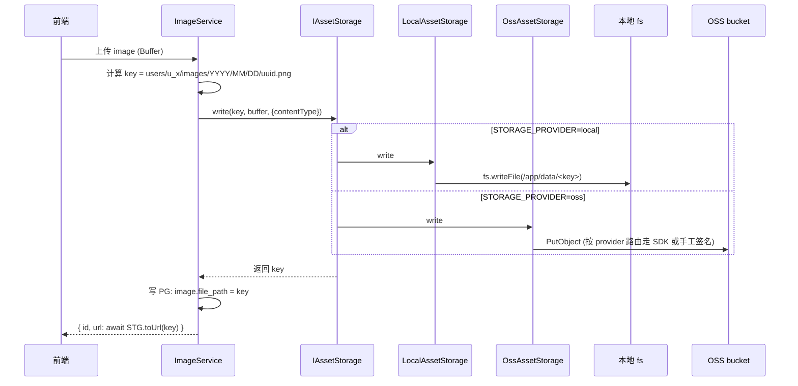
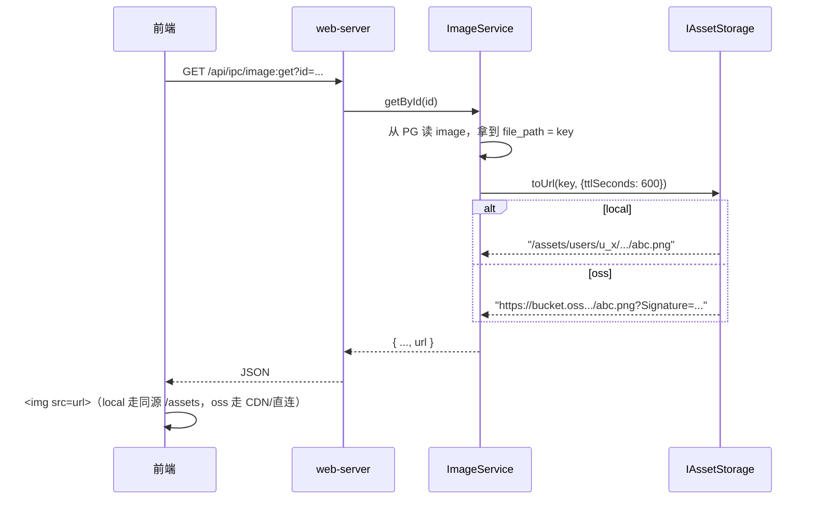
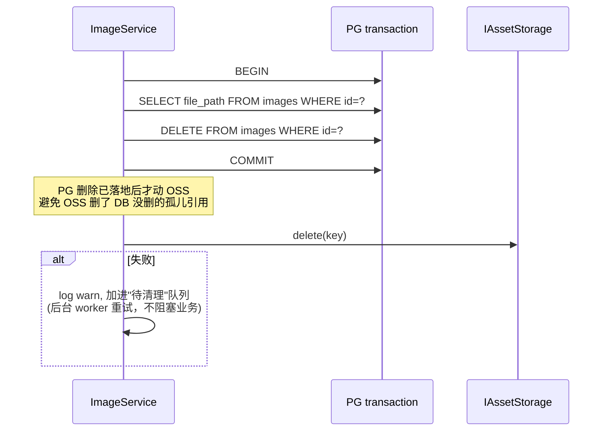
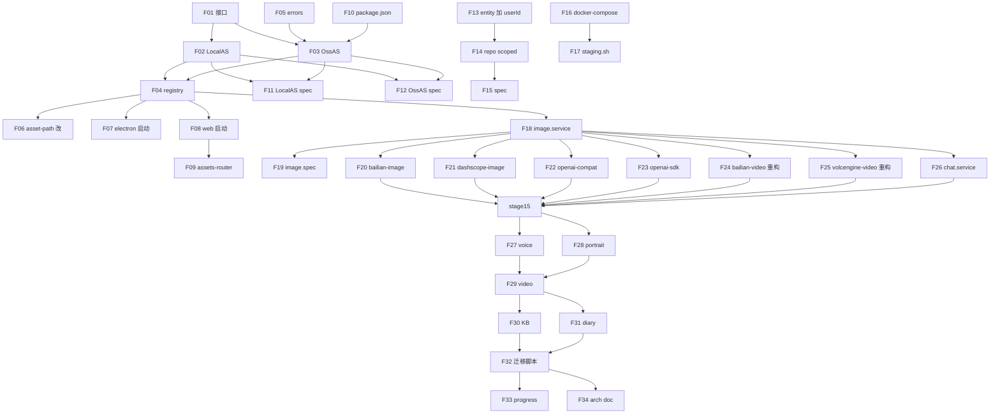

# Web 端文件存储抽象 → OSS 迁移

## Context

**问题（双驱动）**：
1. **存储侧**：当前所有文件类资产（图片 / 语音 / 视频 / KB 原文 / 日记附件 / 人像 / 长文图等）都落在 `DATA_ROOT/users/<userId>/...` 本地目录。Docker staging 部署时若动到 volume 就会丢；多实例横向扩展不可能；备份要靠文件系统级 dump。
2. **AI API 侧**：阿里百炼、火山方舟、DashScope、智谱 GLM 等的图生图 / 图生视频 / 视觉理解（VL） / 视频编辑等 API 入参是**公网 URL**（不是本地路径，不接受 base64）。目前只有视频生成（`bailian-video.provider.ts` / `volcengine-video.provider.ts`）走了 OSS；图生图、VL 聊天、参考图等链路要么硬编码 base64、要么假设入参是 URL，没有统一上传机制。

**目标**：把"可对象化"的文件资产搬到 OSS，同时把所有"需要公网 URL 才能调用的 AI API"链路统一接到 OSS 上传通道，**两件事一并做**。PC 端为离线可用保留本地 fs。

**前置事实（与初始认知不符）**：Web 端向量库实际**仍在用 LanceDB**（`src/web/server/index.ts:188` 起 LanceDBService，PG 没装 pgvector），不是 pgvector。本次范围**不包含**向量库迁移；LanceDB 目录在 Web 端继续 bind mount。后果：本次完成后 Web 后端仍非完全无状态（LanceDB 卷锁着一个实例），真正的水平扩展要等"向量库切 pgvector"专题落地。

**已确认决策**（见澄清问答）：
- OSS provider 范围：阿里 OSS + 火山 TOS + S3 兼容（引入 `@aws-sdk/client-s3` 覆盖 MinIO / Cloudflare R2 / AWS S3）
- PC 端保持本地 fs（环境变量 `STORAGE_PROVIDER=local|oss` 切换；PC 锁死 local）
- 按模块分阶段灰度切换（image → voice/portrait → video → KB doc → diary）
- 历史数据走一次性迁移脚本（参考 `scripts/migrate-pc-to-web-user.ts` 模式）
- 向量库（LanceDB）本次不动，另立专题

**关键约束（由动机 2 引出）**：即使 `STORAGE_PROVIDER=local`，只要使用图生图 / 图生视频 / VL 聊天上传图片等功能，**仍必须配置一条可用的 OSS 配置**（用于临时上传 → 拿公网 URL → 调云 API）。临时对象写到 `tmp/` 前缀，bucket lifecycle 配 24-48h 自动过期。换句话说：OSS 在本次完成后**不是可选项**，是基础设施。

**用户级 OSS 配置（已确认）**：每个 user 配自己的 OSS（不再是全局共享池）。当前 `OSSConfigRepository:23` 是 `useRawRepo()`（共享池），**需要顺带做和 `provider_configs` 一样的私有化改造**（entity 加 userId / repo 删 useRawRepo / 现有数据回填 / 单测）。这件事作为**阶段 0.5** 塞在阶段 0 后、阶段 1 之前，所有后续阶段依赖"按当前用户拿 OSS 配置"。

**OSS 缺失时的降级（已确认）**：业务 service 调 `ensurePublicUrl()` 时如果当前用户没有可用 OSS 配置，**返回结构化业务错误**（不抛 5xx）：
```
{ ok: false, code: 'OSS_NOT_CONFIGURED', error: '请到 设置 → 图床设置 配置 OSS 后再使用此功能', linkTo: '/settings?tab=oss' }
```
前端 IPC 客户端识别 `code === 'OSS_NOT_CONFIGURED'` → ElMessage 提示 + 提供"前往配置"跳转。Settings.vue 已有 OSS tab（`src/renderer/src/views/Settings.vue:342`），不需要新写 UI。

**OSS tmp 对象的隔离（已确认）**：临时对象 key 形态 `tmp/users/<userId>/<timestamp>-<hash>.<ext>` —— 用户级前缀，便于 IAM 策略隔离 + 单用户配额。lifecycle rule 写 `Filter: { Prefix: "tmp/" }`，TTL 24-48h。

---

## 哪些可以上 OSS、哪些不行

| 模块 | 文件类型 | 上 OSS | 备注 |
|---|---|:---:|---|
| AI 对话 | （无文件）| — | message.attachments 元信息留 PG |
| **image / image_assets** | 小图 PNG/JPG | ✅ | 试点首选，文件小、量大 |
| **voice + cloned_voice** | WAV/MP3 | ✅ | TTS 输出 / STT 输入 / 克隆样本 |
| **portrait_variant** | 生成图 PNG | ✅ | |
| **video / scene_script / storyboard** | MP4 大文件 | ✅ | 需 multipart upload + 前端 signed URL 直拉，避免后端转发瓶颈 |
| **kb_documents 原文** | PDF/docx/md/txt | ✅ | 文档原文上 OSS；chunks 留 PG |
| **diary 正文 + .assets/** | Markdown + 附件 | ✅ | 重新映射 prefix |
| **lw_* 图片** | 小图 | ✅ | 复用 image storage |
| **role.avatar** | 小图 | ✅ | |
| kb_chunks（PG 行）| 文本切片 | — | 已在 PG，不动 |
| **LanceDB 向量库** | 本地目录 + 文件锁 | ❌ | PC + Web 都用 LanceDB（Web 端待 pgvector 专题）；对象存储不支持文件锁。Web 容器继续 bind mount `/app/data/lancedb` |
| **secure-key 主密钥** | 32 字节 | ❌ | 主密钥不能上云（解密所有 API key 的根）。继续走 bind mount，且每环境独立（PC/dev/staging/prod 各自一份） |
| Postgres 本身 | DB | ❌ | DB 文件不上 OSS（用 RDS / 云数据库属另一专题） |

不上 OSS 的 3 类（LanceDB / secure-key / PG 数据卷）继续走 docker named volume 或 bind mount，不在本次范围。

**Web 容器存储分层（本次完成后）**：
```
/app/data/  ← bind mount ./.staging-data/app/
├── lancedb/        # 向量库，仍本地（LanceDB 文件锁限制）
├── secure-key      # 主密钥，仍本地（不能上云）
└── users/<uid>/    # ★ 业务文件，本次切到 OSS（local 模式仍走这里）

OSS bucket（仅 STORAGE_PROVIDER=oss 时使用）
└── users/<uid>/{images,voice,videos,knowledge-base,diary,portrait,longwriting}/...
```

---

## 架构

### 核心接口（新增）

`src/core/interfaces/storage.interface.ts`（与现有 `ISecureStorage` 同目录，名字别撞）→ 实际命名 `asset-storage.interface.ts`：

```ts
export interface IAssetStorage {
  /** 写文件，返回标准化 storage key（e.g. "users/<uid>/images/2026/05/02/abc.png"）*/
  write(key: string, data: Buffer | NodeJS.ReadableStream, opts?: { contentType?: string }): Promise<string>
  /** 读文件 */
  read(key: string): Promise<Buffer>
  readStream(key: string): Promise<NodeJS.ReadableStream>
  exists(key: string): Promise<boolean>
  delete(key: string): Promise<void>
  /** 给前端用的可访问 URL；本地实现返回 /assets/... 或 local-image://...，OSS 实现返回签名 URL（短期 TTL）*/
  toUrl(key: string, opts?: { ttlSeconds?: number; scheme?: 'image' | 'video' | 'audio' | 'file' }): Promise<string>
  /** 复制（用于 KB 文档版本化、diary 引用等）*/
  copy(srcKey: string, dstKey: string): Promise<void>
}
```

### 两个实现

| 类 | 文件 | 行为 |
|---|---|---|
| `LocalAssetStorage` | `src/core/services/storage/local-asset-storage.ts` | 包装现有 `fs` + `IPathProvider`，key 即相对路径 |
| `OssAssetStorage` | `src/core/services/storage/oss-asset-storage.ts` | 走 `@aws-sdk/client-s3`（覆盖 S3/MinIO/R2/B2/...）；阿里 OSS / 火山 TOS 沿用现有 `OSSService` 手工签名实现作为 fallback。配置读 `oss_configs` 表的 default 项 |

### 注册器

`src/core/services/storage/registry.ts`：
- PC 启动：`registerAssetStorage(() => new LocalAssetStorage(...))`
- Web 启动：根据 `STORAGE_PROVIDER` env：`local` → 本地；`oss` → 走 `OssAssetStorage` + 读 `oss_configs.default`

业务侧统一用 `getAssetStorage()`（与 `getCoreDatabaseManager()` 同套路），永远不直接 `import fs`。

### DB 字段语义升级

各 entity 的 `filePath` / `imagePath` / `outputAudioPath` / 等列**含义扩展**：
- 老：dataPath 下的相对路径（`images/2026/05/02/abc.png`）
- 新：storage key（同形态字符串，由 storage provider 决定底层是本地还是 OSS）

`toAssetUrl()`（`src/core/utils/asset-path.ts:73-79`）改为委托 `getAssetStorage().toUrl(key)`，由实现决定返回什么协议。

**不引入新字段**：减少 schema 改动。OSS key 与 local 相对路径同形态（`users/<uid>/images/...`），靠 provider 路由。

---

## 详细设计

### Storage key 命名规范

统一形态：`users/<userId>/<module>/<sub>/<filename>`

| 模块 | 模板 | 示例 |
|---|---|---|
| image | `users/<uid>/images/YYYY/MM/DD/<uuid>.<ext>` | `users/u_xxx/images/2026/05/02/abc.png` |
| voice | `users/<uid>/voice/<type>/<uuid>.<ext>` | `users/u_xxx/voice/tts/x.wav`（type=tts/stt/clone）|
| video | `users/<uid>/videos/<projectId>/<episodeId>/<uuid>.mp4` | |
| portrait | `users/<uid>/portrait/<projectId>/<characterId>/<variantId>.png` | |
| kb document | `users/<uid>/knowledge-base/<kbId>/documents/<uuid>.<ext>` | 原文 |
| diary | `users/<uid>/diary/<entryId>/<filename>` | 含 `.assets/` 子级 |
| longwriting | `users/<uid>/longwriting/<projectId>/<filename>` | |

**原则**：
- key 全部相对，不含 `/app/data` 前缀；与现有 DB 存的相对路径**完全一致**，零迁移成本
- 第一段必须是 `users/<userId>/`，OSS bucket policy 可按此前缀做 IAM 隔离
- 时间分目录（image/video）控制单目录文件数；其余按业务父子键分

### Provider 路由

`OssAssetStorage` 内部按 `oss_configs.provider` 字段分流：

```
provider = 'aliyun'    → 现有 OSSService 手工签名（沿用 src/core/services/oss.service.ts）
provider = 'volcengine'→ 同上
provider = 's3' / 'minio' / 'r2' / 'b2' / 'cos' → @aws-sdk/client-s3 + S3Client
```

`oss_configs` entity 加：
- `provider` 列 enum 扩展（已有 aliyun/volcengine，新增 s3/minio/r2/b2/cos）
- `endpoint` 列已有，S3 兼容直接填 endpoint URL
- `pathStyle` boolean（MinIO 默认 path-style，AWS 默认 virtual-hosted）

### 数据流：上传



### 数据流：读取



### AI Provider 公网 URL 入参（新增章节）

**问题**：很多云 AI API 不接受本地文件 / base64，必须传 https URL。当前调用点（已调研）：

| 模块 | 文件 | 当前实现 | 需要改造？ |
|---|---|---|:---:|
| **图生视频 · 阿里百炼** | `src/core/video-providers/sdk/bailian-video.provider.ts:156-334`（uploadLocalFile / uploadViaTempPolicy / uploadViaOSS）| 已用 OSS（百炼临时上传 + 兜底走 OSSService）| 重构对接新接口 |
| **图生视频 · 火山** | `src/core/video-providers/sdk/volcengine-video.provider.ts:278-300`（uploadLocalFile）| 已用 OSS | 重构对接新接口 |
| **图生图 · 阿里百炼** | `src/core/image-providers/bailian-image.provider.ts:296` | 假设入参已是 URL，本地图片需调用方自己处理 | ✅ 改造 |
| **图生图 · DashScope** | `src/core/image-providers/dashscope-image.provider.ts:338, 659` | 同上 | ✅ 改造 |
| **VL 聊天 · OpenAI 兼容（含智谱 GLM）** | `src/core/providers/openai-compatible-provider.ts:190, 218` | 直接转发 image_url，不接受本地路径 | ✅ 改造 |
| **VL 聊天 · OpenAI SDK** | `src/core/providers/sdk/openai-sdk-provider.ts:265, 295` | 同上 | ✅ 改造 |
| 视觉 · Anthropic Claude | `src/core/providers/sdk/anthropic-sdk-provider.ts:104-106` | 接受 base64 data URL | 不强制（保留兼容） |
| 视觉 · Google Gemini | `src/core/providers/sdk/google-sdk-provider.ts:109-111` | 接受 base64 data URL | 不强制（保留兼容） |
| 人像设计参考图 | `src/core/services/portrait.service.ts:403-502` | 间接走 ImageProvider；本地路径未处理 | ✅ 顺着 image provider 一起 |
| 长文配图 / KB 多模态 embedding | — | 暂未实现 | 未来 |

**统一抽象**：在 `IAssetStorage` 上加一个 helper：

```ts
/**
 * 接收任意形态的资源输入，确保返回一个**云端 AI API 可访问的公网 URL**。
 * - input 是 https URL → 直接返回
 * - input 是 storage key（"users/x/..."）→ 走 toUrl(key) 生成签名 URL
 * - input 是本地绝对路径 → 上传到 OSS 临时区（key="tmp/<uid>/<timestamp>-<hash>.<ext>"），返回签名 URL
 * - input 是 Buffer → 同上
 *
 * 临时上传的对象走 bucket lifecycle：tmp/ 前缀 24-48h 自动过期，避免无限堆积。
 *
 * 在 STORAGE_PROVIDER=local 模式下，本地路径要走"借道 OSS 临时上传"分支
 * （即使其余模块走本地存储，AI API 调用仍需公网 URL）—— 这要求 oss_configs
 * 里至少有一条可用配置；没有则抛"AI 调用要求公网 URL，请配置 OSS"业务错误。
 */
ensurePublicUrl(input: string | Buffer | NodeJS.ReadableStream, opts?: { ttlSeconds?: number; ext?: string }): Promise<string>
```

**改造模式**：所有上述 ✅ 行的 provider 改为：

```ts
// 改前（举例）：
async generate(refImage: string) { ... 直接传 refImage ... }

// 改后：
async generate(refImage: string | Buffer) {
  const url = await getAssetStorage().ensurePublicUrl(refImage, { ext: 'png', ttlSeconds: 3600 })
  ... 用 url 调云 API ...
}
```

**好处**：
- provider 不再各自 reinvent 上传逻辑（百炼有自己的临时上传 API、火山走 OSSService，逻辑分散）
- 调用方（image.service / chat.service / portrait.service）传本地资源不用再担心
- 即使 STORAGE_PROVIDER=local，也能优雅处理"AI 必须公网 URL"的场景（借道 OSS 临时上传）

### 数据流：删除（一致性）



**为什么不双写事务**：OSS 不参与 PG 事务。如果 OSS 删了但 PG 回滚，文件就找不回；反过来 PG 删了 OSS 没删，只是产生孤儿对象，可被定期 GC 任务清理（low impact）。所以**先 PG 后 OSS** + 失败容忍，是安全的。

### 错误处理 / 重试

| 场景 | 行为 |
|---|---|
| 上传 OSS 超时 | service 抛错回前端；DB 不写；用户重试 |
| 上传 OSS 部分成功（multipart 中断） | SDK 内置重试 + abort multipart upload；最终失败按上一行处理 |
| 下载 OSS 404（key 不存在）| service 返回"文件不存在"业务错误（非 500） |
| 删除 OSS 失败 | 不阻塞 DB 删除；写入 `oss_pending_delete` 表（新建小表 id/key/created_at），后台 worker 周期性重试 |

### 配置切换 / 灰度

环境变量：
- `STORAGE_PROVIDER=local|oss`（默认 local）
- `OSS_DEFAULT_CONFIG_ID=<oss_configs.id>`（oss 模式下选哪条 config，不指定则用 isDefault=1）

灰度策略：
- staging 环境 `STORAGE_PROVIDER=oss`，配 MinIO 容器作为 dev OSS
- dev 环境保持 `local`
- prod 环境上线后先单实例 oss 跑 1-2 周，再考虑加实例

回滚预案：
- env 切回 `local` + 跑 reverse 迁移脚本（OSS → fs）：扫所有 entity 的 file_path，从 OSS 拉文件回本地相同 key 路径
- 由于 key 形态完全一致，回滚成本就是网络下行 + 写盘

### 测试策略

**单测**：
- `LocalAssetStorage` 用临时目录 fixture
- `OssAssetStorage` 用 MinIO docker（CI 里 docker-compose 起 MinIO 当 fixture）
- 双 provider × CRUD 全覆盖（write / read / readStream / exists / delete / toUrl / copy）
- 错误注入（OSS 5xx / 404 / 超时）

**集成测试**：
- staging 环境（已有 docker-compose.staging.yml）增加 MinIO service
- `bash scripts/staging.sh up` 自动起 MinIO + 自动 mc 命令建 bucket
- 切 `STORAGE_PROVIDER=oss` 重启 → 跑端到端 image / voice / video / kb / diary 五条主路径
- 校验 MinIO web console（http://localhost:9001）能看到对应 key 文件

**多用户隔离测试**：
- 用户 A 上传 image → bucket 里 key = `users/A/images/...`
- 用户 B 登录 → list 不应看到 A 的 OSS 文件（依赖 service 层 user_id 过滤；OSS 端 IAM 是第二道防线）

**回滚演练**：
- OSS 模式跑通后，env 切回 local + 跑 reverse 脚本 → 验证浏览器仍能加载所有图片
- 确保 reverse 后 DB 不动、文件回本地、URL 由 toUrl() 自动走 local-image://

---

## 关键实施改动

### 阶段 0：契约 + 抽象（**1 周**）

新增：
- `src/core/interfaces/asset-storage.interface.ts` —— 契约 + register/get
- `src/core/services/storage/local-asset-storage.ts` —— 包 fs，对齐现有 `IPathProvider` 行为
- `src/core/services/storage/oss-asset-storage.ts` —— 用 `@aws-sdk/client-s3` 实现 read/write/delete/exists/signedUrl/copy；多 provider 路由（aliyun/volcengine 仍走现有签名，s3 兼容走 SDK）
- `src/core/services/storage/registry.ts` —— 注册器（PC startup / Web startup 各自注入）
- 单测：双实现 + scoped 行为（OSS 实现用 MinIO docker 跑 e2e）

修改：
- `src/core/utils/asset-path.ts` —— `toAssetUrl()` 委托 storage 实现
- `src/electron/index.ts` 启动序列：`registerAssetStorage(() => new LocalAssetStorage(...))`
- `src/web/server/index.ts` 启动序列：根据 env 注册 local 或 oss
- `src/web/server/api/assets-router.ts` —— 当 STORAGE_PROVIDER=oss 时，**直接 302 redirect 到签名 URL**（不再后端读流转发，避免容器流量）
- `package.json` 加 `@aws-sdk/client-s3` `@aws-sdk/s3-request-presigner`

### 阶段 0.5：oss_configs 私有化 + MinIO 接入 staging（**3 天**）

**oss_configs 私有化**（参考 `provider_configs` 私有化 commit `b456143` 那次的范围）：
- `src/core/database/entities/oss-config.entity.ts` —— 加 `@Index() @Column user_id varchar nullable` 字段
- `src/core/database/repositories/oss-config.repository.ts:23` —— 删 `this.useRawRepo()`，全部读写改 `this.scoped.*`
- 现有 PG `oss_configs` 数据回填给 default user（renmadao 等）：`UPDATE oss_configs SET user_id=... WHERE user_id IS NULL`
- 单测加多租户隔离用例（用户 A 看不到 B 的 OSS 配置）

**MinIO 接入 `docker-compose.staging.yml`**：
- 新加 service `minio`：`minio/minio:latest` 镜像，端口 9000 (S3 API) + 9001 (web console)
- 启动后 init 脚本（`scripts/staging.sh up` 顺带）：
  - mc alias / mc mb（建 bucket `the-bot-staging`）
  - mc ilm import 配 `tmp/` 前缀 24h lifecycle
- 给 staging 默认用户（renmadao）预插一条 oss_configs 指向这个 MinIO（`provider=minio`, endpoint=http://minio:9000, accessKey=minioadmin, secret=minioadmin）

### 阶段 1：image 试点（**1 周**）

- `src/core/services/image.service.ts` —— 所有 `fs.writeFileSync` / `fs.readFileSync` 改 `getAssetStorage().write/read`
- `src/core/services/image.service.ts:481, 502, 667` —— 涉及 `filePath` 的存写/转 URL 改造
- 兼容老数据：本地相对路径在 LocalAssetStorage 透传；OSS 模式下检查 key 不存在则走 fallback（fs 读 + 上传补漏）
- e2e：staging 环境 `STORAGE_PROVIDER=oss` + MinIO 容器，renmadao 上传图片 → 签名 URL → 浏览器可访问

### 阶段 1.5：AI Provider 公网 URL 上传统一化（**1 周，与阶段 1 紧贴**）

`IAssetStorage.ensurePublicUrl()` 接口在阶段 0 设计、阶段 0 末尾完成实现。本阶段把所有需要公网 URL 的 provider 改造接入：

- `src/core/image-providers/bailian-image.provider.ts:296` —— 图生图参考图
- `src/core/image-providers/dashscope-image.provider.ts:338, 659` —— 图生图参考图
- `src/core/providers/openai-compatible-provider.ts:190, 218` —— VL 聊天图片入参
- `src/core/providers/sdk/openai-sdk-provider.ts:265, 295` —— 同上
- `src/core/video-providers/sdk/bailian-video.provider.ts:156-334` —— **重构**：把 uploadLocalFile / uploadViaTempPolicy / uploadViaOSS 三条上传路径统一到 `ensurePublicUrl()`；保留百炼临时上传作为内部优选实现，但暴露给业务的接口统一
- `src/core/video-providers/sdk/volcengine-video.provider.ts:278-300` —— 同上重构

调用方相应改造：
- `src/core/services/image.service.ts` —— 图生图调用 provider 时本地图自动 ensurePublicUrl
- `src/core/services/chat.service.ts` —— VL 模型对话时把 message.attachments 里的本地图片 ensurePublicUrl
- `src/core/services/portrait.service.ts` —— 参考角色形象的本地图

**bucket lifecycle**：建 bucket 时配 `tmp/` 前缀 24-48h 过期规则（用 staging.sh 脚本里的 mc 命令）。

### 阶段 2：voice + portrait（**1 周**）

同样套路：
- `src/core/services/voice.service.ts:466-475` 等
- `src/core/services/portrait.service.ts` 全部 fs 调用

### 阶段 3：video（**1-2 周**，难度最高）

- 视频文件大（10-500MB），必须走 multipart upload（`@aws-sdk/lib-storage` 自动分片）
- 前端播放器拿 signed URL 直拉 OSS（带 Range 支持），不经过后端
- 现存 `bailian-video.provider.ts` / `volcengine-video.provider.ts` 已经在用 OSS（生成中间步），统一到新接口

### 阶段 4：KB document 原文 + diary（**1 周**）

- `src/core/services/knowledge-base.service.ts` —— 原文文件上 OSS；chunks / LanceDB 不动
- `src/core/services/diary.service.ts` —— 正文 + `.assets/` 上 OSS
- diary 内嵌图片引用（Markdown 里 ``）需要把链接也改成 storage key 引用

### 阶段 5：迁移脚本 + 灰度 + 文档（**1 周**）

新增：
- `scripts/migrate-local-files-to-oss.ts` —— 仿 `migrate-pc-to-web-user.ts` 模式：扫所有 entity 的文件路径列 → 上传 OSS → 校验 → 改 DB（实际 key 不变，只是底层从 fs 搬到 OSS）。支持 `--dry-run` / `--module image,voice,...` / `--user <id>`
- `progress/<date>-files-to-oss.md` 进度记录
- `docs/arch/asset-storage-abstraction.md` 架构文档（含 Mermaid）

灰度：
- 环境变量 `STORAGE_PROVIDER=local|oss`（默认 local）
- staging 先切 oss 跑一周，dev 仍 local，正式 prod 待评估
- 回滚：env 切回 local + reverse 迁移脚本（OSS → fs）

---

## 工作量评估

| 阶段 | 工作量 | 风险点 |
|---|:---:|---|
| 0 契约 + 抽象（含 ensurePublicUrl）| 1 周 | SDK 集成 / provider 路由设计 |
| **0.5 oss_configs 私有化 + MinIO 接入** | **3 天** | 参考 provider_configs 私有化既有 pattern，低风险 |
| 1 image 试点 | 1 周 | 老路径兼容 / 删除级联一致性 |
| **1.5 AI provider 公网 URL 统一化** | **1 周** | **触及 4 个 image / VL provider + 重构 2 个 video provider 已有上传逻辑** |
| 2 voice + portrait | 1 周 | 低 |
| 3 video（存储侧 multipart）| 1-2 周 | 大文件 multipart / signed URL Range；与 1.5 已重构的 video provider 协同 |
| 4 KB doc + diary | 1 周 | diary 内嵌引用重写 |
| 5 迁移脚本 + 灰度 | 1 周 | 数据校验、灰度回滚演练 |
| **合计** | **8-10 周** | （单人估时；2 人并行可压到 5-7 周。新增 0.5 + 1.5 共 1.5 周）|

---

## Critical Files

**新增**：
- `src/core/interfaces/asset-storage.interface.ts`
- `src/core/services/storage/local-asset-storage.ts`
- `src/core/services/storage/oss-asset-storage.ts`
- `src/core/services/storage/registry.ts`
- `tests/unit/storage/*.spec.ts`
- `scripts/migrate-local-files-to-oss.ts`
- `docs/arch/asset-storage-abstraction.md`
- `progress/<date>-files-to-oss.md`

**改动**（按阶段）：
- 阶段 0：`src/core/utils/asset-path.ts:73-79`、`src/electron/index.ts`、`src/web/server/index.ts`、`src/web/server/api/assets-router.ts`、`package.json`
- 阶段 0.5：
  - `src/core/database/entities/oss-config.entity.ts`（加 userId）
  - `src/core/database/repositories/oss-config.repository.ts:23`（删 useRawRepo + scoped 改造）
  - `tests/unit/repositories/oss-config.repository.spec.ts`（多租户隔离）
  - `docker-compose.staging.yml`（MinIO service + init mc 命令）
  - `scripts/staging.sh`（up 时自动建 bucket + lifecycle）
- 阶段 1：`src/core/services/image.service.ts`（重点行 481 / 502 / 667 / 720-728）
- 阶段 1.5：
  - `src/core/image-providers/bailian-image.provider.ts:296`
  - `src/core/image-providers/dashscope-image.provider.ts:338, 659`
  - `src/core/providers/openai-compatible-provider.ts:190, 218`
  - `src/core/providers/sdk/openai-sdk-provider.ts:265, 295`
  - `src/core/video-providers/sdk/bailian-video.provider.ts:156-334`（重构，统一对接 ensurePublicUrl）
  - `src/core/video-providers/sdk/volcengine-video.provider.ts:278-300`（同上）
  - `src/core/services/chat.service.ts`（VL 模型 message.attachments 自动 ensurePublicUrl）
- 阶段 2：`src/core/services/voice.service.ts`、`src/core/services/portrait.service.ts`
- 阶段 3：`src/core/services/video.service.ts`（存储侧；调 provider 部分阶段 1.5 已统一）
- 阶段 4：`src/core/services/knowledge-base.service.ts`、`src/core/services/diary.service.ts`
- 阶段 5：`docker-compose.staging.yml`（加 MinIO 服务 + 配 tmp/ lifecycle）、`scripts/staging.sh`（加 oss-up / oss-down 命令）

**只读参考**（不改但要熟）：
- `src/core/interfaces/path.interface.ts:35-82` —— `IPathProvider` 同套注册模式
- `src/core/services/oss.service.ts:64-123` —— 现有 uploadFile 实现（阿里/火山签名逻辑保留）
- `src/core/database/entities/oss-config.entity.ts` —— provider 字段（aliyun / volcengine），需扩 `s3` / `minio` 等
- `src/web/server/api/assets-router.ts:20-44` —— Web 端文件路由，要改成"OSS 模式 redirect 到签名 URL"

---

## Verification

每阶段都要做：

1. **单测**：双方言（sqlite/postgres）+ 双 storage provider（local / oss）矩阵覆盖
2. **e2e on staging**：
   - `docker-compose.staging.yml` 加 `minio` service（端口 9000/9001）
   - `bash scripts/staging.sh up` 自动起 MinIO
   - 切 `STORAGE_PROVIDER=oss` 重启 app
   - 用 renmadao 账号在浏览器走通：上传图片 → 列表 → 详情 → 删除 → 验证 OSS bucket 中文件已删
3. **PC 回归**：`STORAGE_PROVIDER=local`（PC 端默认）跑通 image / voice / video / kb / diary 五条主路径
4. **跨用户隔离**：另一用户登录 → 看不到 renmadao 的 OSS 文件（key prefix 按 userId）
5. **删除一致性**：删 image entity → 对应 OSS object 也删（用 service 层级联钩子）
6. **AI Provider 公网 URL 验证**（阶段 1.5 专项）：
   - 在 staging 用 renmadao 触发图生图：`POST /api/ipc/image:generate { providerConfigId, params: { reference_images: [<本地图 path>] } }`
   - 容器日志里应看到 `ensurePublicUrl: 借道 OSS 临时上传 → tmp/users/.../xxx.png`
   - 检查 MinIO bucket 的 `tmp/` 前缀有对应对象
   - 24h 后再查（或 mc 命令模拟过期）→ tmp 对象已被 lifecycle 清理
   - 同样测 VL 聊天上传图片、图生视频等链路

最终阶段 5 跑迁移脚本：
- dry-run 输出"将上传 N 个文件，总大小 X"
- 实跑后校验：`SELECT COUNT(*) FROM images WHERE file_path IS NOT NULL` 与 OSS bucket 对象数对得上
- e2e：renmadao 浏览器查看历史图片，全部能加载（走签名 URL）

---

## 未列入本次（明确排除）

- **向量库迁 pgvector 专题**：Web 端切 LanceDB → pgvector，让 Web 真正无状态可水平扩展。建议作为本次完成后立刻跟进的下一专题
- Postgres 数据卷上云（运维侧 RDS / 云数据库 → 部署架构问题）
- secure-key 上云（KMS 集成 → 安全专题）
- 文件 LRU 本地缓存（可观察后再做；初期 signed URL 直拉，简单）
- CDN 接入（OSS bucket 套 CDN → 部署侧）

---

## 后续专题（建议路线图）

完成本次"文件→OSS"后，建议按下列顺序继续：

1. **Web 向量库切 pgvector**（1-2 周）：装 pgvector 扩展、`KbVectorRepository` 增加 PG 实现、灰度 + 历史向量数据迁移；完成后 Web 容器去掉 LanceDB bind mount，**真正无状态**
2. **secure-key KMS 集成**（按需）：把主密钥托管到云 KMS（阿里 KMS / AWS KMS），消除最后一个本地状态
3. **OSS bucket + CDN**（运维）：bucket 套 CDN，签名 URL 改 CDN 域名，加速跨地域访问

---

## 文件级实施详单

每个文件给出：路径 / 改动类型（新增 / 修改 / 删除）/ 关键签名 / 改动说明 / 风险点。所有代码片段是**契约骨架**，不是最终实现。

### 文件清单全表

| # | 阶段 | 文件 | 类型 |
|---:|:---:|---|:---:|
| F01 | 0 | `src/core/interfaces/asset-storage.interface.ts` | 新增 |
| F02 | 0 | `src/core/services/storage/local-asset-storage.ts` | 新增 |
| F03 | 0 | `src/core/services/storage/oss-asset-storage.ts` | 新增 |
| F04 | 0 | `src/core/services/storage/registry.ts` | 新增 |
| F05 | 0 | `src/core/services/storage/errors.ts` | 新增 |
| F06 | 0 | `src/core/utils/asset-path.ts` | 修改 |
| F07 | 0 | `src/electron/index.ts` | 修改 |
| F08 | 0 | `src/web/server/index.ts` | 修改 |
| F09 | 0 | `src/web/server/api/assets-router.ts` | 修改 |
| F10 | 0 | `package.json` | 修改 |
| F11 | 0 | `tests/unit/storage/local-asset-storage.spec.ts` | 新增 |
| F12 | 0 | `tests/unit/storage/oss-asset-storage.spec.ts` | 新增 |
| F13 | 0.5 | `src/core/database/entities/oss-config.entity.ts` | 修改 |
| F14 | 0.5 | `src/core/database/repositories/oss-config.repository.ts` | 修改 |
| F15 | 0.5 | `tests/unit/repositories/oss-config.repository.spec.ts` | 修改 |
| F16 | 0.5 | `docker-compose.staging.yml` | 修改 |
| F17 | 0.5 | `scripts/staging.sh` | 修改 |
| F18 | 1 | `src/core/services/image.service.ts` | 修改 |
| F19 | 1 | `tests/unit/services/image.service.spec.ts` | 新增/修改 |
| F20 | 1.5 | `src/core/image-providers/bailian-image.provider.ts` | 修改 |
| F21 | 1.5 | `src/core/image-providers/dashscope-image.provider.ts` | 修改 |
| F22 | 1.5 | `src/core/providers/openai-compatible-provider.ts` | 修改 |
| F23 | 1.5 | `src/core/providers/sdk/openai-sdk-provider.ts` | 修改 |
| F24 | 1.5 | `src/core/video-providers/sdk/bailian-video.provider.ts` | 重构 |
| F25 | 1.5 | `src/core/video-providers/sdk/volcengine-video.provider.ts` | 重构 |
| F26 | 1.5 | `src/core/services/chat.service.ts` | 修改 |
| F27 | 2 | `src/core/services/voice.service.ts` | 修改 |
| F28 | 2 | `src/core/services/portrait.service.ts` | 修改 |
| F29 | 3 | `src/core/services/video.service.ts` | 修改 |
| F30 | 4 | `src/core/services/knowledge-base.service.ts` | 修改 |
| F31 | 4 | `src/core/services/diary.service.ts` | 修改 |
| F32 | 5 | `scripts/migrate-local-files-to-oss.ts` | 新增 |
| F33 | 5 | `progress/2026-05-XX-files-to-oss.md` | 新增 |
| F34 | 5 | `docs/arch/asset-storage-abstraction.md` | 新增 |
| F35 | * | `src/renderer/src/views/Settings.vue` | 验证 + 微调 |
| F36 | * | `src/web/client/channel-map.ts` | 验证（已注册 oss.* 通道）|

---

### F01 · `src/core/interfaces/asset-storage.interface.ts` (新增)

**作用**：存储抽象的契约 + 全局注册器，业务侧统一通过 `getAssetStorage()` 访问。

**导出**：
```ts
export type StorageInput = string /* path or https URL or storage key */
                        | Buffer
                        | NodeJS.ReadableStream

export interface ToUrlOpts {
  ttlSeconds?: number          // OSS 实现签名 URL TTL，默认 600
  scheme?: 'image' | 'video' | 'audio' | 'file'  // PC 实现选 protocol
}

export interface EnsurePublicUrlOpts {
  ttlSeconds?: number          // 默认 3600
  ext?: string                 // 'png' / 'jpg' / 'mp4' ...
  contentType?: string
  /** 临时对象前缀，默认 'tmp'。同一 user 下避免冲突用 timestamp + random */
  prefix?: string
}

export interface IAssetStorage {
  write(key: string, data: Buffer | NodeJS.ReadableStream, opts?: { contentType?: string }): Promise<string>
  read(key: string): Promise<Buffer>
  readStream(key: string): Promise<NodeJS.ReadableStream>
  exists(key: string): Promise<boolean>
  delete(key: string): Promise<void>
  copy(srcKey: string, dstKey: string): Promise<void>
  /** 给前端用的 URL（local 返回 /assets/... 或 local-image://；oss 返回签名 URL）*/
  toUrl(key: string, opts?: ToUrlOpts): Promise<string>
  /** AI API 调用专用：保证返回**云端可访问的公网 URL** */
  ensurePublicUrl(input: StorageInput, opts?: EnsurePublicUrlOpts): Promise<string>
}

let _accessor: (() => IAssetStorage) | null = null
export function registerAssetStorage(fn: () => IAssetStorage): void { _accessor = fn }
export function getAssetStorage(): IAssetStorage {
  if (!_accessor) throw new Error('[IAssetStorage] 未注册：请在启动时 registerAssetStorage()')
  return _accessor()
}
```

**风险**：接口设计一旦发布，后续 30+ 调用方都依赖它。要预留 `metadata?` / `aclTier?` 等扩展点。

---

### F02 · `src/core/services/storage/local-asset-storage.ts` (新增)

**作用**：现有 fs 操作的封装。key 即相对路径（相对 `IPathProvider.getDataPath()`）。

**关键内容**：
- 构造接收 `IPathProvider` 实例
- `write`：`fs.mkdir(dir, recursive) + fs.writeFile(absPath, data)`；流入参用 `pipeline(stream, fs.createWriteStream)`
- `read`：`fs.readFile(absPath)`；不存在抛 `AssetNotFoundError`
- `delete`：`fs.unlink`；不存在不抛
- `toUrl`：复用现有 `toAssetUrl(key, scheme)` —— `IPathProvider` 实现已对应（PC 返 `local-image://`；Web 返 `/assets/`）
- `ensurePublicUrl`：
  - 入参是 https URL → 直接返回
  - 入参是相对路径 / Buffer → **抛 `OssRequiredError`**（local 模式没法生成公网 URL）
  - 业务侧捕获该错误转为 `OSS_NOT_CONFIGURED` 业务错误码（前端引导配 OSS）
- 路径安全：所有 key resolve 后必须仍在 `dataPath` 内（防 `../` 越权），抛 `InvalidKeyError`

**风险**：与现有 `asset-path.ts` 工具函数语义对齐，避免出现两套相对/绝对路径转换逻辑。

---

### F03 · `src/core/services/storage/oss-asset-storage.ts` (新增)

**作用**：S3 兼容 + 阿里 OSS / 火山 TOS 的 OSS 实现。

**构造**：接收一个 `oss_configs` 行对象（或一个返回当前用户 default OSS config 的 fn，因为多用户场景每次操作可能用不同配置）。

**provider 路由**：
```ts
constructor(private getActiveConfig: () => Promise<OssConfigDto>) {}

private async getClient() {
  const cfg = await this.getActiveConfig()
  switch (cfg.provider) {
    case 'aliyun':
    case 'volcengine':
      return new LegacyOssClient(cfg)  // 包装现有 OSSService 手工签名
    case 's3':
    case 'minio':
    case 'r2':
    case 'b2':
    case 'cos':
      return new S3CompatibleClient(cfg)  // @aws-sdk/client-s3
    default:
      throw new UnsupportedProviderError(cfg.provider)
  }
}
```

**关键方法**：
- `write(key, data, opts)`：S3 client `PutObjectCommand` / aliyun PUT；大文件（>5MB）自动用 `@aws-sdk/lib-storage` 的 `Upload` 类（multipart）
- `toUrl(key, opts)`：S3 client `getSignedUrl(GetObjectCommand)` TTL 默认 600s；aliyun 走现有 `OSSService.signUrl()`
- `delete(key)`：`DeleteObjectCommand`
- `copy(src, dst)`：`CopyObjectCommand`
- `ensurePublicUrl(input, opts)`：
  - 入参是 https URL → 直接返回
  - 入参是 storage key → `await this.toUrl(key, { ttlSeconds: opts.ttlSeconds ?? 3600 })`
  - 入参是本地路径 → 上传到 `tmp/users/<currentUserId>/<ts>-<rand>.<ext>` → 返回签名 URL
  - 入参是 Buffer / Stream → 同本地路径

**lifecycle**：bucket 创建时配 `tmp/` 前缀 24-48h 自动过期（在 `staging.sh up` 里用 `mc ilm` 自动配；生产部署写文档）。

**风险**：S3 兼容生态各家 ACL / 签名细节差异（MinIO 默认 path-style，AWS virtual-hosted）—— `oss_configs.pathStyle` 字段控制；需要测试矩阵。

---

### F04 · `src/core/services/storage/registry.ts` (新增)

**作用**：根据环境注册具体实现。

```ts
import { registerAssetStorage } from '@core/interfaces/asset-storage.interface'
import { LocalAssetStorage } from './local-asset-storage'
import { OssAssetStorage } from './oss-asset-storage'
import { getCoreDatabaseManager } from '@core/database/database-manager.interface'
import { getCurrentUserId } from '@core/context/user-context'
import { getPathProvider } from '@core/interfaces/path.interface'

export function initAssetStorage(opts: { mode: 'local' | 'oss' }): void {
  if (opts.mode === 'local') {
    const local = new LocalAssetStorage(getPathProvider())
    registerAssetStorage(() => local)
    return
  }
  // OSS 模式：每次调用按当前 user 取 default OSS config
  const oss = new OssAssetStorage(async () => {
    const db = getCoreDatabaseManager()
    const cfg = await db.ossConfigs!.getDefault()  // 已 scoped to user
    if (!cfg) throw new OssNotConfiguredError(getCurrentUserId())
    return cfg
  })
  registerAssetStorage(() => oss)
}
```

**风险**：OssAssetStorage 内部缓存 client 时要按 (userId, configId) 维度缓存，避免不同用户共享 client（密钥泄露）。

---

### F05 · `src/core/services/storage/errors.ts` (新增)

**作用**：统一错误类型 + 业务错误码常量。

```ts
export class AssetNotFoundError extends Error { code = 'ASSET_NOT_FOUND' as const }
export class InvalidKeyError extends Error { code = 'INVALID_KEY' as const }
export class OssNotConfiguredError extends Error {
  code = 'OSS_NOT_CONFIGURED' as const
  constructor(public userId: string | null) {
    super(`用户 ${userId} 未配置 OSS。请到 设置 → 图床设置 配置`)
  }
}
export class OssRequiredError extends Error {
  code = 'OSS_REQUIRED_FOR_PUBLIC_URL' as const
  constructor() { super('当前操作需要 OSS 生成公网 URL，但 STORAGE_PROVIDER=local 且未配置 OSS') }
}
export class UnsupportedProviderError extends Error {
  code = 'UNSUPPORTED_OSS_PROVIDER' as const
  constructor(public provider: string) { super(`不支持的 OSS provider: ${provider}`) }
}

/** IPC 路由层捕获到这些错误时，转成 `{ ok: false, code, error, linkTo? }` 给前端 */
export function toIpcErrorResponse(e: unknown) {
  if (e instanceof OssNotConfiguredError) {
    return { ok: false, code: e.code, error: e.message, linkTo: '/settings?tab=oss' }
  }
  // ...其余按 code 处理
}
```

---

### F06 · `src/core/utils/asset-path.ts` (修改)

**当前**：`toAssetUrl(relOrAbs, scheme)` 委托 `getPathProvider().toAssetUrl(...)`（当前位置约 line 73-79）。

**改动**：
- 第 73-79 行 `toAssetUrl` 改为委托 `getAssetStorage().toUrl(key, { scheme })`
- 保留 `toRelativeAssetPath` / `resolveAssetPath` 不动（LocalAssetStorage 内部继续用）
- 加注释：本函数现在是"按 storage provider 决定 URL 形态"的桥梁

**兼容性**：所有现有 service 调用 `toAssetUrl(...)` 的地方零改动；底层切换由 storage provider 决定。

---

### F07 · `src/electron/index.ts` (修改)

**当前**：app whenReady 之后初始化 DatabaseManager / Repository。

**改动**：在 DatabaseManager 初始化完之后、ipc handlers 注册之前，加一行：
```ts
import { initAssetStorage } from '@core/services/storage/registry'
// ...
await dbManager.initialize()
initAssetStorage({ mode: 'local' })  // PC 端永远 local
```

PC 端不读 STORAGE_PROVIDER env，硬编码 local（即使配置了 OSS 也只用于 ensurePublicUrl 借道上传）。

---

### F08 · `src/web/server/index.ts` (修改)

**当前**：bootstrap 调 `initDatabase()` → `initLanceDB()` → `registerAllWebChannels()` → 起 express。

**改动**：
- 顶部 import `initAssetStorage`
- `initDatabase()` 完成后、`registerAllWebChannels()` 之前加：
  ```ts
  const storageMode = (process.env.STORAGE_PROVIDER ?? 'local') as 'local' | 'oss'
  initAssetStorage({ mode: storageMode })
  console.log(`[web-server] AssetStorage mode = ${storageMode}`)
  ```
- 启动 banner 加上 storageMode 显示

**风险**：env 变量名要在 `docker-compose.staging.yml` / 文档同步。

---

### F09 · `src/web/server/api/assets-router.ts` (修改)

**当前**：`GET /assets/*splat` 走 requireAuth + runWithUserAsync + path resolve + sendFile。

**改动**：
- 路由 handler 开头判断 storage 模式：
  ```ts
  router.get('/*splat', requireAuth, async (req, res) => {
    const key = req.params.splat as unknown as string  // 如 "users/u_x/images/.../abc.png"
    await runWithUserAsync(req.user!.userId, async () => {
      const storage = getAssetStorage()
      // OSS 模式：直接 302 redirect 到签名 URL，不让流量过容器
      if (storage instanceof OssAssetStorage) {
        const url = await storage.toUrl(key, { ttlSeconds: 600 })
        return res.redirect(302, url)
      }
      // local 模式：保持原 sendFile 行为
      const absPath = resolveAssetPath(key)
      // ... 原有的 path safety check + sendFile
    })
  })
  ```
- 保留 path traversal 防御（`startsWith` 检查）

**风险**：302 redirect 的 cache 控制要小心 —— 浏览器可能缓存 302 location 包括签名 URL（签名过期后还会用旧 URL）。加 `Cache-Control: no-store` 到 302 响应头。

---

### F10 · `package.json` (修改)

**改动 dependencies**：
```json
{
  "@aws-sdk/client-s3": "^3.700.0",
  "@aws-sdk/lib-storage": "^3.700.0",
  "@aws-sdk/s3-request-presigner": "^3.700.0"
}
```

**版本**：写入时取最新稳定版（>= 3.700）。三个包总大小约 5MB（含依赖）。

---

### F11-F12 · 单测（新增）

**F11 `tests/unit/storage/local-asset-storage.spec.ts`**：
- fixture：临时目录 + mock IPathProvider
- 用例：write/read/delete/exists/copy/toUrl/ensurePublicUrl 全覆盖
- 边界：路径越权（`../etc/passwd`）抛 InvalidKeyError；不存在文件抛 AssetNotFoundError；ensurePublicUrl 收到 buffer 时抛 OssRequiredError

**F12 `tests/unit/storage/oss-asset-storage.spec.ts`**：
- fixture：本地起 MinIO docker（reuse `scripts/staging.sh` 思路；加 `tests/helpers/start-minio.ts`），spec 前 setUp、后 tearDown
- 用例：所有方法 + provider 路由（s3 vs aliyun vs volcengine）+ ensurePublicUrl 各种入参形态 + 大文件 multipart
- 隔离：跨用户 prefix 验证

---

### F13 · `src/core/database/entities/oss-config.entity.ts` (修改)

**当前**：无 userId 字段。

**改动**（参考 `provider-config.entity.ts` 私有化 commit `b456143`）：
```ts
@Index()
@Column({ name: 'user_id', type: 'varchar', nullable: true })
userId!: string | null
```
+ `provider` 列接受值的 enum 文档扩展：现有 `aliyun` / `volcengine` + 新增 `s3` / `minio` / `r2` / `b2` / `cos`
+ 加 `pathStyle` 字段（boolean，nullable，默认 null = 按 provider 推断）

---

### F14 · `src/core/database/repositories/oss-config.repository.ts` (修改)

**当前**：line 23 `this.useRawRepo()` 关闭 user_id 隔离。

**改动**：
- 删除 line 23-24
- 所有 `this.repo.*` 改 `this.scoped.*`（参考 `provider-config.repository.ts` 私有化 commit）
- `setDefault` 的 clearOtherDefaults 改用 `Not(excludeId)` 走 scoped.update
- 加多租户测试用例

---

### F15 · `tests/unit/repositories/oss-config.repository.spec.ts` (修改)

加多租户隔离用例（5-6 个 case，参考 `tests/unit/repositories/provider-config.repository.spec.ts` 多租户 describe 块）。

---

### F16 · `docker-compose.staging.yml` (修改)

**新增 service**：
```yaml
  minio:
    image: minio/minio:latest
    container_name: the-bot-staging-minio
    restart: unless-stopped
    environment:
      MINIO_ROOT_USER: minioadmin
      MINIO_ROOT_PASSWORD: minioadmin
    ports:
      - "9000:9000"   # S3 API
      - "9001:9001"   # Web console
    volumes:
      - ./.staging-data/minio:/data
    command: server /data --console-address ":9001"
    healthcheck:
      test: ["CMD", "curl", "-sf", "http://localhost:9000/minio/health/ready"]
      interval: 5s
      timeout: 3s
      retries: 10

  app:
    # 新增 env：
    environment:
      STORAGE_PROVIDER: "${STORAGE_PROVIDER:-local}"
      # 上一句默认 local，跑 oss 模式时 STORAGE_PROVIDER=oss bash scripts/staging.sh up
    depends_on:
      postgres:
        condition: service_healthy
      minio:
        condition: service_healthy
```

---

### F17 · `scripts/staging.sh` (修改)

**新增 cmd_oss_init**：
```bash
cmd_oss_init() {
  local mc="docker run --rm --network the-bot-mp_default -v /tmp:/tmp minio/mc"
  local alias="staging http://the-bot-staging-minio:9000 minioadmin minioadmin"
  $mc alias set $alias
  $mc mb --ignore-existing staging/the-bot-staging
  # tmp/ 前缀 24h lifecycle
  $mc ilm import staging/the-bot-staging <<EOF
{ "Rules": [{ "ID": "tmp-cleanup", "Status": "Enabled",
              "Filter": { "Prefix": "tmp/" },
              "Expiration": { "Days": 1 } }] }
EOF
  ok "MinIO bucket the-bot-staging 已就绪 + tmp/ lifecycle 已配"
}
```

`cmd_up` 内部 minio Healthy 后自动调 `cmd_oss_init`。

新增子命令派发：
- `bash scripts/staging.sh oss-init`：手动重建 bucket / lifecycle
- `bash scripts/staging.sh oss-mc <args>`：透传 mc 命令到 staging MinIO

usage 文档同步更新。

---

### F18 · `src/core/services/image.service.ts` (修改) **阶段 1 主战场**

**当前**：直接 `fs.writeFileSync(filePath, data)` + `toRelativeAssetPath(filePath)` 存 DB（line 481, 502, 667 等）。

**改动**：

| 函数 | 改动 |
|---|---|
| `generate(req)` (内部下载 + 写盘) | 把 `fs.writeFileSync` 改 `await getAssetStorage().write(key, buffer, { contentType })` |
| `localPathToUrl(absPath)` | 整体删除，调用方改用 `await getAssetStorage().toUrl(key)` |
| `getById` / `getList` | 返前端 dto 时 `url` 字段改 `await storage.toUrl(image.filePath)` |
| `delete` / `deleteMany` | PG 删完之后 `await storage.delete(image.filePath)`；失败 log warn 不阻塞 |
| `editImage` 等用本地图调 provider 的地方 | 用 `await storage.ensurePublicUrl(localPath, { ext: 'png' })` 拿公网 URL 再传 provider（这里属于阶段 1.5 调用方改造，与本文件改动同步） |

**兼容老路径**：
- 老 entity 的 `filePath` 是 `images/2026/05/02/abc.png`（相对路径），LocalAssetStorage 直接当 key 用，零迁移
- OSS 模式下，如果 storage.exists(key) 返回 false，fallback 路径：`fs.exists(resolveAssetPath(key))` → 临时上传补漏 → 后续访问就在 OSS 了（self-healing）

**风险**：image.service 是体量最大的 service 之一（~1100 行，依赖处多）。试点要小心改后回归。

---

### F19 · `tests/unit/services/image.service.spec.ts` (新增/修改)

如果文件存在则修，不存在则新建。
- 双 storage provider 矩阵（local / oss）跑同一组用例
- 重点 case：generate / getList url 拼接 / delete 级联 OSS object / 跨用户隔离

---

### F20-F23 · 4 个 image / VL provider (修改)

模式相同：

**F20 `src/core/image-providers/bailian-image.provider.ts:296`**：
```ts
// 改前：
const refImageUrl = req.referenceImage  // 假设已是 URL，本地路径直接传过去会报错
// 改后：
const refImageUrl = req.referenceImage
  ? await getAssetStorage().ensurePublicUrl(req.referenceImage, { ext: 'png', ttlSeconds: 3600 })
  : undefined
```

**F21 `src/core/image-providers/dashscope-image.provider.ts:338, 659`**：同上模式，对所有 reference image 入参做 ensurePublicUrl。

**F22 `src/core/providers/openai-compatible-provider.ts:190, 218`**：处理 message 里的 `image_url.url`，如果是本地路径或 storage key 就 ensurePublicUrl 转公网。

**F23 `src/core/providers/sdk/openai-sdk-provider.ts:265, 295`**：同 F22。

**注意**：这些 provider 在 PC 端运行时，`STORAGE_PROVIDER=local` 下 ensurePublicUrl 会从 oss_configs 找配置。所以**用户即使在 PC 上用图生图，也要先配 OSS**（或者引入"local fallback：base64 内嵌"作为更弱方案——但很多 API 不支持，所以仍以 OSS 为主线）。

---

### F24-F25 · 2 个 video provider (重构)

**F24 `src/core/video-providers/sdk/bailian-video.provider.ts`**：
- 现有 3 条上传路径（uploadLocalFile / uploadViaTempPolicy / uploadViaOSS）合并成 1 个内部 helper
- 对外暴露：`ensureVideoFrameUrl(input)` —— 优先用百炼临时上传 API（百炼自家 OSS 临时区，免费 + 自动过期），失败时 fallback 走 `getAssetStorage().ensurePublicUrl(input)`
- 调用方（video.service）改为只调 `ensureVideoFrameUrl`，不关心底层

**F25 `src/core/video-providers/sdk/volcengine-video.provider.ts:278-300`**：同上模式。火山可能没有"自家临时上传 API"，直接走 `ensurePublicUrl`。

---

### F26 · `src/core/services/chat.service.ts` (修改)

**改动点**：在 chat send 流程里，遍历 message.attachments，凡是图片附件 → `ensurePublicUrl` → 把 URL 形式的 attachment 传给 provider。

```ts
// 简化骨架
async send(req) {
  const attachments = await Promise.all(
    (req.attachments ?? []).map(async (att) => {
      if (att.type === 'image') {
        return { ...att, url: await getAssetStorage().ensurePublicUrl(att.localPath ?? att.url) }
      }
      return att
    })
  )
  // 调 provider
}
```

---

### F27-F31 · 后续阶段 service 改动（同 image 模式）

阶段 2-4 的 service 改动模式与 F18 image 一致，详细 line 在实施时按文件确认。重点：

**F27 `src/core/services/voice.service.ts`**（阶段 2）：
- TTS 输出 / STT 输入 / 克隆样本 三类音频文件
- `voice.service.ts:466-475` 等的 `localPathToUrl` 改 storage.toUrl
- 删除时级联删 OSS 对象

**F28 `src/core/services/portrait.service.ts`**（阶段 2）：
- 生成图存写改 storage.write
- 参考角色形象走 ensurePublicUrl（依赖 image provider 改造，阶段 1.5 已落）

**F29 `src/core/services/video.service.ts`**（阶段 3）：
- 视频文件改走 storage.write，自动 multipart upload
- `video.service.ts:312` 等 fs 调用改 storage
- 前端播放器 src 改用签名 URL（带 Range 支持）

**F30 `src/core/services/knowledge-base.service.ts`**（阶段 4）：
- KB 文档原文写盘改 storage.write
- chunks / LanceDB 不动
- 文档预览 URL 改 storage.toUrl

**F31 `src/core/services/diary.service.ts`**（阶段 4）：
- 日记正文 + .assets/ 子目录走 storage
- Markdown 内嵌图片引用（``）需要替换函数：扫文中所有相对路径 → 转 OSS key 引用 → 渲染时 storage.toUrl

---

### F32 · `scripts/migrate-local-files-to-oss.ts` (新增) **阶段 5**

**作用**：扫所有 entity 的文件路径列 → 批量上传到 OSS → 校验 → 不需改 DB（key 形态一致）。

**接口**：
```bash
DB_PATH=... PGHOST=... STORAGE_PROVIDER=oss \
TARGET_USER_ID=... \
npx tsx -r tsconfig-paths/register scripts/migrate-local-files-to-oss.ts \
  [--dry-run] [--module image,voice,video,kb,diary,portrait] [--max-mb 500]
```

**步骤**：
1. 预检：当前 user 有 oss_configs default？
2. 按 module 扫 entity（image / voice / video / kb_documents / diary_attachments / portrait_variants）：
   - 取 file_path 列
   - 检查本地文件存在
   - 上传 OSS（同 key）
   - 校验 OSS object size 与本地一致
3. 统计：上传 N 个 / 跳过 M 个（已存在）/ 失败 K 个（log）
4. 不改 DB（key 形态相同，业务侧 STORAGE_PROVIDER=oss 启动后自动从 OSS 读）
5. reverse 模式（`--reverse`）：从 OSS 拉回本地，用于回滚

**风险**：大文件 / 大量小文件并发控制（限制 5 并发）；网络波动时断点续传（用 SDK 内置）。

---

### F33-F34 · 进度 + 架构文档 (新增)

**F33 `progress/2026-05-XX-files-to-oss.md`**：仿 `progress/2026-05-02-pc-to-web-renmadao-migration.md` 模板。

**F34 `docs/arch/asset-storage-abstraction.md`**：含本文档的 Mermaid 数据流图 + 接口定义快照 + provider 路由表。

---

### F35 · `src/renderer/src/views/Settings.vue` (验证 + 微调)

**当前**：line 342 已有 `<el-tab-pane label="图床设置" name="oss">`。

**验证**：
- 已支持 aliyun / volcengine 选择 → 加 s3 / minio / r2 / b2 / cos 选项
- accessKeyId / accessKeySecret / region / bucket / endpoint / pathPrefix 字段已齐全 → 加 `pathStyle` 选项（针对 MinIO）
- 测试连接按钮验证 OSS 配置可用性

**微调**：
- "添加 OSS" 弹窗加新增 provider 类型选项
- 业务模块（image / video / chat 等）拿到 `OSS_NOT_CONFIGURED` 错误码时，前端拦截 → ElMessage 提示 + 按钮跳转到 `/settings?tab=oss`

---

### F36 · `src/web/client/channel-map.ts` (验证)

oss.* 通道（`oss.listConfigs` / `oss.uploadFile` 等）已注册（line 423-431）。无新增。

---

## 实施顺序与依赖



---

## 文档存放约定

本 plan 完成后，转存到仓库：
- `docs/plan/2026-05-02-asset-storage-oss-migration.md`（本文档完整版）
- 每完成一个阶段，进度记录写到 `progress/2026-05-XX-<阶段>.md`
- 架构变更文档归 `docs/arch/asset-storage-abstraction.md`（F34 产出）
