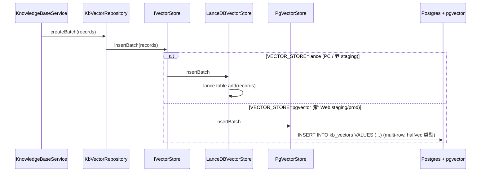
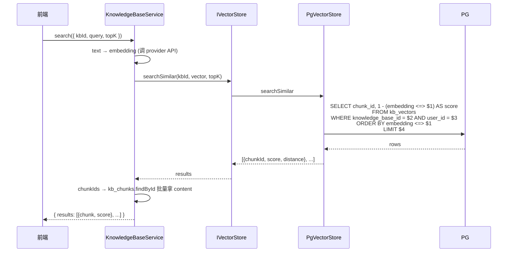
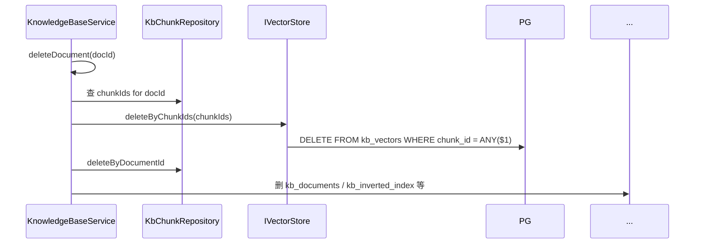
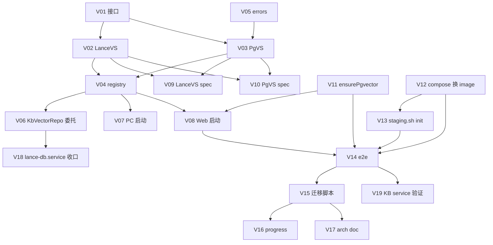

# Web 端向量库迁移：LanceDB → pgvector(halfvec)

## Context

**问题**：Web 端知识库向量当前与 PC 端一样存在本地 LanceDB（`/app/data/lancedb/`）：
- LanceDB 用文件锁，**Web 容器多实例不能同时读写**同一目录 → 真正水平扩展受限
- 容器 redeploy 时 lancedb/ 目录必须 bind mount 才不丢
- Web 后端"无状态化"已通过 OSS 抽象（`docs/plan/2026-05-02-asset-storage-oss-migration.md`）解决了文件资产部分；向量库是最后一块本地状态

**目标**：把 Web 端向量库从 LanceDB 切到 PostgreSQL `pgvector` 扩展。完成后 Web 容器**真正无状态**，可水平扩展。PC 端**保留 LanceDB**（与 OSS spec 一致策略：PC 离线优先，Web 云原生）。

**前置事实**：
- Embedding 维度：阿里百炼 `text-embedding-v4` = **8192 维**（其他模型如 OpenAI text-embedding-3-small=1536，可混用）
- pgvector 经典 `vector` 类型上限 2000 维 → 装不下 8192
- pgvector 0.7+ 新增 `halfvec` 半精度类型，**支持到 16000 维**，8192 完全装下；HNSW 索引兼容
- Postgres 16 + `pgvector/pgvector:pg16` Docker 镜像可一键起 pgvector

**已确认决策**：
- **embedding 维度方案**：`halfvec(8192)` — 不动 embedding API 调用方式，零业务侵入性，精度损失忽略不计（半精度 fp16 vs fp32 在向量检索场景实测影响 < 1%）
- **PC 端保持 LanceDB 不切**（环境变量 `VECTOR_STORE=lance|pgvector`，PC 锁死 lance）
- **不引入混合检索**（关键词 + 向量融合）—— 已有 `kb_inverted_index` 表，但 service 端没融合，本次维持现状
- **历史 LanceDB 数据走一次性迁移脚本**（参考 OSS 的 `migrate-local-files-to-oss.ts` 模式）

**完成后效果**：
1. `STORAGE_PROVIDER=oss` + `VECTOR_STORE=pgvector` → Web 容器无任何本地状态依赖（除 secure-key 主密钥），可任意 scale up
2. 删 docker-compose.staging.yml 的 `lancedb` bind mount，删 `LanceDBService.initialize` 调用（Web 端）
3. 后续可上 PG 主从 / 读写分离 / 云数据库（RDS）

---

## 哪些保留 / 哪些切

| 项 | Web | PC | 备注 |
|---|:---:|:---:|---|
| 向量存储 | **pgvector** | LanceDB | 本次主要工作 |
| 向量字段类型 | halfvec(8192) | float32 array | LanceDB 内部表示沿用 |
| 索引 | HNSW (halfvec_cosine_ops) | LanceDB 自带 | |
| chunks（PG 表）| 不动 | 不动 | kb_chunks 已在 PG/SQLite |
| 倒排索引（kb_inverted_index）| 不动 | 不动 | 已在 PG/SQLite |
| KB 元信息（kb_documents / knowledge_bases）| 不动 | 不动 | 已在 PG/SQLite |

**Web 容器存储分层（本次完成后）**：
```
/app/data/  ← bind mount ./.staging-data/app/
├── secure-key      # 主密钥，仍本地（不能上云，独立专题）
└── tmp/            # OSS ensurePublicUrl 临时本地中转（可选）
└── （lancedb/ 移除）

PostgreSQL (pgvector 扩展)
├── 业务表（已有）
└── kb_vectors      # 新增：halfvec(8192) + HNSW 索引
```

---

## 架构

### 核心接口（新增）

`src/core/interfaces/vector-store.interface.ts`：

```ts
export interface VectorRecord {
  id: string                      // 向量记录 id（uuid）
  chunkId: string                 // 关联 kb_chunks.id
  knowledgeBaseId: string         // 隔离键
  userId?: string | null          // 多租户（可空，按上层 KB.user_id 兜底）
  vector: number[]                // float32 数组，长度 = dim
  dim: number                     // 维度（8192 / 1536 / ...）
  model?: string                  // embedding 模型标识（'text-embedding-v4'）
  metadata?: Record<string, unknown>
  createdAt: Date
}

export interface VectorSearchResult {
  chunkId: string
  score: number                   // 0-1，1 = 最相似
  distance: number                // raw cosine distance
}

export interface IVectorStore {
  /** 初始化（pgvector 端建表 / 索引；LanceDB 端打开本地表）*/
  initialize(opts?: { dataPath?: string }): Promise<void>

  /** 是否已就绪 */
  isReady(): boolean

  /** 单条插入 */
  insert(record: VectorRecord): Promise<void>

  /** 批量插入（pgvector 一条 INSERT ... VALUES (multi-row)；LanceDB 走批 add）*/
  insertBatch(records: VectorRecord[]): Promise<void>

  /** KNN 检索：在指定 KB 内找 topK 最相似 */
  searchSimilar(
    knowledgeBaseId: string,
    queryVector: number[],
    topK: number,
    opts?: { distanceMetric?: 'cosine' | 'l2' | 'inner_product' }
  ): Promise<VectorSearchResult[]>

  /** 按 chunkId 删除（删 chunk 时级联调）*/
  deleteByChunkId(chunkId: string): Promise<void>
  deleteByChunkIds(chunkIds: string[]): Promise<void>

  /** 按 KB 删除（删整个知识库时调）*/
  deleteByKnowledgeBaseId(knowledgeBaseId: string): Promise<void>

  /** 统计 */
  countByKnowledgeBaseId(knowledgeBaseId: string): Promise<number>

  /** 全局统计（debug 用）*/
  getStats(): Promise<{ totalVectors: number; totalKnowledgeBases?: number }>
}

let _accessor: (() => IVectorStore) | null = null
export function registerVectorStore(fn: () => IVectorStore): void { _accessor = fn }
export function getVectorStore(): IVectorStore {
  if (!_accessor) throw new Error('[IVectorStore] 未注册：请在启动时 registerVectorStore()')
  return _accessor()
}
```

### 两个实现

| 类 | 文件 | 行为 |
|---|---|---|
| `LanceDBVectorStore` | `src/core/services/vector/lance-db-vector-store.ts` | 包装现有 `LanceDBService`，作为 PC 端默认实现 |
| `PgVectorStore` | `src/core/services/vector/pg-vector-store.ts` | 走 TypeORM raw query + pgvector 操作符（`<=>` cosine / `<->` l2 / `<#>` inner），HNSW 索引 |

### 注册器

`src/core/services/vector/registry.ts`：

```ts
export function initVectorStore(opts: { mode: 'lance' | 'pgvector', dataPath?: string }): Promise<void> {
  if (opts.mode === 'lance') {
    const lance = new LanceDBVectorStore()
    await lance.initialize({ dataPath: opts.dataPath! })
    registerVectorStore(() => lance)
    return
  }
  const pg = new PgVectorStore()
  await pg.initialize()
  registerVectorStore(() => pg)
}
```

启动序列：
- PC 启动：`initVectorStore({ mode: 'lance', dataPath })`
- Web 启动：`initVectorStore({ mode: process.env.VECTOR_STORE === 'pgvector' ? 'pgvector' : 'lance' })`（默认 lance 兼容老 staging；新 staging 显式 pgvector）

### KbVectorRepository 改造

现有 `KbVectorRepository` 是 LanceDB 的薄包装。改为**委托 `IVectorStore`**：

```ts
// 改前：
constructor() { this.lanceDB = LanceDBService.getInstance() }
async create(data) { ... await this.lanceDB.insertVectors([record]) ... }

// 改后：
constructor() { /* nothing; lazy resolve at call time */ }
async create(data) {
  const record = { ...data, id: randomUUID(), dim: data.vector.length, createdAt: new Date() }
  await getVectorStore().insert(record)
  return record
}
async searchSimilar(kbId, vec, topK) { return getVectorStore().searchSimilar(kbId, vec, topK) }
// ... 其余方法同样委托
```

调用方（`KnowledgeBaseService` / `dbManager.kbVectors.*`）零改动 —— Repository 接口签名保持。

---

## 详细设计

### Schema（pgvector 端新表）

```sql
-- 1. 装扩展（一次性，PG 启动后执行）
CREATE EXTENSION IF NOT EXISTS vector;

-- 2. 新增 kb_vectors 表
CREATE TABLE IF NOT EXISTS kb_vectors (
  id              varchar PRIMARY KEY,
  chunk_id        varchar NOT NULL UNIQUE,                  -- 一个 chunk 一条向量
  knowledge_base_id varchar NOT NULL,
  user_id         varchar,                                  -- 多租户（按上层 KB.user_id 派生，allow null 兼容旧）
  embedding       halfvec(8192),                            -- 半精度向量
  embedding_dim   integer NOT NULL,                         -- 实际维度（≤8192；不足时尾部 0 填充？或拒绝插入）
  embedding_model varchar,                                  -- 'text-embedding-v4' 等
  metadata        jsonb,
  created_at      timestamp NOT NULL DEFAULT now()
);

-- 3. 二级索引
CREATE INDEX IF NOT EXISTS idx_kb_vectors_kb_id    ON kb_vectors (knowledge_base_id);
CREATE INDEX IF NOT EXISTS idx_kb_vectors_user_id  ON kb_vectors (user_id);
CREATE INDEX IF NOT EXISTS idx_kb_vectors_chunk_id ON kb_vectors (chunk_id);

-- 4. HNSW 向量索引（halfvec_cosine_ops 配 cosine 距离）
CREATE INDEX IF NOT EXISTS idx_kb_vectors_embedding
  ON kb_vectors USING hnsw (embedding halfvec_cosine_ops)
  WITH (m = 16, ef_construction = 64);                      -- 默认参数即可
```

**关于不同维度 embedding 模型混用**：
- 所有 embedding 都存到同一列 `halfvec(8192)`
- 维度 < 8192 的向量（如 OpenAI 1536）**用 0 填充**到 8192 长度后存入
- 查询时也填充
- 缺点：低维存储浪费空间；优点：不用按 dim 分表
- 备选方案（未采纳）：每个 dim 一张表 → 复杂；或把 dim 编码进 key 走分区 → PG 14+ 可考虑

> **实施时的规范**：写入前 service 层校验 `dim <= 8192`，超过抛错；不足时由 `PgVectorStore.insert` 自动 pad 0；检索时同样 pad query vector。

### 多租户隔离

- `kb_vectors.user_id` 字段冗余存储（KB 自带 user_id，但 vector 表也存便于直接查询）
- 检索 SQL：`WHERE knowledge_base_id = $1 AND user_id = $2`（user_id 由 ALS 注入）
- 删除 SQL：同上 WHERE 过滤
- BaseRepository 不直接管 `kb_vectors`（它不是 entity 控制的表，由 `PgVectorStore` 走 raw SQL）；但 `PgVectorStore` 内部用 `getCurrentUserId()` 拿 ALS userId 加 WHERE

### 数据流：写入



### 数据流：检索



### 数据流：删除（一致性）



**为什么先删 vector 再删 chunk**：避免出现 chunk 已删但 vector 留下的孤儿（与 OSS 那边的 PG-first 策略相反，因为这边 vector 是依赖 chunk 的"附属物"，没了 chunk vector 也无意义）。失败：vector 删失败但 chunk 还在 → 重试；chunk 已删但 vector 还在 → 孤儿，靠后台 GC 清理（参考 OSS 的 oss_pending_delete 模式）。

### 错误处理 / 降级

| 场景 | 行为 |
|---|---|
| pgvector 扩展未装 | 启动 `PgVectorStore.initialize` 检测；缺失抛 `PgVectorExtensionMissingError`，引导运维 `CREATE EXTENSION vector` |
| embedding 维度 > 8192 | 写入前 service 抛业务错误 `EMBEDDING_DIM_TOO_LARGE`，前端提示更换 embedding 模型 |
| 索引未建 → 检索慢但功能正常 | 启动期检查 HNSW 索引；缺失则 log warn 并自动 `CREATE INDEX` 兜底 |
| Web 启动 `VECTOR_STORE=pgvector` 但 PG 没装 pgvector | 启动失败（fail-fast，避免业务运行时出错）|

### 配置切换 / 灰度

环境变量：
- `VECTOR_STORE=lance|pgvector`（默认 `lance` — 保持兼容；新部署显式 `pgvector`）
- `PGVECTOR_HNSW_M=16` / `PGVECTOR_HNSW_EF_CONSTRUCTION=64`（HNSW 参数，默认值即可）

灰度：
- staging 环境先 `VECTOR_STORE=pgvector` 跑 1 周观察
- prod 上线后单实例 pgvector 跑 2 周后再考虑加实例
- 回滚：env 切回 `lance` + 跑 reverse 迁移脚本（pgvector → LanceDB）

### 测试策略

**单测**（双 store provider 矩阵）：
- `LanceDBVectorStore` 用 `:memory:` 风格临时目录
- `PgVectorStore` 用 staging PG（test schema 隔离）
- 用例：CRUD + searchSimilar 准确性（构造已知向量，验证 topK 顺序）+ 多租户隔离 + 维度边界（pad 0 / >8192 拒绝）

**集成测试**：
- staging 环境（已有 docker-compose.staging.yml）pg 镜像换 `pgvector/pgvector:pg16`
- `bash scripts/staging.sh up` 启动后自动 `CREATE EXTENSION vector`
- 切 `VECTOR_STORE=pgvector` 重启 → renmadao 浏览器走端到端：上传文档 → 向量化 → 检索 → 验证结果与 LanceDB 时期一致

**性能验证**：
- 100 / 1000 / 10000 chunks 量级 KB 各跑一次检索
- LanceDB vs pgvector 的 search latency 对比（pgvector HNSW 应在 100k 量级仍 <50ms）

---

## 关键实施改动

### 阶段 0：契约 + 抽象（**3 天**）

新增：
- `src/core/interfaces/vector-store.interface.ts` —— 契约 + 注册器
- `src/core/services/vector/lance-db-vector-store.ts` —— 包装现有 `LanceDBService`
- `src/core/services/vector/pg-vector-store.ts` —— pgvector raw query 实现
- `src/core/services/vector/registry.ts` —— `initVectorStore({ mode })`
- `src/core/services/vector/errors.ts` —— `PgVectorExtensionMissingError` / `EmbeddingDimTooLargeError` 等

修改：
- `src/core/database/repositories/kb-vector.repository.ts` —— 改为委托 `getVectorStore()`，方法签名不变
- `src/electron/database/index.ts` —— 启动序列加 `initVectorStore({ mode: 'lance', dataPath })`，去掉直接 `LanceDBService.initialize`（移到 LanceDBVectorStore 内部）
- `src/web/server/index.ts` —— `initLanceDB(rootDataPath)` 改 `initVectorStore({ mode: process.env.VECTOR_STORE === 'pgvector' ? 'pgvector' : 'lance', dataPath: rootDataPath })`

### 阶段 0.5：PG 装 pgvector + schema（**3 天**）

**Docker / 部署侧**：
- `docker-compose.staging.yml`：postgres 镜像从 `postgres:16-alpine` 换 `pgvector/pgvector:pg16`（自带 pgvector 扩展）
- 现有数据 volume 兼容（PG data 目录格式不变；只是 binary 多了 pgvector）
- 启动后自动 `CREATE EXTENSION IF NOT EXISTS vector`（在 web-server initDatabase 里）

**新增 migration**：
- `src/core/database/migrations/ensure-pgvector.ts`：CREATE EXTENSION + CREATE TABLE kb_vectors + CREATE INDEX
- 在 web-server `initDatabase()` 里调（仅 `VECTOR_STORE=pgvector` 时执行）

### 阶段 1：staging 灰度 + e2e（**3 天**）

- 切 staging `VECTOR_STORE=pgvector` 重启
- e2e：renmadao 走通 KB 加文档 → 检索 → 删除 → 验证 PG `kb_vectors` 表
- 与 LanceDB 模式跑同一 query，对比 topK 结果一致性

### 阶段 2：数据迁移脚本（**3 天**）

新增：`scripts/migrate-lancedb-to-pgvector.ts`

```bash
DB_PATH=... PGHOST=... PGUSER=... PGDATABASE=the_bot_web \
LANCE_PATH=/app/data/lancedb \
TARGET_USER_ID=... \
npx tsx scripts/migrate-lancedb-to-pgvector.ts [--dry-run] [--kb <kbId>] [--reverse]
```

步骤：
1. 预检：pgvector 已装；目标表已建
2. 扫 LanceDB vectors 表，按 KB 分批拉
3. 转换为 `VectorRecord` 形态（halfvec 编码）
4. INSERT 到 PG kb_vectors
5. 校验：count 一致 + 抽样 KNN 结果对比
6. reverse 模式：PG → LanceDB（用于回滚）

### 阶段 3：staging 验证 + 性能基线（**2 天**）

- 跑全量回归（vitest 单测 + e2e）
- 性能：100/1k/10k 向量检索 latency
- bind mount 移除 `lancedb/`：验证 Web 容器重启后仍正常（确认无本地依赖）

---

## 工作量评估

| 阶段 | 工作量 | 风险点 |
|---|:---:|---|
| 0 契约 + 抽象 | 3 天 | LanceDB 与 pgvector API 差异（distance metric 解读、result 排序）|
| 0.5 PG pgvector + schema | 3 天 | docker image 切换 / 现有 PG 数据兼容 |
| 1 灰度 + e2e | 3 天 | 准确性对比（向量检索结果与 LanceDB 一致性）|
| 2 数据迁移脚本 | 3 天 | 大 KB 量级（10k+ chunks）的批量 INSERT 性能 |
| 3 staging 验证 + 基线 | 2 天 | HNSW 参数调优 |
| **合计** | **2-3 周** | （单人；2 人并行 1.5 周）|

---

## 文件级实施详单

每个文件给出：路径 / 改动类型 / 关键签名 / 改动说明 / 风险点。

### 文件清单全表

| # | 阶段 | 文件 | 类型 |
|---:|:---:|---|:---:|
| V01 | 0 | `src/core/interfaces/vector-store.interface.ts` | 新增 |
| V02 | 0 | `src/core/services/vector/lance-db-vector-store.ts` | 新增 |
| V03 | 0 | `src/core/services/vector/pg-vector-store.ts` | 新增 |
| V04 | 0 | `src/core/services/vector/registry.ts` | 新增 |
| V05 | 0 | `src/core/services/vector/errors.ts` | 新增 |
| V06 | 0 | `src/core/database/repositories/kb-vector.repository.ts` | 修改（改委托）|
| V07 | 0 | `src/electron/database/index.ts` | 修改（启动序列）|
| V08 | 0 | `src/web/server/index.ts` | 修改（启动序列）|
| V09 | 0 | `tests/unit/vector/lance-db-vector-store.spec.ts` | 新增 |
| V10 | 0 | `tests/unit/vector/pg-vector-store.spec.ts` | 新增 |
| V11 | 0.5 | `src/core/database/migrations/ensure-pgvector.ts` | 新增 |
| V12 | 0.5 | `docker-compose.staging.yml` | 修改（换镜像）|
| V13 | 0.5 | `scripts/staging.sh` | 修改（init pgvector）|
| V14 | 1 | `tests/e2e/web/kb-vector-pgvector.spec.ts` | 新增 |
| V15 | 2 | `scripts/migrate-lancedb-to-pgvector.ts` | 新增 |
| V16 | 2 | `progress/2026-05-XX-pgvector-migration.md` | 新增 |
| V17 | 3 | `docs/arch/vector-store-abstraction.md` | 新增 |
| V18 | * | `src/core/services/lance-db.service.ts` | 验证 + 微调（被 LanceDBVectorStore 包，本身保留）|
| V19 | * | `src/core/services/knowledge-base.service.ts` | 验证（调用方零改，仍用 dbManager.kbVectors）|

---

### V01 · `src/core/interfaces/vector-store.interface.ts` (新增)

**作用**：向量库抽象的契约 + 全局注册器。

**导出**（详见上文"架构 → 核心接口"）：
- `VectorRecord` / `VectorSearchResult` 类型
- `IVectorStore` 接口（10 个方法）
- `registerVectorStore(fn)` / `getVectorStore()` 注册器

**风险**：API 设计后所有调用方依赖。要预留 `metadata` 字段、distance metric 选项、batch 大小推荐等。

---

### V02 · `src/core/services/vector/lance-db-vector-store.ts` (新增)

**作用**：包装现有 `LanceDBService`，作为 PC 端默认实现 + Web 端老兼容路径。

**关键内容**：
- 构造时不立即依赖 LanceDBService（懒加载，避免 Web 端不需要 lance 时也启动）
- `initialize({ dataPath })` 内部调 `LanceDBService.getInstance().initialize(dataPath)`
- 其余方法直接转发到 LanceDBService（API 已对齐）：
  - `insert/insertBatch` → `insertVectors`
  - `searchSimilar` → 同名（`searchSimilar`）
  - `delete*` → `deleteByChunkId(s)` / `deleteByKnowledgeBaseId`
- `getStats` → 调 `LanceDBService.getStats`

**风险**：LanceDB 内部 distance metric 是 cosine（默认）；要保证与 pgvector 端一致。

---

### V03 · `src/core/services/vector/pg-vector-store.ts` (新增)

**作用**：pgvector + halfvec 实现，Web 端的目标方案。

**关键内容**：

```ts
import type { DataSource } from 'typeorm'
import { getCoreDatabaseManager } from '@core/database/database-manager.interface'
import { getCurrentUserId } from '@core/context/user-context'

export class PgVectorStore implements IVectorStore {
  private ds!: DataSource

  async initialize(): Promise<void> {
    this.ds = getCoreDatabaseManager().dataSource!
    // 检查 pgvector 扩展
    const ext = await this.ds.query(`SELECT extname FROM pg_extension WHERE extname='vector'`)
    if (ext.length === 0) {
      throw new PgVectorExtensionMissingError(
        '请先在 PG 上执行 CREATE EXTENSION vector（或换 pgvector/pgvector:pg16 镜像）'
      )
    }
    // 确保 kb_vectors 表存在
    await this.ds.query(SQL_CREATE_KB_VECTORS_TABLE)
    await this.ds.query(SQL_CREATE_HNSW_INDEX)
  }

  isReady() { return !!this.ds }

  async insert(record: VectorRecord): Promise<void> {
    await this.ds.query(
      `INSERT INTO kb_vectors (id, chunk_id, knowledge_base_id, user_id, embedding, embedding_dim, embedding_model, metadata, created_at)
       VALUES ($1, $2, $3, $4, $5::halfvec, $6, $7, $8, $9)
       ON CONFLICT (chunk_id) DO UPDATE SET
         embedding = EXCLUDED.embedding,
         embedding_dim = EXCLUDED.embedding_dim,
         embedding_model = EXCLUDED.embedding_model`,
      [record.id, record.chunkId, record.knowledgeBaseId, record.userId ?? null,
       padToVectorString(record.vector, 8192), record.dim, record.model ?? null,
       record.metadata ?? null, record.createdAt]
    )
  }

  async insertBatch(records: VectorRecord[]): Promise<void> {
    if (records.length === 0) return
    // multi-row INSERT，单事务内 2000 条/批
    for (const batch of chunk(records, 2000)) {
      const values: any[] = []
      const placeholders = batch.map((r, i) => {
        const off = i * 9
        values.push(r.id, r.chunkId, r.knowledgeBaseId, r.userId ?? null,
                    padToVectorString(r.vector, 8192), r.dim, r.model ?? null,
                    r.metadata ?? null, r.createdAt)
        return `($${off+1},$${off+2},$${off+3},$${off+4},$${off+5}::halfvec,$${off+6},$${off+7},$${off+8},$${off+9})`
      }).join(',')
      await this.ds.query(
        `INSERT INTO kb_vectors (id, chunk_id, knowledge_base_id, user_id, embedding, embedding_dim, embedding_model, metadata, created_at)
         VALUES ${placeholders}
         ON CONFLICT (chunk_id) DO NOTHING`,
        values
      )
    }
  }

  async searchSimilar(kbId, vector, topK, opts) {
    const userId = getCurrentUserId()
    const op = opts?.distanceMetric === 'l2' ? '<->' :
               opts?.distanceMetric === 'inner_product' ? '<#>' : '<=>'  // 默认 cosine
    const rows = await this.ds.query(
      `SELECT chunk_id,
              ${op === '<=>' ? `1 - (embedding ${op} $1::halfvec)` : `-1 * (embedding ${op} $1::halfvec)`} AS score,
              embedding ${op} $1::halfvec AS distance
       FROM kb_vectors
       WHERE knowledge_base_id = $2
         ${userId ? 'AND user_id = $3' : ''}
       ORDER BY embedding ${op} $1::halfvec
       LIMIT ${userId ? '$4' : '$3'}`,
      userId ? [padToVectorString(vector, 8192), kbId, userId, topK]
             : [padToVectorString(vector, 8192), kbId, topK]
    )
    return rows.map(r => ({ chunkId: r.chunk_id, score: Number(r.score), distance: Number(r.distance) }))
  }

  async deleteByChunkId(chunkId) {
    await this.ds.query(`DELETE FROM kb_vectors WHERE chunk_id = $1`, [chunkId])
  }
  async deleteByChunkIds(ids) {
    if (ids.length === 0) return
    await this.ds.query(`DELETE FROM kb_vectors WHERE chunk_id = ANY($1::varchar[])`, [ids])
  }
  async deleteByKnowledgeBaseId(kbId) {
    await this.ds.query(`DELETE FROM kb_vectors WHERE knowledge_base_id = $1`, [kbId])
  }
  async countByKnowledgeBaseId(kbId): Promise<number> {
    const rows = await this.ds.query(`SELECT COUNT(*)::int AS n FROM kb_vectors WHERE knowledge_base_id = $1`, [kbId])
    return rows[0].n
  }
  async getStats() {
    const r1 = await this.ds.query(`SELECT COUNT(*)::int AS n FROM kb_vectors`)
    const r2 = await this.ds.query(`SELECT COUNT(DISTINCT knowledge_base_id)::int AS n FROM kb_vectors`)
    return { totalVectors: r1[0].n, totalKnowledgeBases: r2[0].n }
  }
}

// helper：number[] → '[1.2,3.4,...,0,0]' 字符串（pgvector 接受文本表示），不足 8192 补 0
function padToVectorString(vec: number[], targetDim: number): string {
  if (vec.length > targetDim) throw new EmbeddingDimTooLargeError(vec.length, targetDim)
  const padded = vec.length === targetDim ? vec : [...vec, ...new Array(targetDim - vec.length).fill(0)]
  return '[' + padded.join(',') + ']'
}
```

**风险**：
- halfvec 字面值格式（PG 端走文本解析）—— 需测试大向量序列化性能（8192 维 × 数千条批量插入时的字符串构造开销）
- ON CONFLICT 策略：reprocess document 时会重新生成同 chunkId 的 vector，UPDATE 还是 DO NOTHING？倾向 UPDATE（embedding 模型可能换）
- HNSW 索引在大批量插入时需要重建？验证一下

---

### V04 · `src/core/services/vector/registry.ts` (新增)

```ts
import { registerVectorStore, type IVectorStore } from '@core/interfaces/vector-store.interface'
import { LanceDBVectorStore } from './lance-db-vector-store'
import { PgVectorStore } from './pg-vector-store'

export async function initVectorStore(opts: { mode: 'lance' | 'pgvector', dataPath?: string }): Promise<void> {
  let impl: IVectorStore
  if (opts.mode === 'lance') {
    if (!opts.dataPath) throw new Error('LanceDB mode requires dataPath')
    const lance = new LanceDBVectorStore()
    await lance.initialize({ dataPath: opts.dataPath })
    impl = lance
  } else {
    const pg = new PgVectorStore()
    await pg.initialize()
    impl = pg
  }
  registerVectorStore(() => impl)
  console.log(`[VectorStore] mode = ${opts.mode}`)
}
```

---

### V05 · `src/core/services/vector/errors.ts` (新增)

```ts
export class PgVectorExtensionMissingError extends Error {
  code = 'PGVECTOR_EXTENSION_MISSING' as const
}
export class EmbeddingDimTooLargeError extends Error {
  code = 'EMBEDDING_DIM_TOO_LARGE' as const
  constructor(public actual: number, public max: number) {
    super(`向量维度 ${actual} 超过上限 ${max}（halfvec 最大 16000；当前 schema 用 ${max}）`)
  }
}
```

---

### V06 · `src/core/database/repositories/kb-vector.repository.ts` (修改)

**当前**：直接持有 `LanceDBService.getInstance()`。

**改动**：构造方法清空，所有方法改委托 `getVectorStore()`。API 签名（KbVectorEntity 形态）保持，调用方零改动。

```ts
import { getVectorStore } from '@core/interfaces/vector-store.interface'
import { randomUUID } from 'crypto'

export class KbVectorRepository {
  constructor() {} // no-op

  async create(data: { chunkId: string; knowledgeBaseId: string; vector: number[] }): Promise<KbVectorEntity> {
    const id = randomUUID()
    const now = new Date()
    await getVectorStore().insert({
      id, chunkId: data.chunkId, knowledgeBaseId: data.knowledgeBaseId,
      userId: getCurrentUserId(), vector: data.vector, dim: data.vector.length,
      createdAt: now,
    })
    return { id, chunkId: data.chunkId, knowledgeBaseId: data.knowledgeBaseId, vector: data.vector, createdAt: now }
  }

  async createBatch(items: Array<{...}>) { await getVectorStore().insertBatch(items.map(...)) }
  async findByChunkId(chunkId: string) { /* 用 searchSimilar 替代 / 或暴露 store.findByChunkId */ }
  async deleteByChunkId(chunkId: string) { await getVectorStore().deleteByChunkId(chunkId) }
  async deleteByDocumentId(docId: string) {
    // 1. 查 chunkIds
    const chunks = await getCoreDatabaseManager().kbChunks!.findByDocumentId(docId)
    // 2. 删向量
    await getVectorStore().deleteByChunkIds(chunks.map(c => c.id))
  }
  async deleteByKnowledgeBaseId(kbId) { await getVectorStore().deleteByKnowledgeBaseId(kbId) }
  async searchSimilar(kbId, vector, topK) { return getVectorStore().searchSimilar(kbId, vector, topK) }
  async countByKnowledgeBaseId(kbId) { return getVectorStore().countByKnowledgeBaseId(kbId) }
}
```

**风险**：`findByChunkId` / `findByChunkIds` 方法 IVectorStore 没暴露 — 加上去（PG 端 `SELECT WHERE chunk_id = ANY(...)`，LanceDB 端走 where filter）。

---

### V07 · `src/electron/database/index.ts` (修改)

**当前**：私有方法 `initializeLanceDB(dataPath)` 直接调 `LanceDBService.initialize`。

**改动**：替换为调 `initVectorStore({ mode: 'lance', dataPath })`。

```ts
// 改前：
private async initializeLanceDB(dataPath: string): Promise<void> {
  const lanceDB = LanceDBService.getInstance()
  await lanceDB.initialize(dataPath)
}

// 改后：
private async initializeVectorStore(dataPath: string): Promise<void> {
  const { initVectorStore } = await import('@core/services/vector/registry')
  await initVectorStore({ mode: 'lance', dataPath })
}
```

调用点改名同步。

---

### V08 · `src/web/server/index.ts` (修改)

**当前**：`initLanceDB(rootDataPath)` 函数 + `bootstrap()` 里调用。

**改动**：改名 `initVectorStoreLayer`，按 env 选模式：

```ts
async function initVectorStoreLayer(rootDataPath: string): Promise<void> {
  const mode = (process.env.VECTOR_STORE === 'pgvector' ? 'pgvector' : 'lance') as 'lance' | 'pgvector'
  if (mode === 'lance') {
    const lancePath = path.join(rootDataPath, 'lancedb')
    if (!fs.existsSync(lancePath)) fs.mkdirSync(lancePath, { recursive: true })
    await initVectorStore({ mode, dataPath: lancePath })
  } else {
    await initVectorStore({ mode })
  }
  console.log(`[web-server] VectorStore mode = ${mode}`)
}
```

bootstrap 调用：`await initVectorStoreLayer(cfg.rootDataPath)`。

---

### V09-V10 · 单测（新增）

**V09 `tests/unit/vector/lance-db-vector-store.spec.ts`**：
- fixture：临时 lancedb 目录
- 用例：所有方法 CRUD + 已知向量 KNN 顺序 + dim 边界

**V10 `tests/unit/vector/pg-vector-store.spec.ts`**：
- fixture：用 `createTestDataSource('postgres')` + 测前 `CREATE EXTENSION vector`
- 用例：同 V09 + halfvec 序列化 + 维度 pad 0 + ON CONFLICT 行为 + 多租户隔离（不同 user_id 互不可见）+ HNSW 索引存在

---

### V11 · `src/core/database/migrations/ensure-pgvector.ts` (新增)

```ts
import type { DataSource } from 'typeorm'

export async function ensurePgvector(ds: DataSource): Promise<void> {
  // 1. 装扩展
  await ds.query(`CREATE EXTENSION IF NOT EXISTS vector`)

  // 2. 建表（halfvec 列 + 索引）
  await ds.query(`
    CREATE TABLE IF NOT EXISTS kb_vectors (
      id              varchar PRIMARY KEY,
      chunk_id        varchar NOT NULL UNIQUE,
      knowledge_base_id varchar NOT NULL,
      user_id         varchar,
      embedding       halfvec(8192),
      embedding_dim   integer NOT NULL,
      embedding_model varchar,
      metadata        jsonb,
      created_at      timestamp NOT NULL DEFAULT now()
    )
  `)
  await ds.query(`CREATE INDEX IF NOT EXISTS idx_kb_vectors_kb_id ON kb_vectors (knowledge_base_id)`)
  await ds.query(`CREATE INDEX IF NOT EXISTS idx_kb_vectors_user_id ON kb_vectors (user_id)`)

  // 3. HNSW 向量索引
  await ds.query(`
    CREATE INDEX IF NOT EXISTS idx_kb_vectors_embedding
    ON kb_vectors USING hnsw (embedding halfvec_cosine_ops)
    WITH (m = 16, ef_construction = 64)
  `)
}
```

**调用点**：`src/web/server/index.ts:initDatabase()` 末尾（仅 `VECTOR_STORE=pgvector` 时执行）。

---

### V12 · `docker-compose.staging.yml` (修改)

```diff
   postgres:
-    image: postgres:16-alpine
+    image: pgvector/pgvector:pg16
     container_name: the-bot-staging-pg
     ...
```

**注意**：换镜像后**不需要重建数据 volume**（PG 数据格式不变；只是多了 pgvector binary）。但 init 时需要 `CREATE EXTENSION vector`（V11 自动跑）。

新增 env：
```yaml
  app:
    environment:
      VECTOR_STORE: "${VECTOR_STORE:-lance}"  # 默认 lance 兼容；新部署设 pgvector
```

---

### V13 · `scripts/staging.sh` (修改)

`cmd_pg_init`（新增）：
```bash
cmd_pg_init() {
  log "确保 pgvector 扩展已装"
  docker exec "$PG_CONTAINER" psql -U postgres -d the_bot_web -c "CREATE EXTENSION IF NOT EXISTS vector"
  ok "pgvector 扩展就绪"
}
```

`cmd_up` 末尾自动跑 `cmd_pg_init`（PG Healthy 后）。

---

### V14 · `tests/e2e/web/kb-vector-pgvector.spec.ts` (新增)

E2E：浏览器 / playwright 模拟 renmadao 走 KB 全流程，断言：
1. 添加文档 → DB `kb_vectors` 行数 = chunks 数
2. 检索 query → 返回 topK 包含预期 chunk
3. 删除文档 → `kb_vectors` 对应行被清

---

### V15 · `scripts/migrate-lancedb-to-pgvector.ts` (新增)

**接口**：
```bash
PGHOST=... PGUSER=... PGDATABASE=the_bot_web \
LANCE_PATH=./.staging-data/app/lancedb \
TARGET_USER_ID=user_xxx \
npx tsx -r tsconfig-paths/register scripts/migrate-lancedb-to-pgvector.ts \
  [--dry-run] [--kb <kbId>] [--reverse] [--batch-size 1000]
```

**步骤**：
1. 预检：pgvector 已装；kb_vectors 表已建；目标 user 存在
2. 打开 LanceDB（`LanceDBService.initialize(LANCE_PATH)`）
3. 扫所有 KB（用 `dbManager.knowledgeBases.getAll()` 拿 user 名下 KB）
4. 对每个 KB：
   - LanceDB.searchSimilar 拿不到全量；改用底层 lance table.search().limit(MAX_INT)
   - 或用 lance table 的 `query()` 全表 scan
   - 转换为 VectorRecord，batch INSERT 到 PG
5. 校验：每个 KB 的 PG count vs LanceDB count 一致；抽样 KNN 结果对比
6. reverse：PG → LanceDB（用 LanceDB API 重写）

**风险**：
- LanceDB API 全表 scan 需要看 `@lancedb/lancedb` SDK 文档
- 大 KB（10k+ 向量）批量插入 PG 内存压力 → batch-size 默认 1000

---

### V16-V17 · 文档 (新增)

**V16 `progress/2026-05-XX-pgvector-migration.md`**：仿 OSS 那次的 progress 模板。

**V17 `docs/arch/vector-store-abstraction.md`**：含本文档的 Mermaid 数据流 + 接口定义快照 + LanceDB vs pgvector 对比表。

---

### V18 · `src/core/services/lance-db.service.ts` (验证 + 微调)

**保留**：作为 LanceDBVectorStore 的内部依赖，对外不再暴露。

**微调**：
- 把对外 `LanceDBService.getInstance()` 调用全部改走 `getVectorStore()`（Web 端老 staging 仍用 lance 模式 → 透明切换）
- grep 残留：除 lance-db-vector-store.ts 外不应再有直接 import `LanceDBService` 的地方

---

### V19 · `src/core/services/knowledge-base.service.ts` (验证)

**调用方零改**：service 仍调 `db.kbVectors.searchSimilar(...)` / `db.kbVectors.createBatch(...)`，KbVectorRepository 改造后内部走 IVectorStore。

**验证**：跑端到端 KB 流程，确认：
- `processDocument` 写入向量正常
- `search` 检索结果（PG 端 cosine similarity）与 LanceDB 端排序一致
- 删除文档级联删向量

---

## 实施顺序 + 依赖



---

## 验证

每阶段都要做：

1. **单测**：双 store 矩阵（lance / pgvector）跑 V09 + V10
2. **e2e on staging**（PG 镜像换 pgvector）：
   - `bash scripts/staging.sh up` → 自动建扩展 + 表 + 索引
   - 切 `VECTOR_STORE=pgvector` 重启
   - renmadao 走 KB 全流程：上传 → 处理 → 检索 → 验证 → 删除
3. **PC 回归**：保持 `VECTOR_STORE=lance`，PC 启动跑通 KB（确保 LanceDBVectorStore 包装 LanceDBService 没退化）
4. **多用户隔离**：用户 A 上传 KB → B 查询 → 看不到（依赖 `kb_vectors.user_id` 过滤）
5. **删除一致性**：删 document → kb_vectors 对应行被清（log 验证）
6. **检索准确性**：
   - 同一组 chunks 同时插 LanceDB 和 pgvector
   - 同一 query 各检索 topK
   - 验证 chunkId 集合 ≥ 90% 重合（cosine 相似度排序应基本一致）
   - 维度 pad 0 不应影响相似度顺序（数学上证明：pad 0 不改变相对排序）

最终阶段 5 跑迁移脚本：
- dry-run 输出"将迁移 N 个向量到 M 个 KB"
- 实跑后校验：每个 KB 的 LanceDB count == PG count
- e2e：renmadao 浏览器查询历史 KB 仍能找到原结果

---

## 未列入本次（明确排除）

- **PC 端切 pgvector**：PC 离线优先，保留 LanceDB
- **混合检索（向量 + BM25/inverted-index）**：现有 `kb_inverted_index` 表已存在但 search 函数没融合，本次维持现状；后续单独专题
- **多 embedding 模型按 dim 分表**：本次统一 halfvec(8192) + 维度 pad 0；后续若性能 / 存储有压力再分
- **向量量化（PQ/SQ 等）**：halfvec 已经是 fp16 半精度，进一步量化收益有限
- **多模态向量**（图像 / 视频 embedding）：本次仅文本

---

## 后续专题（建议路线图）

完成本次"向量库 → pgvector"后：

1. **混合检索接入**（1 周）：service 层把 `kb_inverted_index` 关键词检索结果与向量 topK 融合（RRF / 加权），提升召回质量
2. **PG 主从读写分离**（运维侧）：Web 后端真正无状态后，可对接 RDS 主从，读流量分摊到从库
3. **secure-key KMS 集成**（按需）：本地状态最后一块（参考 OSS spec）
4. **embedding 模型升级 / 多模态**：如果上多模态 embedding（CLIP 等图像向量），按需要新 schema

---

## 文档存放约定

- 本 spec：`docs/plan/2026-05-03-web-vector-store-pgvector-migration.md`（feat/episode-production-redesign 分支）
- 进度记录：完成每个阶段写到 `progress/2026-05-XX-pgvector-<阶段>.md`
- 架构文档：`docs/arch/vector-store-abstraction.md`（V17 产出）
