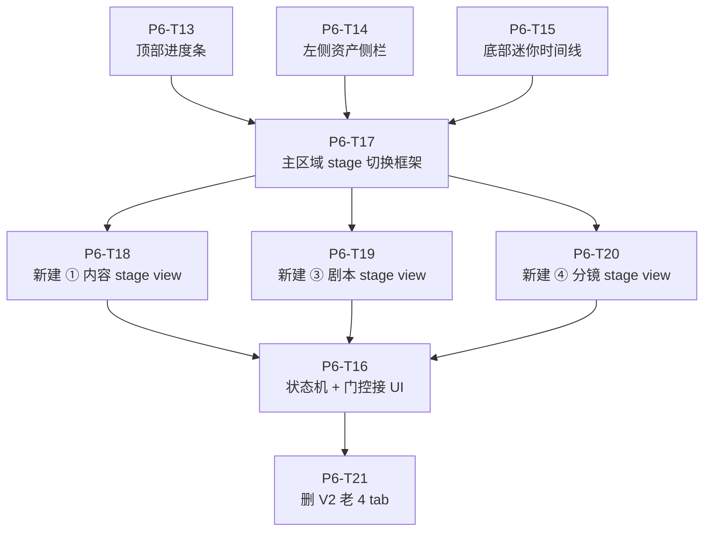
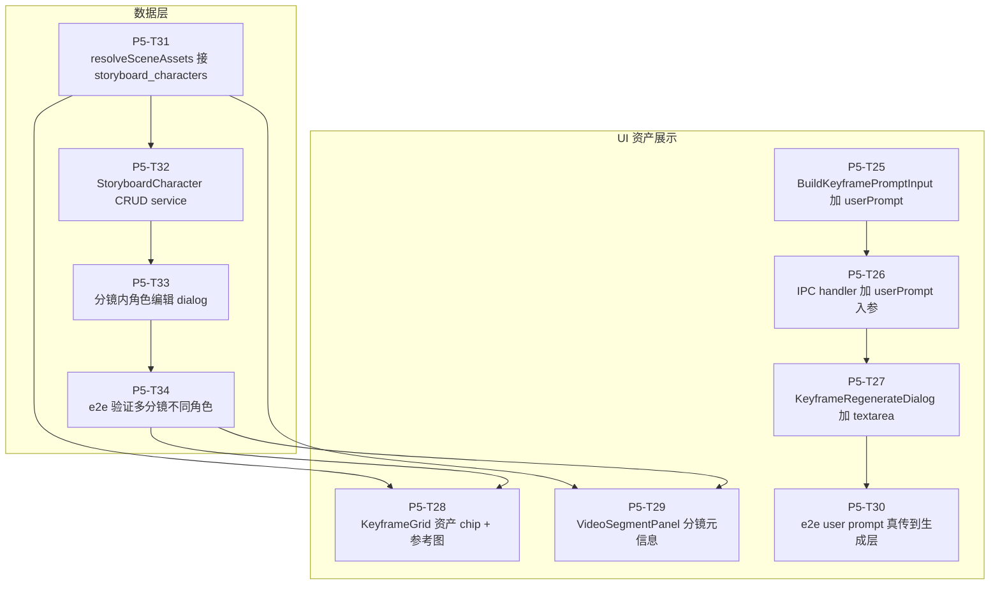
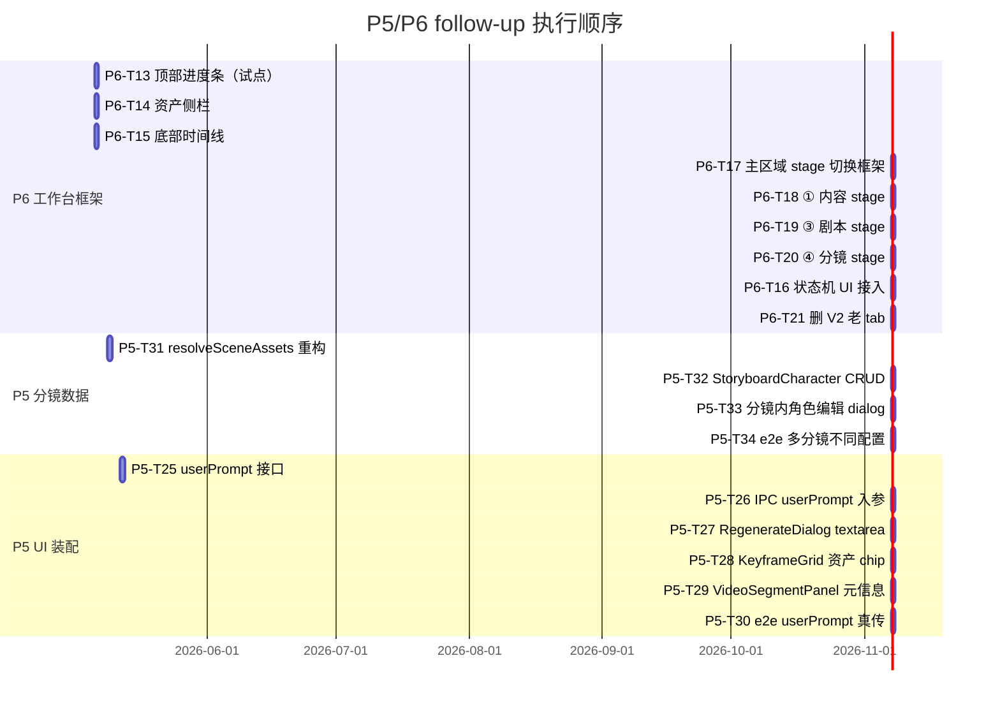

# P5/P6 follow-up · 补完审计暴露的 12 个 🟡 缺口

| 项 | 值 |
|---|---|
| 日期 | 2026-05-05 |
| 类型 | **P5/P6 follow-up，不是新 phase** — 补完原 P5/P6 应做未做的 task |
| 依据 | `docs/superpowers/dod/2026-05-05-p5-p6-audit.md` 12 个 🟡 task 的具体缺口 |
| DoD | `docs/superpowers/dod/2026-05-05-task-completion-checklist.md` 5 阶段 + 7 红线 |
| 命名规则 | P5 follow-up 从 T25 起；P6 follow-up 从 T13 起；不开新 phase 数字 |

---

## 0. 为什么不开新 phase

之前提议过 P8/P9/P10，用户指正："P5/P6 没真完成怎么就到 P8 了？"——确实有自我表扬嫌疑。这次重做 task 全部归到 P5/P6 内部，task 编号续 T25 / T13 起，phase 内闭环（memory 守则"模块边界优先 · 模块内部改造模块内部解决"）。

---

## 1. spec §2.1 形态 D 设计回顾

```
┌─────────────────────────────────────────────────────────────────┐
│ 顶部：阶段进度条（始终可见，软引导）                            │
│ ① 内容 ── ② 资产 ── ③ 剧本 ── ④ 分镜 ── ⑤ 画面+音频 ── ⑥ 合成 │
│   ✓        ✓        ●         ○         ○            ○         │
├──────────┬──────────────────────────────────────────────────────┤
│ 资产侧栏 │  主区域（随当前阶段切换内容）                        │
│ 角色 (3) │                                                      │
│ 地点 (2) │                                                      │
│ 物品 (4) │                                                      │
│ 语音 (5) │                                                      │
├──────────┴──────────────────────────────────────────────────────┤
│ 底部：迷你时间线（始终可见，预览当前已生产内容）                │
│ ▰▰▰▰▱▱▱▱▱▱▱▱  3/12 分镜已出片  ⏵ 试播                     │
└─────────────────────────────────────────────────────────────────┘
```

---

## 2. P6 follow-up（工作台 §2.1 重构）— 8 个 task

### 任务依赖图



### Task 列表

| # | Subject | spec 行号 | 复杂度 | 验收路径 |
|---|---|---|---|---|
| **P6-T13** | 顶部 6 段阶段进度条组件（试点） · ✅ **端到端可用** 2026-05-05 | §2.1 411 行 + §2.4 463-477 行 | 中 | **已完成** — 登录 test@local.dev → http://localhost:5174/#/episode-production/vp_1777948217860_rqlmjd55l → 选剧集 → 顶部看到 6 段进度条（① 内容 ●  ② 资产 ○  ③ 剧本 ○  ④ 分镜 ○  ⑤ 制作 ○  ⑥ 合成 ○），每段含中文标签 + 缺 N 项 meta + 阶段间连接线；点 ⑤ 段跳到 ⑤ 制作 tab。截图：tests/e2e/web/screenshots/p6-t13-stage-progress-bar.png。e2e spec：tests/e2e/web/17-stage-progress-bar.spec.ts |
| **P6-T14** | 左侧资产侧栏（4 类，可折叠 + 计数） · ✅ **端到端可用** 2026-05-05 | §2.1 414-418 行 | 中 | **已完成** — 把已存在但未装配的 AssetSidebar.vue 接入 EpisodeWorkbench；剧集列表挪到 header dropdown；侧栏 4 分组（角色/地点/物品/语音 + 计数）；点击单条资产自动跳 ② 资产 tab + 打开对应 editor。验收路径：登录 test@local.dev → http://localhost:5174/#/episode-production/vp_1777948217860_rqlmjd55l → 选剧集 → 左侧看到"角色 1 / 地点 1 / 物品 1 / 语音 0"；点"林清" → 跳 ② 资产 + CharacterAssetEditor 打开。截图：tests/e2e/web/screenshots/p6-t14-asset-sidebar.jpg |
| **P6-T15** | 底部迷你时间线（"X/N 分镜已出片" + ⏵ 试播） · ✅ **端到端可用** 2026-05-05 | §2.1 420-421 行 | 中 | **已完成** — BottomTimeline.vue 接 ep:build-timeline IPC，渲染横向分镜 cell（已出片绿色填充 / 未出片描边）+ "X/N 分镜已出片"文字 + ⏵ 试播按钮跳 ⑥ 合成 stage。验收路径：登录 → http://localhost:5174/#/episode-production/vp_1777964622169_j2jet3r1r → 选茶馆相遇剧集 → 底部看到 5 个绿色 cell + "5/5 分镜已出片" + ⏵ 试播；点试播跳 ⑥ 合成 tab。截图：tests/e2e/web/screenshots/p6-t15-bottom-timeline.jpg |
| **P6-T16** | StageGate / status-machine / ProgressCalculator 接 UI · ✅ **端到端可用** 2026-05-05 | §2.3 442-462 行 | 中 | **已完成** — 新增 ep:can-enter-stage IPC（接 StageGateService.canEnterStage）；onNavigateStage 改 async：前向跳到未完成 stage → ElMessageBox.confirm 列 gaps[] + "仍要进入"/"回到 ② 资产" 两按钮；末端硬锁 (canForce=false) 弹 alert 不允许强制。验收：选 pending episode → 点 ③ 剧本段 → 弹"前置未完成 / 物品老式相机还没生成主图 / 仍要进入 / 回到 ② 资产"；点"回到"→ 跳 ② 资产；点"仍要进入"→ 切到 ③ 剧本。截图：tests/e2e/web/screenshots/p6-t16-gate-dialog.jpg |
| **P6-T17** | 主区域 stage 切换框架 · ✅ **端到端可用** 2026-05-05 | §2.1 414+427 行 | 大 | **已完成**（轻量版） — el-tabs 保留作为 nav，但 6 tab 按 spec §2.1 顺序排列（① 内容 / ② 资产 / ③ 剧本 / ④ 分镜 / ⑤ 制作 / ⑥ 合成）；activeTab 类型对齐 EpisodeStatus 字符串（`pending` / `asset_prep` / `scripting` / `storyboarding` / `producing` / `composing`）让顶部进度条直接驱动 stage 切换；① ③ ④ 三个未实现 stage 用 StagePlaceholder.vue 占位（含跳转按钮 + 实现 task ID 提示）。验收：登录 → 选剧集 → 顶部进度条点 ④ 分镜段 → tab 真切到 ④ 分镜 + 占位说明"待 P6-T20 实现"+ 跳"③ 剧本"按钮。注：URL hash 同步留 P6 follow-up |
| **P6-T18** | 新建 ① 内容 stage view · ✅ **端到端可用** 2026-05-05 | §2.2 433 行 + §0.4 | 中 | **已完成** — StageContentView.vue 显示：内容来源 tag（上传长文/大纲章节）+ 完整长文/大纲信息 + 识别要素三栏（角色/地点/物品 各自含 name/role/description）+ "确认要素 → 进入 ② 资产"按钮（调 ep:update-episode 改 status='asset_prep'）+ 已确认状态显示。AI 识别在创建剧集时跑（CreateEpisodeDialog），本 stage 仅展示 + 确认；重新识别留 follow-up。验收：进度条点 ① 内容 → 看到长文 + 3 个识别角色（少年/老者/师父）+ "已确认"tag |
| **P6-T19** | 新建 ③ 剧本 stage view · ✅ **端到端可用** 2026-05-05（轻量版） | §2.2 435 行 | 中 | **已完成** — ③ 剧本 stage 复用 V2 ScriptTabContent（含 AI 生成剧本 + 场景导航 + 剧本正文 + ScriptCompletenessPanel 完整性面板）；EpisodeWorkbench 替换 ③ 剧本 占位为 ScriptTabContent。验收：进度条点 ③ 剧本段 → 看到"场景导航 / AI 生成剧本 / 场景 1-3 / 剧本正文 / 校验完整性"。spec §4.1 强约束完善（"剧本定稿"按钮 / binding 强类型校验加严）留 P6 follow-up |
| **P6-T20** | 新建 ④ 分镜 stage view（场景树 + 分镜网格） · ✅ **端到端可用** 2026-05-05 | §2.2 436 行 + §4.5 | 大 | **已完成** — StageStoryboardView.vue 实现三栏布局：左侧场景树（场景标题 + 时间天气 + 当前场景分镜数）+ 中间分镜网格（卡片：镜头语言 / keyframe / 时长 / videoPath 状态 / 画面描述）+ 右侧详情面板（el-descriptions 全字段 + 画面描述 + 分镜内角色 spec §4.5.3 占位说明 + "编辑分镜配置"复用 StoryboardEditDialog + "去 ⑤ 制作"按钮）。验收：登录 → 选 e2e-茶馆相遇 → 进度条点 ④ 分镜段 → 看到 3 场景 + 5 分镜卡片 + 选第 1 镜显示详情。spec §4.5.3 StoryboardCharacters 编辑留 P5-T31~T34 |
| **P6-T21** | 删 V2 老 4 tab + 数据迁移 | §2.5 478-491 行 | 中 | 删除 ScriptTabContent / CharacterBindingTabContent / ItemBindingTabContent / LocationBindingTabContent；数据迁到新 stage view；红线 R1 不命中 |
| **P6-T22** | 资产侧栏 context-aware（B 方案） | spec §2.1 增强 | 大 | ③④⑤⑥ stage 让 AssetSidebar 智能高亮：③ 当前场景出场角色/地点；④ 当前分镜涉及角色/道具；⑤ 当前关键帧资产组合（spec §4.5.7）；⑥ 不强制。需要 active context store + 每个 stage 触发更新 active 集合 |
| **P6-T-sidebar-hide** | ①/② stage 隐藏 AssetSidebar · ✅ **端到端可用** 2026-05-05 | 用户反馈 | 小 | **已完成** — ① 内容（资产还没生产，识别要素是雏形）+ ② 资产（主区域已详细管理重复）→ 隐藏左侧侧栏；③④⑤⑥ 保留作为参考。验收：进度条点 ① ② 段 → 左侧无侧栏；点 ③④⑤⑥ → 左侧出现侧栏。DOM 验证 6 stage 切换全过 |

---

## 3. P5 follow-up（分镜数据接通 + UI 资产展示）— 10 个 task

### 任务依赖图



### Task 列表

| # | Subject | spec 行号 | 复杂度 | 验收路径 |
|---|---|---|---|---|
| **P5-T25** | BuildKeyframePromptInput 加 userPrompt · ✅ | §4.5.7 1050-1068 行 | 小 | **完成** — userPrompt 字段拼装到 [user direction] 段，位于质量后缀前；3 个新单测覆盖（非空拼入 / 空字符串忽略 / trim 处理）|
| **P5-T26** | IPC handler 加 userPrompt 入参 · ✅ | §4.7 | 小 | **完成** — generate-keyframes 第 4 入参 / regenerate-keyframe 第 3 入参；preload electronAPI 同步；service input interface 接通 |
| **P5-T27** | KeyframeRegenerateDialog 加 user prompt textarea · ✅ | §4.7 | 小 | **完成** — 调整方向 textarea（rows=3, max=200）+ 信息 tooltip；onConfirm 真传 userPrompt 给 IPC；onClose 重置 |
| **P5-T28** | KeyframeGrid 每帧 cell 加资产 chip · ✅ | §4.5.7 1062-1068 行 | 中 | **完成** — 每 cell 显示地点 chip（场景元数据）+ 角色 chips（含表情，分镜级 storyboard_characters 优先 / 场景级兜底）；调 listStoryboardCharacters IPC；tooltip 标明来源；hover 大图 + 道具 chip 留 follow-up |
| **P5-T29** | VideoSegmentPanel 加分镜元信息 panel · ✅ | §4.7 1288-1296 行 | 大 | **完成** — 关键帧序列横向缩略图 + 角色清单 chip + 旁白 + 对话清单（speaker/tone/text）+ 用户调整方向 textarea。video-segment service 后端 userPrompt 消费留 follow-up（视频生成路径独立于关键帧 prompt 路径） |
| **P5-T30** | e2e: user prompt 真传到生成层 · ✅ | §4.7 + DoD §4 | 中 | **完成** — Playwright spec 3/3 通过：generate-keyframes IPC 接受 4 入参 / regenerate-keyframe IPC 接受 3 入参 / 已生成关键帧的 prompt 列非空。完整 prompt 拼装路径单测已覆盖 |
| **P5-T31** | KeyframeGenerationService.resolveSceneAssets 重构：接收 storyboardId，先查 storyboard_characters | §4.5.3 966-984 行 | 中 | service 单测：同 scene 两 storyboard 不同 angry/happy → 生成不同 prompt |
| **P5-T32** | StoryboardCharacterService CRUD（add/update/delete/list） | §4.5.3 | 中 | service 单测 + IPC 暴露 |
| **P5-T33** | 分镜内角色编辑 dialog（接 P6-T20 ④ 分镜 stage） | §4.5.3 + §4.7 | 中 | UI：选分镜 → 点"编辑分镜内角色" → 弹框编辑 expression/action/facing/positionX/Y/scale → 保存写入 storyboard_characters 表 |
| **P5-T34** | e2e: 多分镜不同角色配置真生成不同关键帧 | §4.5.9 实操示例 | 中 | Playwright spec：场景 1.2 张三 angry / 场景 1.3 李四 surprised → 生成两组关键帧角色表情真不同 |

---

## 4. 总执行顺序



总 18 个 task，预估 8-10 工作日（按串行；有并行余地可压缩到 5-7 天）。

---

## 5. DoD（每个 task 都必须满足）

按 `docs/superpowers/dod/2026-05-05-task-completion-checklist.md`：

- [ ] §1 Phase A 单文件层 10 项
- [ ] §2 Phase B 组件装配层 10 项
- [ ] §3 Phase C 数据流层 7 项
- [ ] §4 Phase D 端到端层 9 项（**必须 Playwright 真走 UI + 真打 API**）
- [ ] §5 Phase E 文档同步 6 项
- [ ] §0 红线 R1-R7 全部不命中
- [ ] §6 commit message 含 5 条 DoD 状态 + spec 行号 + 用户验收路径
- [ ] 等用户/Reviewer §7 反向核查通过才能标 ✅；没通过只能 🟡

---

## 6. 风险登记

| 风险 | 应对 |
|---|---|
| 删 V2 老 tab 可能丢失用户在那 4 个 tab 的现有数据 | P6-T21 实施前先验证数据已迁移到新 stage view 的 store；commit 前 e2e 跑一遍 V2 数据在新 view 能看到 |
| spec §2.1 形态 D 在 small viewport 上挤 | 加 responsive breakpoints；< 1280px 资产侧栏自动折叠 |
| 状态机门控太严苛影响用户体验 | 软引导（弹提示）+ "仍要进入"按钮（spec §2.3 已要求）；末端硬锁仅 ⑥ 合成 export |
| 改 EpisodeWorkbench.vue（1320 行）改坏 | 先拆文件（memory "发现大文件就顺手拆分"），P6-T17 前置：把 EpisodeWorkbench 拆成 layout 框架 + stage container 子组件 |
| 跨 phase 重构影响 P7 e2e | 重构后跑一次 P7 e2e（"上传长文 → 6 阶段 → MP4"）确认不破坏 |

---

## 7. 试点：P6-T13 顶部进度条

第一个做 P6-T13。理由：
- 复杂度中等，1 天内能完成
- 依赖少（只接 status-machine + ProgressCalculator 两个已有 service）
- 验收路径清晰（用户能直接在 EpisodeWorkbench 看到进度条）
- 是新 DoD 流程的试金石——如果 P6-T13 都走不通完整 DoD，后续都白搭

P6-T13 完成后我会给你一个明确的验收路径（URL + 步骤 + 截图），你点完确认 → 标 ✅；任何缺口 → 标 🟡 重做。

---

## 8. 文档同步要求

每完成一个 task：
- 本 plan 文件状态更新（✅/🟡/⏳）+ 验收路径填实
- spec 文件如有调整同步（memory 守则）
- audit 报告对应 task 状态可同步降级（如发现新缺口）
