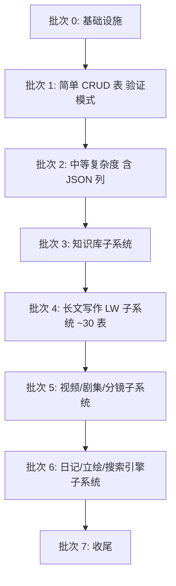

# Phase 1 设计文档 · Repository 层 TypeORM 化（双方言）

- **创建日期**：2026-04-30
- **作者**：daoge + Claude
- **范围**：仅 Phase 1（Repository TypeORM 化 + sqlite/postgres 双方言）
- **后续阶段（不在本文档范围）**：
  - Phase 2 — Service 接口抽象 + 迁移到 `core/services`
  - Phase 3 — Web Controller 层 + 多用户支持

## 1. 目标与不变量

### 1.1 目标

1. 把 `src/core/database/repositories/` 下 65 个 Repository 的底层实现从 `better-sqlite3` 直写 SQL，改为基于 TypeORM 的 Entity + DataSource。
2. 同一份代码同时支持 **SQLite**（默认，electron 桌面端）与 **PostgreSQL**（Docker 容器，未来 Web 端 / 测试矩阵）。
3. 当前 Electron 应用迁移完成后必须能正常启动、所有功能等价于迁移前。

### 1.2 不变量（硬性要求）

- **公共 API 完全不变**：调用方仍写 `dbManager.dialogs.getAll()` / `dbManager.apiKeys.save(...)`，方法名 / 参数名 / 参数顺序 / 参数类型 / 返回类型 / 返回字段名 0 改动。
- **现有用户数据保留**：Entity 必须严格对齐现有 SQLite schema，使 `synchronize` 在已有库上是 no-op；启动前做 schema 漂移检查，失败先备份再终止。
- **应用层级联与兼容行为保留**：`dialog.delete` 仍同时删 `messages`；`role_id = 'default-assistant'` 仍等同 `null`；其他类似细节逐 Repository 保留。
- **不引入新框架**：仅新增 `typeorm` + `pg`；不引入 migrations 框架（YAGNI）；不引入 DI 容器；不重构 IPC / Service 层。

## 2. 架构

### 2.1 分层

```mermaid
graph TB
    subgraph 调用方
        IPC[Electron IPC Handlers]
        SVC[Services]
    end

    subgraph "src/electron/database"
        DM[DatabaseManager<br/>singleton]
    end

    subgraph "src/core/database"
        DSF[DataSource Factory<br/>config.ts + create-data-source.ts]
        BR[BaseRepository&lt;TEntity, TDto&gt;]
        REPOS[65 个 XxxRepository]
        ENTS[65 个 XxxEntity]
        DRIFT[schema-drift 检查]
    end

    subgraph 外部
        SQLITE[(SQLite 文件)]
        PG[(PostgreSQL Docker)]
    end

    IPC --> DM
    SVC --> DM
    DM -->|持有 DataSource + Repo 实例| DSF
    DM -->|new XxxRepository(dataSource)| REPOS
    DM --> DRIFT
    REPOS --> BR
    REPOS -->|getRepository| ENTS
    DSF -->|按 DB_TYPE 选驱动| SQLITE
    DSF --> PG
```

### 2.2 模块边界

- **`src/core/database/`** — 平台无关，可被 electron 端 / 未来 web-server 端 / 单元测试任意复用；不依赖 `electron` API、不调 `app.getPath`、不读文件系统路径。
- **`src/electron/database/`** — 仅做"读 electron 路径 → 拼配置 → 调 `createDataSource` → 持有 Repository 实例 → 暴露给 IPC/Service"的薄壳；耦合点集中在此。
- 配置注入方向：electron 端把 sqlite 文件路径作为参数传给 `createDataSource`，core 不主动求路径。

### 2.3 目录结构（增量）

```
src/core/database/
├── config.ts                      # 新增：DbConfig 类型 + loadDbConfigFromEnv
├── data-source.ts                 # 新增：createDataSource(config) 工厂
├── base-repository.ts             # 新增：BaseRepository<TEntity, TDto>
├── schema-drift.ts                # 新增：checkSchemaDrift
├── entities/                      # 新增：65 个 Entity
│   ├── index.ts                   # barrel export
│   ├── api-key.entity.ts
│   ├── dialog.entity.ts
│   └── ... (65)
└── repositories/                  # 改造：65 个 Repository（公共 API 不变）
    └── ... (65)

tests/unit/
├── helpers/
│   ├── create-test-data-source.ts
│   └── seed-data.ts
└── repositories/
    └── ... (65 个 spec 文件)

scripts/
├── test-pg-up.sh                  # 新增
└── test-pg-down.sh                # 新增

src/electron/database/index.ts     # 改造：删 raw DDL，改用 DataSource
```

## 3. 数据模型层（Entity）

### 3.1 命名

- 一表 → 一文件 → 一 Entity 类。
- 文件名：`{table-stem}.entity.ts`（`api_keys` → `api-key.entity.ts`）。
- 类名：`{PascalTableStem}Entity`（`api_keys` → `ApiKeyEntity`）。
- DTO（业务侧形状如 `Dialog` / `ApiKeyInfo`）继续放 `src/shared/types/`，与 Entity 解耦；Repository 负责 Entity ↔ DTO 双向转换。

### 3.2 列类型方言映射

| 语义 | TypeORM 写法 | SQLite 实际类型 | PostgreSQL 实际类型 |
|---|---|---|---|
| 主键 ID（UUID 字符串） | `@PrimaryColumn('varchar')` | TEXT | varchar |
| 短文本 | `@Column('varchar')` | TEXT | varchar |
| 长文本 | `@Column('text', { nullable: true })` | TEXT | text |
| 整数 | `@Column('integer')` | INTEGER | integer |
| 布尔 | `@Column('boolean')` | INTEGER (0/1) | boolean |
| 浮点 | `@Column('real')` | REAL | double precision |
| JSON 对象/数组 | `@Column('simple-json', { nullable: true })` | TEXT + JSON 序列化 | jsonb |
| 创建/更新时间 | `@CreateDateColumn` / `@UpdateDateColumn` | DATETIME | timestamp |
| 普通日期时间字段 | `@Column('datetime')` | DATETIME | timestamp |
| 二进制 | `@Column('blob')` | BLOB | bytea |

### 3.3 关系策略

**只用外键列，不用 `@ManyToOne` / `@OneToMany` 关系装饰器。**

理由：现有所有关联都靠"取另一个 Repo + ID 二次查询"实现；引入关系装饰器会改变 `find` 默认行为（lazy/eager），破坏 API 不变；JOIN 在 Repository 内用 `QueryBuilder` 显式写。

外键约束保留 `@Index` 即可，**不**用 TypeORM 自动生成 `FK CONSTRAINT`。SQLite 默认不强制 FK，启用与否影响 cascade 行为，保守起见保留现状（应用层级联）。

### 3.4 索引

现有 `CREATE INDEX IF NOT EXISTS idx_xxx_yyy ON tab(col)` 一律翻译成 Entity 的 `@Index('idx_xxx_yyy', ['col'])`，名字保持一致。

### 3.5 对齐现有 schema 的硬性要求

为了让 `synchronize: true` 在已有 SQLite 文件上是 no-op，Entity 定义必须满足：

1. **列名一致**（snake_case，用 `@Column({ name: 'snake_name' })` 显式指定）。
2. **类型一致**（按 §3.2 映射表选定类型，driver 出来的 affinity 必须等于现有 DDL）。
3. **可空一致**（`nullable: true/false`）。
4. **默认值一致**（`@Column({ default: ... })`，`datetime('now')` 由 `@CreateDateColumn`/`@UpdateDateColumn` 接管）。
5. **索引名一致**（`@Index('idx_xxx', ['col'])` 显式命名）。
6. **PRIMARY KEY 一致**（单列 `@PrimaryColumn`；联合主键多个 `@PrimaryColumn`）。

### 3.6 Entity 示例

```ts
// src/core/database/entities/api-key.entity.ts
import { Column, Entity, PrimaryColumn, UpdateDateColumn } from 'typeorm'

@Entity({ name: 'api_keys' })
export class ApiKeyEntity {
  @PrimaryColumn({ name: 'provider', type: 'varchar' })
  provider!: string

  @Column({ name: 'encrypted_key', type: 'text' })
  encryptedKey!: string

  @Column({ name: 'endpoint', type: 'text', nullable: true })
  endpoint!: string | null

  @UpdateDateColumn({ name: 'updated_at' })
  updatedAt!: Date
}
```

## 4. Repository 层

### 4.1 BaseRepository 基类

提供 `protected` 工具方法（`findOneByWhere`/`findManyByWhere`/`deleteByWhere`/`existsByWhere`）+ 强制 `toDto` 抽象方法。**不**暴露统一 CRUD API（如 `getAll/findById`）以避免子类被诱导改方法名。

```ts
// src/core/database/base-repository.ts
import type { DataSource, EntityTarget, Repository, FindOptionsWhere } from 'typeorm'

export abstract class BaseRepository<TEntity extends object, TDto> {
  protected readonly repo: Repository<TEntity>
  protected readonly dataSource: DataSource

  constructor(dataSource: DataSource, target: EntityTarget<TEntity>) {
    this.dataSource = dataSource
    this.repo = dataSource.getRepository(target)
  }

  protected abstract toDto(entity: TEntity): TDto

  protected fromDto(_dto: Partial<TDto>): Partial<TEntity> {
    throw new Error('fromDto not implemented')
  }

  protected toDtoList(entities: TEntity[]): TDto[] {
    return entities.map(e => this.toDto(e))
  }

  protected async findOneByWhere(where: FindOptionsWhere<TEntity>): Promise<TDto | null> {
    const entity = await this.repo.findOne({ where })
    return entity ? this.toDto(entity) : null
  }

  protected async findManyByWhere(
    where: FindOptionsWhere<TEntity>,
    order?: Record<string, 'ASC' | 'DESC'>,
  ): Promise<TDto[]> {
    const entities = await this.repo.find({ where, order: order as any })
    return this.toDtoList(entities)
  }

  protected async deleteByWhere(where: FindOptionsWhere<TEntity>): Promise<void> {
    await this.repo.delete(where)
  }

  protected async existsByWhere(where: FindOptionsWhere<TEntity>): Promise<boolean> {
    const count = await this.repo.count({ where })
    return count > 0
  }
}
```

### 4.2 Repository 改造规则（每个 Repo 必须满足）

1. **公共方法签名 100% 不变**（方法名、参数名 / 顺序 / 类型、返回类型）。
2. **DTO 字段名、可选性、`null` vs `undefined` 行为与原实现一致**。
3. 所有"应用层级联"行为保留（如 `dialog.delete` 同时删 messages）。
4. 所有"兼容处理"行为保留（如 `roleId === 'default-assistant'` 视为 null）。
5. 现有 `JSON.stringify/parse` 全部替换为 Entity `simple-json` 列 + 直接读写对象。
6. 现有 `datetime('now')` 全部替换为 `@CreateDateColumn`/`@UpdateDateColumn` 或 `new Date()`。
7. 多步操作放进 `dataSource.transaction()`。
8. `async/await` 一致：现有 Repo 方法都返回 `Promise<T>`，TypeORM 天生异步，零调用方改动。

### 4.3 单 Repository 改造的最小步骤

```
1. 写 Entity 文件，对齐现有 DDL 列定义
2. 写测试文件（先红）：覆盖该 Repo 所有公共方法
3. 改 Repository 文件：构造函数收 DataSource，方法内部走 TypeORM
4. 跑 sqlite 测试 → 全绿
5. DatabaseManager 里把该 Repo 的实例化从 (db) 切到 (dataSource)
6. 跑应用 dev 模式，手测该模块（必要时）
7. 提交 commit（每 Repo 或紧密关联的批量一次）
```

### 4.4 Repository 改造示例（简单表）

```ts
// src/core/database/repositories/api-key.repository.ts
import type { DataSource } from 'typeorm'
import { ApiKeyEntity } from '../entities/api-key.entity'
import { BaseRepository } from '../base-repository'

interface ApiKeyDto {
  encryptedKey: string
  endpoint?: string
}

export class ApiKeyRepository extends BaseRepository<ApiKeyEntity, ApiKeyDto> {
  constructor(dataSource: DataSource) {
    super(dataSource, ApiKeyEntity)
  }

  protected toDto(e: ApiKeyEntity): ApiKeyDto {
    return {
      encryptedKey: e.encryptedKey,
      endpoint: e.endpoint || undefined,
    }
  }

  async getAll(): Promise<Array<{ provider: string; hasEndpoint: boolean }>> {
    const entities = await this.repo.find({ select: ['provider', 'endpoint'] })
    return entities.map(e => ({ provider: e.provider, hasEndpoint: !!e.endpoint }))
  }

  async save(provider: string, encryptedKey: string, endpoint?: string): Promise<void> {
    await this.repo.save({
      provider,
      encryptedKey,
      endpoint: endpoint ?? null,
    })
  }

  async get(provider: string): Promise<ApiKeyDto | null> {
    return this.findOneByWhere({ provider } as any)
  }

  async delete(provider: string): Promise<void> {
    await this.deleteByWhere({ provider } as any)
  }

  async exists(provider: string): Promise<boolean> {
    return this.existsByWhere({ provider } as any)
  }
}
```

### 4.5 Repository 改造示例（复杂表）

```ts
// src/core/database/repositories/dialog.repository.ts (节选)
async delete(id: string): Promise<void> {
  // 保留原级联：先删 messages 再删 dialog
  await this.dataSource.transaction(async manager => {
    await manager.delete(MessageEntity, { dialogId: id })
    await manager.delete(DialogEntity, { id })
  })
}

async getByRoleId(roleId: string | null): Promise<Dialog[]> {
  const qb = this.repo.createQueryBuilder('d')
  if (roleId) {
    qb.where('d.role_id = :roleId', { roleId })
  } else {
    // 默认助手：兼容旧数据 role_id IS NULL 或 = 'default-assistant'
    qb.where("d.role_id IS NULL OR d.role_id = 'default-assistant'")
  }
  qb.orderBy('d.updated_at', 'DESC')
  return this.toDtoList(await qb.getMany())
}
```

## 5. DataSource / 配置 / DatabaseManager

### 5.1 配置层

```ts
// src/core/database/config.ts
export type DbDialect = 'sqlite' | 'postgres'

export interface SqliteDbConfig {
  type: 'sqlite'
  database: string         // 完整文件路径
  enableWal?: boolean      // 默认 true
}

export interface PostgresDbConfig {
  type: 'postgres'
  host: string
  port: number
  username: string
  password: string
  database: string
  poolSize?: number        // 默认 10
  ssl?: boolean
}

export type DbConfig = SqliteDbConfig | PostgresDbConfig

export function loadDbConfigFromEnv(): DbConfig | null {
  const dbType = process.env.DB_TYPE
  if (dbType === 'postgres') {
    return {
      type: 'postgres',
      host: process.env.PGHOST ?? 'localhost',
      port: Number(process.env.PGPORT ?? 5432),
      username: process.env.PGUSER ?? 'postgres',
      password: process.env.PGPASSWORD ?? '',
      database: process.env.PGDATABASE ?? 'the_bot',
      poolSize: Number(process.env.PG_POOL_SIZE ?? 10),
      ssl: process.env.PGSSL === 'true',
    }
  }
  if (dbType === 'sqlite') {
    const file = process.env.SQLITE_PATH
    if (!file) return null
    return { type: 'sqlite', database: file, enableWal: true }
  }
  return null
}
```

要点：
- 环境变量是首选，但允许调用方直接构造 `DbConfig`。
- electron 端默认行为不变：当 `DB_TYPE` 未设置时，electron 入口手动构造 `{ type: 'sqlite', database: userData/the_bot.db }`。
- core 层不知道 `electron-store` 或 `userData`，避免反向依赖。

### 5.2 DataSource 工厂

```ts
// src/core/database/data-source.ts
import { DataSource, DataSourceOptions } from 'typeorm'
import type { DbConfig } from './config'
import * as entities from './entities'

export interface CreateDataSourceOptions {
  config: DbConfig
  synchronizeOnInit?: boolean   // 默认 false
}

export async function createDataSource(opts: CreateDataSourceOptions): Promise<DataSource> {
  const ds = new DataSource(buildDataSourceOptions(opts))
  await ds.initialize()
  if (opts.synchronizeOnInit) {
    await ds.synchronize()
  }
  return ds
}

function buildDataSourceOptions(opts: CreateDataSourceOptions): DataSourceOptions {
  const cfg = opts.config
  const allEntities = Object.values(entities)

  if (cfg.type === 'sqlite') {
    return {
      type: 'better-sqlite3',
      database: cfg.database,
      entities: allEntities,
      synchronize: false,
      logging: process.env.DB_LOGGING === 'true',
      prepareDatabase: (db: any) => {
        if (cfg.enableWal !== false) {
          db.pragma('journal_mode = WAL')
          db.pragma('foreign_keys = ON')
        }
      },
    }
  }

  return {
    type: 'postgres',
    host: cfg.host,
    port: cfg.port,
    username: cfg.username,
    password: cfg.password,
    database: cfg.database,
    entities: allEntities,
    synchronize: false,
    logging: process.env.DB_LOGGING === 'true',
    extra: { max: cfg.poolSize ?? 10 },
    ssl: cfg.ssl ? { rejectUnauthorized: false } : false,
  }
}
```

要点：
- 用 **`better-sqlite3` driver**，与现有运行时一致，无需引入 `sqlite3`。
- `prepareDatabase` 钩子启用 WAL + 外键，复刻现有 better-sqlite3 行为。
- `entities` 通过 barrel export 集中。
- `synchronize` 默认关闭，由 DatabaseManager 在漂移检查通过后显式调用。
- PG 加 `extra.max` 控连接池上限。

### 5.3 Schema 漂移检查

```ts
// src/core/database/schema-drift.ts
export interface SchemaDriftReport {
  ok: boolean
  missingTables: string[]
  missingColumns: Array<{ table: string; column: string }>
  typeMismatches: Array<{ table: string; column: string; expected: string; actual: string }>
}

export async function checkSchemaDrift(ds: DataSource): Promise<SchemaDriftReport>
```

实现细节：
- SQLite：`PRAGMA table_info(<table>)` 拉列定义。
- PG：`information_schema.columns` 查。
- 类型比对放宽：只要 affinity 等价即认为一致（`INTEGER` 等价 `int`/`bigint`，`TEXT` 等价 `varchar`/`text`）。
- 输出报告而非直接抛异常，调用方决定如何处理（备份 / 终止 / log）。
- 仅对已存在实库做检查；纯空库 / 新装 / PG 直接放行。

### 5.4 DatabaseManager 改造

**迁移期（Phase 1 进行中）：**

```ts
// src/electron/database/index.ts (节选 · 迁移期)
async initialize(): Promise<void> {
  const dataPath = await DataPathService.getInstance().getDataPath()
  const dbFile = path.join(dataPath, 'the_bot.db')

  const cfg = loadDbConfigFromEnv() ?? {
    type: 'sqlite' as const,
    database: dbFile,
    enableWal: true,
  }

  // 旧的 better-sqlite3 直连 - 迁移期保留，未迁的 Repo 用
  if (cfg.type === 'sqlite') {
    this.db = new Database(cfg.database)
    this.db.pragma('journal_mode = WAL')
    this.runLegacyDdl()  // 现有 CREATE TABLE 全部 SQL，迁移期保留
  }

  // 新的 TypeORM DataSource
  this.dataSource = await createDataSource({ config: cfg })

  // 漂移检查（仅 sqlite + 已有数据）
  if (cfg.type === 'sqlite' && fs.existsSync(cfg.database)) {
    const report = await checkSchemaDrift(this.dataSource)
    if (!report.ok) {
      await this.backupDb(cfg.database)
      throw new Error(`Schema drift detected: ${JSON.stringify(report)}`)
    }
  }
  await this.dataSource.synchronize()  // 漂移=0 时是 no-op

  // 实例化 Repository（每个 Repo 迁完从 (db) 切到 (dataSource)）
  this.apiKeys = new ApiKeyRepository(this.dataSource)        // 已迁
  this.dialogs = new DialogRepository(this.dataSource)        // 已迁
  this.lwProjects = new LwProjectRepository(this.db)          // 未迁
  // ...
}
```

**完成后：**

- 删 `this.db`、`runLegacyDdl()`、所有 raw `CREATE TABLE` SQL。
- 所有 Repository 都用 `this.dataSource`。
- 调用方在 `dbManager.xxx.method()` 上不受影响。

### 5.5 生命周期

```
应用启动:
  app.ready → DatabaseManager.initialize() → dataSource.initialize() → schema 漂移检查 → synchronize() → 实例化 Repo

应用退出:
  before-quit → DatabaseManager.close() → dataSource.destroy()
```

## 6. 测试基础设施

### 6.1 框架与定位

- 用 `vitest`（已有）。
- 新增 `tests/unit/repositories/` 目录，每个 Repository 一个 spec 文件。
- 双方言双跑：默认 sqlite（`:memory:`），PG 通过环境变量 opt-in。
- 测试不 import `electron`。

### 6.2 双方言 fixture

```ts
// tests/unit/helpers/create-test-data-source.ts
export async function createTestDataSource(dialect: DbDialect): Promise<TestDataSource>
```

- **sqlite**：`:memory:`，`synchronize: true` 自动建 schema。
- **postgres**：连真实 Docker PG；为每个测试套件创建独立 schema（`test_<ts>_<rand>`），结束 `DROP SCHEMA CASCADE`，避免互相污染。

### 6.3 双方言矩阵：`describe.each`

```ts
const dialects = process.env.SKIP_PG_TESTS
  ? (['sqlite'] as const)
  : (['sqlite', 'postgres'] as const)

describe.each(dialects)('XxxRepository [%s]', dialect => { ... })
```

### 6.4 PG Docker 约束

- **PG 必须在 Docker 中运行**；测试 / 应用都通过 Docker 端口映射（默认 `localhost:5432`）连接，不假设 PG 跑在宿主机。
- `scripts/test-pg-up.sh` 启容器前先 `docker ps` 检查同名容器；已跑就跳过启动。
- 环境变量 `PGHOST` / `PGPORT` 优先于脚本默认值。
- 本地无 Docker 时 `SKIP_PG_TESTS=1` 跳过 PG 矩阵。
- TypeORM 用 `pg` 包，TCP 走端口映射（不用 unix socket）。

### 6.5 `package.json` 脚本扩充

```json
{
  "scripts": {
    "test:unit": "vitest run tests/unit",
    "test:unit:sqlite": "SKIP_PG_TESTS=1 vitest run tests/unit",
    "test:unit:pg": "vitest run tests/unit"
  }
}
```

### 6.6 覆盖目标

每个 Repository 测试**必须**覆盖：
- 所有公共方法的 happy path。
- JSON 列序列化往返（`create` 写 → `getById` 读 → 字段相等）。
- 时间列自动更新（`update` 后 `updatedAt > createdAt`）。
- 应用层级联（如 `dialog.delete` 同时清 `messages`）。
- 兼容处理（如 `'default-assistant'` ↔ `null`）。

整体 Repository 覆盖率 ≥ 90%。

## 7. 实施序列



排序原则：
1. 基础设施先行（config / data-source / base-repository / schema-drift / 测试 fixture / Docker PG 脚本）。
2. 简单表先验证模式（api-keys / settings / oss-config）。
3. 按子系统聚簇（同子系统外键 / 级联耦合一起迁）。
4. 每个批次 = 一次提交 + 一次 demo 启动验证。
5. 批次 4（LW）拆 4 子批次（基础项目 / 角色物品技能 / 大纲章节 / 实体状态记忆）。

每个批次内严格走 §4.3 的 7 步循环。

## 8. 验收 (DoD)

```bash
npm run lint                                # 无 warning / error
npm run typecheck                           # 无类型错误
SKIP_PG_TESTS=1 npm run test:unit           # SQLite 矩阵全绿
bash scripts/test-pg-up.sh
npm run test:unit                           # SQLite + PG 双方言全绿
bash scripts/test-pg-down.sh
npm run test:e2e                            # 现有 e2e 全绿（行为等价）
npm run test:coverage                       # repositories/ 覆盖率 ≥ 90%

# 代码体积验收
grep -c "CREATE TABLE" src/electron/database/index.ts        # = 0
grep -c "better-sqlite3" src/core/database/repositories/*.ts # = 0
grep -c "this.db.prepare" src/core/database/repositories/*.ts # = 0
```

文档同步要求：
- `docs/arch/`：更新数据访问层架构图（Mermaid）。
- `CLAUDE.md`："数据库：SQLite (better-sqlite3)" → "数据库：SQLite / PostgreSQL（TypeORM 双方言）"。
- 新增 `docs/STD/repository-conventions.md`（Repository 编写规范）。

## 9. 风险与缓解

| # | 风险 | 概率 | 影响 | 缓解 |
|---|---|---|---|---|
| R1 | Entity 与现有 schema 不严格对齐 → `synchronize` 改用户库 | 中 | 严重 | 漂移检查 + 失败先备份再终止；CI 单测断言 0 ALTER |
| R2 | DTO 行为细节遗漏（`null` vs `undefined`、`'default-assistant'` 等） | 高 | 中 | 每 Repo 测试覆盖 DTO 字段一致性 + e2e 兜底 |
| R3 | `simple-json` 反序列化与原 `JSON.parse` 行为差异 | 中 | 中 | 测试 JSON 列往返断言 |
| R4 | 应用层级联漏迁 | 中 | 中 | 每 Repo 测试覆盖级联 case；grep 现有 Repo 找所有关联 DELETE |
| R5 | 迁移期 better-sqlite3 + TypeORM 同时操作冲突 | 低 | 低 | 同进程 + WAL；批次粒度细可即时发现 |
| R6 | PG 上 DDL 与 SQLite 微差（boolean 默认值、timestamp 精度） | 中 | 低 | PG 矩阵测试覆盖 |
| R7 | LW 30 张表对齐工作量超估 | 中 | 中 | 批次 4 拆 4 子批次；plan 阶段先写 1 个 LW 表验证流水线 |
| R8 | 现有 raw SQL 删除时机错误，导致 Repo 用错连接 | 低 | 严重 | 删 raw DDL 是批次 7 最后一步；grep 校验通过才删 |

## 10. 回滚策略

每个批次独立 commit + tag：`phase1/batch-N`。

如某批次发现严重问题：
1. 回滚到上一批次的 tag。
2. 修正 plan / 设计。
3. 重新执行该批次。

## 11. 范围划线（不在本期）

- 不动 `lance-db`（向量库，本来就不走 SQL Repository）。
- 不动 `LanceDBService`、`SecureStorageService`。
- 不动现有 IPC handlers / Service 层（Phase 2）。
- 不引入 TypeORM migrations 框架（YAGNI）。
- 不做 PG ↔ SQLite 数据导入导出工具（YAGNI）。
- 不做用户级数据库切换 UI（Phase 3 多用户场景再设计）。
- 不优化现有 SQL（保留行为，性能优化是单独议题）。

## 12. 后续阶段衔接

Phase 1 完成后保留的口子：
- `core/database/` 已平台无关，未来 Web 端可直接复用。
- `loadDbConfigFromEnv` 已支持 `DB_TYPE=postgres`，Phase 3 Web 端只需设环境变量。
- BaseRepository / DataSource 抽象稳定，Phase 2 Service 层抽象时可基于此构造 `IServiceContext`。
- 多用户支持（Phase 3）将通过给所有用户相关 Entity 加 `userId` 列实现，本期 Entity 不预留——避免 YAGNI；Phase 3 spec 单独设计。
