# 剧集制作流水线 · 设计稿

| 项 | 值 |
|---|---|
| 日期 | 2026-05-02 |
| 模块 | `episode-production`（原 `story-to-video`） |
| 分支 | `feat/episode-production-redesign` |
| 状态 | 草案 · 待复核 |

---

## 0. 背景与目标

### 0.1 现状问题（"逻辑不清晰"的根因）

1. **要素来源双轨但出口单一**：`character` 既来自长文模块 `lw-character`，也来自上传长文的即时识别 `uploadedCharacters`，但都流入同一个 `character_binding`。用户搞不清"角色到底从哪来、谁是权威"。
2. **资产轴和叙事轴混在一个 Editor 里**：`VideoProjectEditor.vue`（5158 行）把"剧本"和"角色绑定"做成平级 Tab，丢失了"资产是叙事的输入"这个基本前提。
3. **项目级 vs 剧集级边界含糊**：`*_binding` 是项目级，但每剧集可能要"换装/换形象"，当前要么全局共用要么挨个生成临时图，无中间方案。
4. **分镜出图"一次到位"**：`buildImagePrompt → generateStoryboardImage` 直接把"帧画面"作为单一产物，没有可复用的中间产物（场景图/人物贴片），一致性靠提示词碰运气。
5. **缺少明确的阶段门**：从长文到视频应该有清晰的阶段交付物，但当前更像"全部页面都开放，用户随机点哪个都行"。

### 0.2 设计目标

- **流程明确**：从长文到成片有清晰的 6 个阶段，每阶段有明确的产物、进入条件、完成条件
- **过程精准可控**：资产、剧本、分镜、关键帧每一步都可独立编辑、独立审核
- **简单易用**：小白也能跟着流水线一步步走完；专业用户也能跳到任意阶段精修
- **一致性可控**：角色/地点/物品在跨分镜跨剧集都能保持视觉一致
- **3D 留口**：本次不实现 3D 摆位，但留出 3 个明确的接入点，将来零侵入接入

---

## 1. 总体架构

### 1.1 双轴 + 单合流点

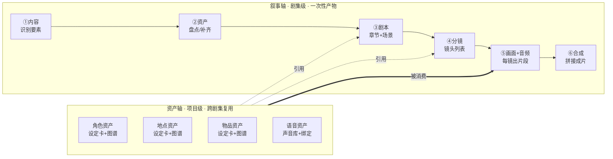

**核心原则**：

- 资产是叙事的输入，不是平级关系
- 叙事的产物只能引用已存在的资产
- 合流点收敛在第 ⑤ 步：画面/视频/音频生成时从资产轴拉素材，从叙事轴拉描述
- 资产轴长期存在，跨剧集复用；叙事轴每剧集一份

### 1.2 双来源（资产权威源）

```
资产记录（character_binding 表为例）
├─ source_type: 'linked_lw' | 'standalone'
├─ project_id（必填）
├─ ─── 当 source_type = linked_lw ───
│   ├─ lw_character_id（指向长文模块）
│   ├─ override_name? / override_description? / override_outfit? ...
│   └─ 设定卡基础值 = 投影自 lw + override 增量
├─ ─── 当 source_type = standalone ───
│   ├─ standalone_name
│   ├─ standalone_description
│   └─ 设定卡基础值 = 直接记在本表
└─ 共有：图谱（多角度图集）、声音配置、portrait_id?
```

**读取规则**：

```
读取一个资产的"当前生效设定"：
  if source_type == 'linked_lw':
      base = 投影 lw_character.* 到资产卡字段
      effective = base + override_*（override 非空覆盖 base）
  else:
      effective = standalone_* 字段
```

**长文更新时的传播**（用户可控）：长文模块的角色被改 → 引用该角色的剧集资产收到"基础值已变更"提示 → 用户决定每个剧集是"接受新基础值"还是"保留当前覆盖"。**不强制传播。**

### 1.3 三层职责

```
┌────────────────────────────────────────────────┐
│ 资产层（domain）：稳定、可复用、跨剧集         │
│   - 角色/地点/物品/语音 的"是什么"              │
│   - 提示词碎片、参考图、声音参数               │
└────────────────────┬───────────────────────────┘
                     ▼ 引用
┌────────────────────────────────────────────────┐
│ 叙事层（narrative）：剧集级、线性、可定稿      │
│   - 章节剧本 / 场景剧本 / 分镜                 │
│   - 描述"何时何地谁做了什么"                   │
└────────────────────┬───────────────────────────┘
                     ▼ 渲染时合流
┌────────────────────────────────────────────────┐
│ 渲染层（render）：分镜帧画面 + 视频片段 + 音频 │
│   - 输入 = 资产层素材 + 叙事层描述             │
│   - 输出 = 关键帧/视频片段/音频                │
│   - 这里是 3D 模块未来的接入点                 │
└────────────────────────────────────────────────┘
```

每层改动不影响相邻层（资产换发色不动剧本；叙事改对话不动资产；渲染换模型前两层不变）。

---

## 2. 工作台 + 6 阶段

### 2.1 工作台布局（形态 D）

```
┌─────────────────────────────────────────────────────────────────┐
│ 顶部：阶段进度条（始终可见，软引导）                            │
│ ① 内容 ── ② 资产 ── ③ 剧本 ── ④ 分镜 ── ⑤ 画面+音频 ── ⑥ 合成 │
│   ✓        ✓        ●         ○         ○            ○         │
├──────────┬──────────────────────────────────────────────────────┤
│ 资产侧栏 │  主区域（随当前阶段切换内容）                        │
│ 角色 (3) │                                                      │
│ 地点 (2) │                                                      │
│ 物品 (4) │                                                      │
│ 语音 (5) │                                                      │
├──────────┴──────────────────────────────────────────────────────┤
│ 底部：迷你时间线（始终可见，预览当前已生产内容）                │
│ ▰▰▰▰▱▱▱▱▱▱▱▱  3/12 分镜已出片  ⏵ 试播                     │
└─────────────────────────────────────────────────────────────────┘
```

- 顶部进度条 / 左侧资产侧栏 / 底部迷你时间线**任何阶段都可见**
- 资产侧栏可折叠
- 主区域是唯一会"换面孔"的区域

### 2.2 6 阶段的"四要素"

| 阶段 | 产物 | 进入条件 | 完成条件 | 主区域形态 |
|---|---|---|---|---|
| ① **内容** | 要素清单（含 source_type） | 剧集已创建 | 用户点"确认要素" | 长文/上传内容 + 识别出的角色/地点/物品 三栏 |
| ② **资产** | 每个出场要素 ≥1 张主图 + 设定卡 | ① 完成 | 所有出场要素都有可用主图 | 资产卡网格（角色/地点/物品/语音 分组） |
| ③ **剧本** | 定稿的 SceneScript 列表 | ② 完成 | 用户点"剧本定稿" | 章节梗概 + 场景卡片列表 |
| ④ **分镜** | 每场 ≥1 个 Storyboard | ③ 完成 | 用户点"分镜定稿" | 场景树 + 该场分镜网格 |
| ⑤ **画面+音频** | 每个分镜的 videoPath + 必要音频 | ④ 完成 | 所有分镜 videoPath 非空 | 单分镜详情：上=关键帧，下=音频 |
| ⑥ **合成** | 完整成片（mp4） | ⑤ 完成 | 导出成功 | 时间线视图 |

每个完成条件都可机器判定 → 进度条上的 ✓ / ● / ○ 状态自动算出。

### 2.3 门控规则（软引导 + 末端硬锁）

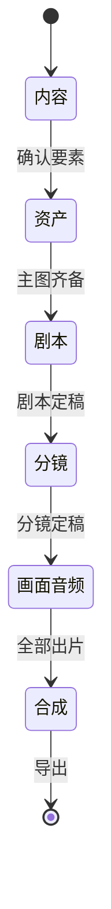

**具体行为**：

- 正向推进：每阶段右下角"完成本阶段"按钮
- 任意跳转：点击顶部进度条任一阶段都能跳
- 跳到未达成的前置阶段：什么都不挡
- 跳到前置未完成的下游阶段：弹"前置未完成"提示，列出缺失项，按钮"仍要进入" / "回到 ② 资产"
- 末端硬锁：⑥ 合成阶段的"导出"按钮必须满足"所有分镜 videoPath 非空"

### 2.4 EpisodeStatus 扩展

```ts
type EpisodeStatus =
  | 'pending'         // ① 内容
  | 'asset_prep'      // ② 资产（新增）
  | 'scripting'       // ③ 剧本
  | 'storyboarding'   // ④ 分镜
  | 'producing'       // ⑤ 画面+音频
  | 'composing'       // ⑥ 合成（reviewing 改名）
  | 'completed'
```

数据迁移：旧 `reviewing` 映射到 `composing`；旧 `pending` 按"是否已识别要素"分流到 `pending` 或 `asset_prep`。

### 2.5 文件拆分清单（剧集制作模块范围内 · 必拆）

```
src/renderer/src/views/VideoProjectEditor.vue          5158 行  ★ 主犯
src/renderer/src/views/VideoProductionPage.vue         1533 行
src/renderer/src/stores/story-to-video.ts              1529 行
src/electron/ipc/handlers/story-to-video.handler.ts    2079 行
src/core/services/story-to-video-ai.service.ts         1557 行
src/core/services/story-to-video-resource.service.ts    980 行
src/core/services/video-synthesis.service.ts            795 行
src/shared/types/story-to-video.types.ts                981 行
```

每个文件的目标拆分形态见第 5 节。

### 2.6 顺手拆但不在本次主线的大文件（记账，单独排期）

```
间接相关（剧集会调用，触及到再拆，本次不主动动）
  ├─ src/core/services/portrait.service.ts                 1390
  ├─ src/core/services/image.service.ts                    1154
  └─ src/renderer/src/components/portrait/CharacterEditor.vue  1914

完全不相关（本次不动，记入项目级"待拆清单"）
  ├─ src/electron/database/index.ts                        3897
  ├─ src/core/services/longwriting-ai.service.ts           2858
  ├─ src/electron/ipc/handlers/longwriting.handler.ts      2857
  ├─ src/renderer/src/components/longwriting/story/*Stage.vue  1500-2300 × N
  ├─ src/renderer/src/components/chat/MessageItem.vue      2301
  ├─ src/renderer/src/views/Settings.vue                   1927
  └─ src/preload/index.ts                                  1648
```

---

## 3. 资产卡 + 图谱（一致性核心）

### 3.1 资产 = 设定卡 + 图谱

```
资产实体（角色/地点/物品/语音）
├─ 设定卡 SettingCard（结构化字段，文字层面"是什么"）
└─ 图谱 Gallery（带语义标签的多角度/多状态图集）  ← 语音资产用"试听样本"代替图谱
```

### 3.2 三类视觉资产的设定卡

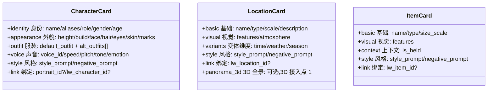

### 3.3 三类视觉资产的图谱结构

```
角色图谱
├─ main           主图（必有 1 张，是其他派生图的参考源）
├─ views[]        视角：front / 3q_left / 3q_right / side_l / side_r / back
├─ expressions[]  表情：neutral / happy / angry / sad / surprised / ...
├─ outfits[]      服装：default / formal / casual / ...
└─ poses[]        姿势：standing / sitting / walking / ...

地点图谱
├─ main                 主图（默认时间+默认天气）
├─ time_variants[]      时间变体：morning/noon/.../night
├─ weather_variants[]   天气变体：sunny/rainy/snowy/...
├─ angle_variants[]     视角变体：wide_shot/entrance/interior_a/...
└─ panorama_360 ★       360 全景图（3D 升级形态，本次不实现）

物品图谱
├─ main           主图（孤立物品图）
├─ views[]        视角：front/side/top/detail
└─ context[]      上下文图：held（被持握）/ in_scene
```

每张图的元数据：`{ category, label, prompt, negative_prompt, image_path, thumbnail_path, is_main, derived_from_image_id?, sort_order }`。

### 3.4 分镜消费资产的规则（一致性核心）

**提示词组装公式**：

```
分镜帧画面 final_prompt =
    项目级 style_anchor               // 全片画风统一
  + 镜头语言（shotType/angle/movement）
  + 场景描述（SceneScript.sceneDescription）
  + 地点引用 → 拉地点图谱里"最匹配 time+weather 的变体"的视觉特征
  + 角色引用 → 每个出场角色拉 face_features + 服装 + 表情/姿势
  + 物品引用 → 重要道具拉 features
  + 反向提示（聚合各资产的 negative_prompt）
```

**Reference Image 注入策略**（强一致性的关键）：

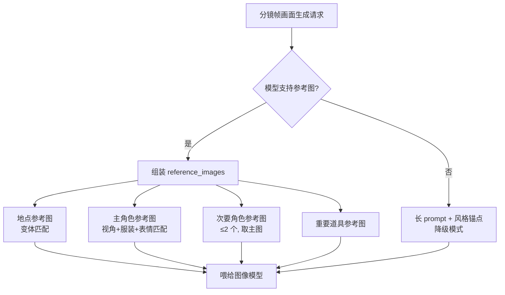

**取图优先级（逐级降级）**：

```
查地点图谱：
  1. 时间+天气都匹配的变体 → 用之
  2. 只有时间匹配 → 用之
  3. 都不匹配 → 用主图

查角色图谱：
  1. 视角+表情+服装都匹配 → 用之
  2. 视角+服装匹配 → 用之
  3. 只有视角匹配 → 用之
  4. 都不匹配 → 用主图
```

### 3.5 资产生成工作流（主图 → 派生）

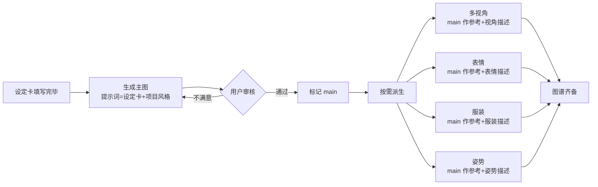

**铁律**：派生图必须以主图作为参考图，**不允许独立生成**。这避免当前代码"每帧独立生成造成漂移"。

### 3.6 与 portrait 模块的关系

```
portrait（独立模块）
   = 一个角色"脸 + 身材"的多变体
   = 长期存在,跨项目复用

character_binding（剧集制作模块）
   = portrait（脸+身材） + 这部剧里的形象状态
   = 服装变体 + 表情变体 + 姿势变体 + 声音 + 与剧集的关联
```

复用方式：角色资产卡的 `views[]` 字段可绑定 `portrait_id`，复用 portrait 的 variants 作为视角图。`outfits / expressions / poses` 永远在 character_binding 内生成（portrait 不管这些）。

### 3.7 双来源在资产卡的差异

| 字段 | linked_lw | standalone |
|---|---|---|
| 身份/外貌/服装 | 投影自 lw + override 增量 | 直接维护 |
| 风格锚点 | 项目级默认 | 项目级默认 |
| 图谱 | **完全在剧集模块内生成**（lw 不管图） | 完全在剧集模块内生成 |
| 声音 | 直接维护（lw 不管声音） | 直接维护 |

**关键观察**：图谱永远是剧集级的，差异只在文字层。

### 3.8 数据库改动（asset_image 表 + 第三范式）

```
现状（违反第三范式）：
  *_binding.image_paths: string  // JSON 数组,每张图无法独立带元数据

新增 asset_image 表：
  ┌─────────────────────────────────────────────────┐
  │ id PK                                            │
  │ asset_type    enum('character','location','item') │
  │ asset_id      FK to xxx_binding                  │
  │ category      enum('main','view','expression','outfit','pose','time_variant','weather_variant','angle_variant','context')│
  │ label         string  (如 'happy', 'morning', 'formal') │
  │ prompt        text                               │
  │ negative_prompt text                             │
  │ image_path    string                             │
  │ thumbnail_path string                            │
  │ is_main       bool                               │
  │ derived_from_image_id FK?                        │
  │ sort_order    int                                │
  │ created_at / updated_at                          │
  └─────────────────────────────────────────────────┘
```

各 binding 表新增字段：
- `source_type` enum('linked_lw', 'standalone')
- `override_*` 字段（仅 linked_lw 模式有效）
- 现有未规范化的 JSON 字段（如 `voice_config`, `generate_config`）全部规范化为列

### 3.9 资产侧栏（4 类，含语音）

```
左侧资产侧栏
  ├─ 角色 (3)
  ├─ 地点 (2)
  ├─ 物品 (4)
  └─ 语音 (5)   ← 新增
      ├─ 系统音色 · "温柔女声"
      ├─ 系统音色 · "沉稳男声"
      ├─ 复刻 · "我自己"
      ├─ 复刻 · "助理音色 A"
      └─ [+ 复刻新音色] → 跳到 voice 模块
```

语音资产的层次：

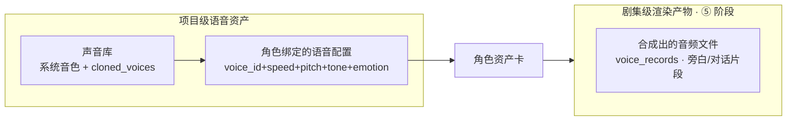

### 3.10 长文模块边界归位（清理图字段）

**现状偏差（必须清理）**：

```
src/core/database/entities/lw-character.entity.ts
  ├─ Line 25-26  portraitId: string | null      ← 不该在 lw
  └─ Line 73     generatedImageId: string | null   ← 不该在 lw

src/core/database/entities/lw-location.entity.ts
  └─ Line 45     generatedImageId: string | null   ← 不该在 lw

src/core/database/entities/lw-item.entity.ts
  └─ 无图字段 ✓
```

**清理动作**：

- `lw_character.portrait_id` → 数据迁移到 `character_binding.portrait_id`，然后从 lw entity 移除
- `lw_character.generated_image_id` → 数据迁移到 `asset_image`（main 类）后从 lw entity 移除
- `lw_location.generated_image_id` → 同上
- 长文模块 UI（`CharacterStage.vue` 1836 行 / `BackgroundStage.vue` 1935 行）移除"人像/图"相关编辑
- `episode-auto-binding.service` 移除"从 lw 拷贝图字段"的代码

### 3.11 portrait / image / voice 三模块独立 + 引用 + 导入

**模块边界**：

```
portrait（人像设计模块）
  └─ 产物：人物的"脸+身材"形象
  └─ 与剧集关系：character_binding.portrait_id 引用

image（图像生成模块）
  └─ 产物：自由创作的图（参考图、心情图等）
  └─ 与剧集关系：作为参考素材"导入"使用

voice（语音模块）
  └─ 产物：声音库（cloned_voices）+ 合成历史（voice_records）
  └─ 与剧集关系：character_binding.voice_id 引用
```

**为什么不合并**：portrait/image/voice 都是通用工具（可独立使用），剧集资产是"这部剧的素材"，颗粒度和生命周期不同。

**统一工作**：

1. **引用机制**：`character_binding.portrait_id`、`asset_image.source_image_id`（如果某图来自 image 模块）、`asset_image.source_portrait_variant_id`（如果某图来自 portrait variant）
2. **导入路径**：剧集资产编辑页的"图谱"区，新增"添加图来源"菜单：项目内 AI 生成 / 从我的人像导入 / 从我的图像生成历史导入 / 上传
3. **统一只读视图**：资产侧栏在 4 大类外可折叠展开"我的全部素材库"，列出 portrait / image / voice 的产物，**只能"导入到当前剧集"**

---

## 4. 叙事轴精细化

### 4.1 剧本：所有引用强约束

```
SceneScript（精细化后）
├─ location_binding_id    FK → location_binding（不再是裸字符串）
├─ time_of_day / weather  → 用于从 location 图谱拉变体
├─ characters[]           每个 SceneCharacter 含 character_binding_id（不再是 lw_id）
│   ├─ position / expression / outfit_label / pose_label
│   └─ props[] → 每个 prop 含 item_binding_id
├─ dialogues[]            每个 Dialogue 含 character_binding_id + voice_id
├─ actions[]              每个 ActionDescription 含 character_binding_id
└─ narration              旁白文本（无角色绑定）
```

**完整性检查**（剧本定稿前必跑）：所有引用必须解析到资产库中存在且其"主图/主声"已就绪的资产。

UI 上：剧本编辑时引用其它资产用"@提及"或下拉，不允许裸打文字。

### 4.2 分镜：从单帧到多关键帧

**新概念**：分镜由 N 张关键帧（2~9）+ 1 段视频片段构成。

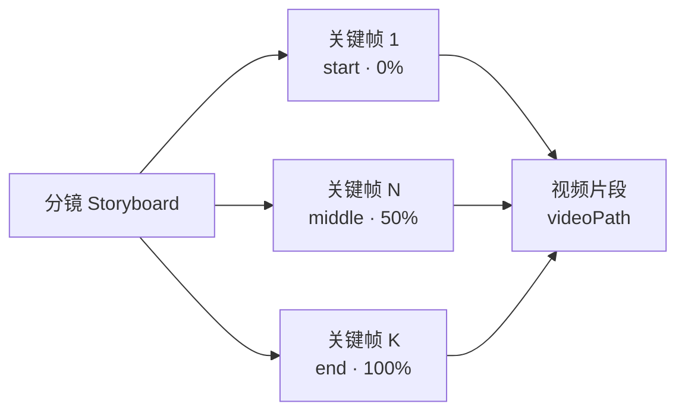

每分镜按复杂度配置 `keyframe_count`：

| 镜头复杂度 | 推荐关键帧数 | 适用场景 |
|---|---|---|
| 简单（特写/对话头/静态） | 1~2 | 大多数对话戏、内心独白 |
| 中等（推拉摇移/单角色动作） | 3~5 | 一般动作戏、短运镜 |
| 复杂（群戏/多动作/长镜头） | 6~9 | 战斗、调度复杂的群戏 |

"九宫格"是俗称——本质是**可变帧数关键帧序列**。UI 默认 3-5 帧呈九宫格状展示，底层数据变长。

### 4.3 关键帧之间的"参考链"

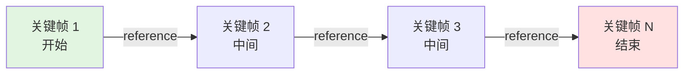

**生成顺序**：

```
1. 先生成"开始帧"（第 1 张）
   提示词 = 资产引用 + 镜头语言 + 该分镜的"开始时刻描述"
   参考图 = 地点变体图 + 角色图 + 物品图

2. 再生成"结束帧"（最后一张）
   参考图 = 开始帧 + 资产引用图 + "结束时刻描述"

3. 最后生成"中间帧"（如有）
   参考图 = 开始帧 + 结束帧 + 资产引用图 + "中间时刻动作"
```

**重生成的传播**：

- 改"开始帧"：弹出"是否重新生成后续中间帧/结束帧"，默认勾选
- 改"中间帧"：只影响该帧自己
- 改"结束帧"：弹出"是否重新生成中间帧"

### 4.4 视频片段生成的多模式

```typescript
interface VideoProvider {
  textToVideo?(prompt, duration, opts): Promise<VideoOutput>
  imageToVideo?(image, prompt?, duration, opts): Promise<VideoOutput>
  keyframesToVideo?(keyframes[], prompt?, duration, opts): Promise<VideoOutput>
  
  capabilities: { text: boolean, image: boolean, keyframes: boolean, maxKeyframes: number }
}
```

**调度策略**（按 `keyframe_count` 选模式）：

```
keyframe_count == 0  → text2video
keyframe_count == 1  → image2video
keyframe_count == 2  → keyframes2video（首尾帧）或退化为 image2video
keyframe_count >= 3  → keyframes2video（多关键帧）

如果选中 provider 不支持当前 keyframe_count：
  → 降级为支持的最高模式
  → UI 提示当前 provider 能力上限
```

### 4.5 3D 接入点（本次不实现）

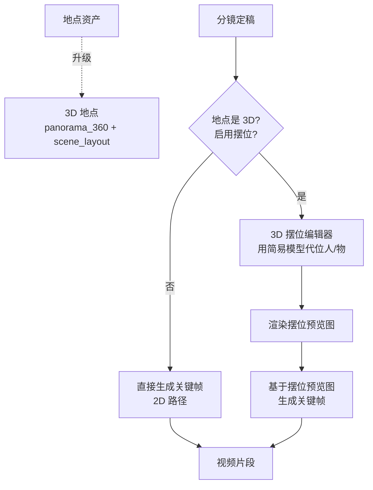

**接入点 1：地点资产层**

```
location_binding 扩展：
  panorama_3d_id  text nullable   ← 360 全景图资源
  scene_layout_id text nullable   ← 3D 场景搭建
```

**接入点 2：分镜层**

```
storyboard 扩展：
  use_3d_staging  bool default false
  staging_layout_id text nullable
```

**接入点 3：关键帧生成器层**

```
generateKeyframe(opts: {
  storyboard, frameRole, prevKeyframes,
  stagingPreviewImage?: string  ← 本次永远 undefined
})
```

接口预留 + 参数为可选，本次实现完全不知道 3D 的存在；将来加 3D 模块只需要填那个参数。

### 4.6 ⑤ 阶段（画面+音频）UI

```
┌──────────────────────────────────────────────────────────────┐
│ ⑤ 画面+音频                                                   │
├────────────┬─────────────────────────────────────────────────┤
│ 分镜列表   │ 分镜 1.2 · 远景 · 平视 · 推镜 · 5.0s             │
│ 场景 1     │ ─────────────────────────────────────────────── │
│  ├ 1.1 ✓  │ 关键帧序列（共 5 帧）                            │
│  ├ 1.2 ●  │  ┌───┐┌───┐┌───┐┌───┐┌───┐                    │
│  └ 1.3 ○  │  │📸开││📸├ ││⏳中││ ┤ ││ 结│ [+ 添加帧]       │
│            │  └───┘└───┘└───┘└───┘└───┘                    │
│ 场景 2     │  [批量生成] [3D 摆位 🔒地点非 3D]               │
│            │ ─────────────────────────────────────────────── │
│            │ 视频生成                                         │
│            │ Provider: 可灵 ▼ 模式: 关键帧→视频 ▼            │
│            │ [生成视频]                                       │
│            │ ─────────────────────────────────────────────── │
│            │ 音频                                             │
│            │ 旁白: 「夕阳下他缓缓走入...」                    │
│            │   声音: 沉稳男声 · 1.0x [试听] [重生成]         │
│            │ 对话: 张三 · neutral · "你来了"                  │
│            │     [生成] [试听] [重试]                         │
└────────────┴─────────────────────────────────────────────────┘
```

### 4.7 数据库改动（叙事+渲染）

新增：

```
storyboard_keyframe 表
├─ id PK
├─ storyboard_id FK
├─ frame_index int               (0-based)
├─ time_percent real              (0-1)
├─ frame_role enum('start','middle','end','extra')
├─ image_asset_id FK to asset_image
├─ derived_from_keyframe_id FK?
├─ prompt text
├─ negative_prompt text
├─ created_at / updated_at
```

扩展 `storyboard`：
- `keyframe_count` int default 2
- `video_provider_id` / `video_model_id` / `video_mode` enum('text2video','image2video','keyframes2video')
- `use_3d_staging` bool default false（接入点 2）
- `staging_layout_id` text nullable（接入点 2）

扩展 `location_binding`：
- `panorama_3d_id` text nullable（接入点 1）
- `scene_layout_id` text nullable（接入点 1）

扩展 `scene_prop`：
- `item_binding_id` text nullable FK（之前是裸 prop_name 字符串）

`storyboard.frame_image_id` 字段保留兼容，但实际改用 `storyboard_keyframe` 表（迁移时 frame_image 写为 frame_index=0 的 keyframe）。

---

## 5. 模块边界 + 目录结构

### 5.1 模块更名

```
当前命名         → 新命名
story-to-video   → episode-production
```

涉及更名：文件路径、目录名、路由路径（`/story-to-video/...` → `/episode-production/...`）、IPC 通道前缀（`story-to-video:*` → `episode-production:*`）、TS 类名（保留 `VideoProject` / `VideoEpisode` 这些已经准确的名字）。**数据库表名不变**。

### 5.2 五大子域

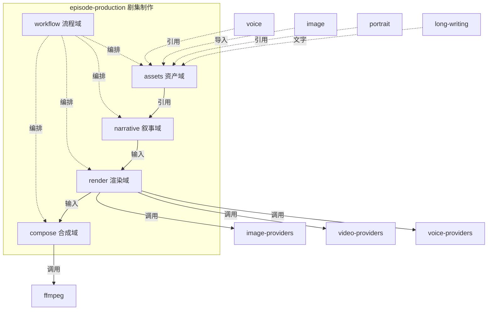

### 5.3 目标目录结构

#### Core 层

```
src/core/modules/episode-production/
├── assets/
│   ├── services/
│   │   ├── character-asset.service.ts
│   │   ├── location-asset.service.ts
│   │   ├── item-asset.service.ts
│   │   ├── voice-asset.service.ts          ← 新增
│   │   ├── asset-image.service.ts          ← 新增
│   │   └── asset-import.service.ts         ← 新增
│   └── prompts/
│       ├── character-card-builder.ts
│       ├── location-card-builder.ts
│       └── item-card-builder.ts
├── narrative/
│   ├── services/
│   │   ├── episode-script.service.ts
│   │   ├── scene-script.service.ts
│   │   └── storyboard.service.ts
│   ├── ai/
│   │   ├── script-generator.ts
│   │   └── storyboard-generator.ts
│   ├── reference-resolver.ts
│   └── validators/
│       └── script-completeness.validator.ts
├── render/
│   ├── keyframe/
│   │   ├── keyframe-generator.service.ts
│   │   ├── keyframe-prompt-builder.ts
│   │   ├── reference-image-selector.ts
│   │   └── keyframe-chain-strategy.ts
│   ├── video/
│   │   ├── video-segment.service.ts
│   │   ├── video-mode-selector.ts
│   │   └── provider-capability-matcher.ts
│   ├── audio/
│   │   ├── narration-synthesis.service.ts
│   │   ├── dialogue-synthesis.service.ts
│   │   └── bgm.service.ts
│   └── staging-3d/
│       └── README.md                       ← 接入点占位
├── compose/
│   ├── timeline-builder.service.ts
│   ├── transition.service.ts
│   ├── subtitle.service.ts
│   └── ffmpeg-assembler.service.ts
├── workflow/
│   ├── stage-gate.service.ts
│   ├── episode-status.machine.ts
│   └── progress-calculator.ts
└── auto-binding/
    ├── episode-auto-binding.service.ts     ← 改造：移除"拷贝图字段"
    ├── uploaded-entity.service.ts          ← 移自 core/services
    └── lw-entity-detection.service.ts      ← 移自 core/services
```

#### Entities

```
src/core/database/entities/episode-production/
├── video-project.entity.ts
├── video-episode.entity.ts
├── episode-script.entity.ts
├── scene-script.entity.ts
├── scene-character.entity.ts
├── scene-action.entity.ts
├── scene-dialogue.entity.ts
├── scene-prop.entity.ts                  ← 改造：含 item_binding_id FK
├── storyboard.entity.ts                  ← 改造
├── storyboard-character.entity.ts
├── storyboard-keyframe.entity.ts         ← 新增
├── character-binding.entity.ts           ← 改造：source_type + override_*
├── location-binding.entity.ts            ← 改造
├── item-binding.entity.ts                ← 改造
└── asset-image.entity.ts                 ← 新增
```

#### Shared types

```
src/shared/types/episode-production/
├── domain.types.ts        ← 资产卡 + 设定卡
├── narrative.types.ts     ← 剧本/场景/分镜
├── render.types.ts        ← 关键帧/视频/音频
├── compose.types.ts       ← 时间线/转场/字幕
├── workflow.types.ts      ← 阶段/状态/进度
└── ipc.types.ts           ← IPC 通道
```

#### IPC handlers

```
src/electron/ipc/handlers/episode-production/
├── index.ts
├── project.handler.ts
├── episode.handler.ts
├── asset/
│   ├── character-asset.handler.ts
│   ├── location-asset.handler.ts
│   ├── item-asset.handler.ts
│   └── voice-asset.handler.ts
├── narrative/
│   ├── script.handler.ts
│   └── storyboard.handler.ts
├── render/
│   ├── keyframe.handler.ts
│   ├── video.handler.ts
│   └── audio.handler.ts
├── compose.handler.ts
└── workflow.handler.ts
```

#### Renderer 视图

```
src/renderer/src/views/
└── EpisodeWorkbench.vue           ← 主壳（< 200 行）

src/renderer/src/components/episode-production/
├── workbench/
│   ├── TopProgressBar.vue
│   ├── AssetSidebar.vue
│   └── BottomMiniTimeline.vue
├── stage-content/
│   ├── ContentStageView.vue
│   ├── EntityIdentifyPanel.vue
│   └── EntityList.vue
├── stage-asset/
│   ├── AssetStageView.vue
│   ├── AssetGrid.vue
│   ├── character/
│   │   ├── CharacterAssetEditor.vue
│   │   ├── CharacterCardForm.vue
│   │   └── CharacterGalleryEditor.vue
│   ├── location/
│   ├── item/
│   └── voice/
│       ├── VoiceLibrary.vue
│       └── VoiceCloneCreate.vue
├── stage-script/
│   ├── ScriptStageView.vue
│   ├── ScriptOutline.vue
│   ├── SceneCardList.vue
│   └── SceneEditor.vue
├── stage-storyboard/
│   ├── StoryboardStageView.vue
│   ├── SceneTree.vue
│   ├── StoryboardGrid.vue
│   └── ShotEditor.vue
├── stage-production/
│   ├── ProductionStageView.vue
│   ├── ShotKeyframePanel.vue
│   ├── KeyframeGrid.vue
│   ├── KeyframeEditor.vue
│   ├── VideoPanel.vue
│   ├── AudioPanel.vue
│   └── 3d-staging/
│       └── README.md
├── stage-compose/
│   ├── ComposeStageView.vue
│   ├── Timeline.vue
│   ├── TransitionPicker.vue
│   └── ExportPanel.vue
└── shared/
    ├── AssetPicker.vue
    ├── PortraitImporter.vue
    ├── ImageImporter.vue
    └── EmbedReferencePreview.vue
```

#### Stores

```
src/renderer/src/stores/episode-production/
├── workbench.store.ts
├── project.store.ts
├── episode.store.ts
├── asset.store.ts
├── script.store.ts
├── storyboard.store.ts
├── production.store.ts
└── compose.store.ts
```

#### 路由

```
/episode-production
/episode-production/:projectId
/episode-production/:projectId/episode/:episodeId/content
/episode-production/:projectId/episode/:episodeId/assets
/episode-production/:projectId/episode/:episodeId/script
/episode-production/:projectId/episode/:episodeId/storyboard
/episode-production/:projectId/episode/:episodeId/production
/episode-production/:projectId/episode/:episodeId/production/:storyboardId
/episode-production/:projectId/episode/:episodeId/compose
```

子路由直接对应 6 个阶段，URL 即位置感。

### 5.4 旧 → 新 完整迁移表

```
旧文件                                                    目标
─────────────────────────────────────────────────────────────────
src/renderer/src/views/VideoProjectEditor.vue 5158       → views/EpisodeWorkbench.vue + 6 stage views + 30+ 子组件
src/renderer/src/views/VideoProductionPage.vue 1533      → 并入 stage-production/* 子组件
src/renderer/src/views/StoryToVideo.vue 432              → 重命名 EpisodeProjectList.vue
src/renderer/src/stores/story-to-video.ts 1529           → stores/episode-production/8 个 store
src/electron/ipc/handlers/story-to-video.handler.ts 2079 → handlers/episode-production/N 个
src/core/services/story-to-video-ai.service.ts 1557      → narrative/ai/* + assets/prompts/*
src/core/services/story-to-video-resource.service.ts 980 → render/keyframe/* + render/audio/* + assets/services/*
src/core/services/video-synthesis.service.ts 795         → compose/*
src/core/services/episode-auto-binding.service.ts        → modules/episode-production/auto-binding/，去掉拷贝图逻辑
src/core/services/uploaded-entity.service.ts             → modules/episode-production/auto-binding/
src/core/services/lw-entity-detection.service.ts         → modules/episode-production/auto-binding/
src/core/services/video.service.ts                       → compose/* + render/video/*
src/core/services/cache.service.ts                       → 留原位（跨模块通用）
src/shared/types/story-to-video.types.ts 981             → shared/types/episode-production/6 个
src/core/database/entities/{video-*,scene-*,storyboard-*,*-binding}.entity.ts → entities/episode-production/
```

### 5.5 长文模块连带清理

```
src/core/database/entities/lw-character.entity.ts
  ✗ 移除 portrait_id            ← 数据迁移到 character_binding.portrait_id
  ✗ 移除 generated_image_id     ← 数据迁移到 asset_image（main 类）

src/core/database/entities/lw-location.entity.ts
  ✗ 移除 generated_image_id

src/renderer/src/components/longwriting/story/CharacterStage.vue 1836
  ✗ 移除"人像/图"相关 UI
  ✓ 顺手最小拆分（不全量重构）

src/renderer/src/components/longwriting/story/BackgroundStage.vue 1935
  ✗ 移除"地点图"相关 UI
  ✓ 同上
```

### 5.6 模块依赖单向性

```
episode-production
  ├─ 强依赖：core/database, core/image-providers, core/video-providers, core/voice-providers, ffmpeg
  ├─ 弱依赖（引用层）：long-writing（读 character/location/item 文字）、portrait、image、voice
  └─ 不依赖：chat, knowledge-base, settings ...

约束：
  - episode-production 不反向依赖 long-writing/portrait/image/voice 内部服务
  - 仅通过明确的"读取/导入"接口（如 long-writing 的 character.repository、portrait 的 variant.service）跨域取数据
  - 长文/人像/图像/语音 模块永远不知道 episode-production 的存在
```

---

## 6. 数据迁移 + 实施分期 + 风险 + DoD

### 6.1 数据迁移策略

**原则**：

- 每条迁移用 typeorm migration 单文件、可逆（up/down）
- 每个 phase schema 变更前自动备份 SQLite 文件
- 旧字段保留一个版本周期后清除
- 数据搬运优先于结构删除
- 每条迁移带迁移测试

**6 项核心迁移**：

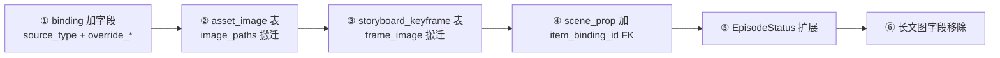

| # | 迁移内容 | 关键搬运 | 风险 |
|---|---|---|---|
| ① | `*_binding` 加 `source_type` / `override_*` + 规范化 JSON | 推断 source_type：有 lw_xxx_id 非空 → linked_lw，否则 standalone | 低 |
| ② | 新增 `asset_image` 表 + 搬 `image_paths` | 数组每张图建一行（main + view），保留旧字段标 deprecated | 中 |
| ③ | 新增 `storyboard_keyframe` 表 + 搬 `frame_image` | 现有 frame_image_id 写为 frame_index=0 / frame_role=start | 中 |
| ④ | `scene_prop` 加 `item_binding_id` FK | 尝试用 prop_name 匹配 item_binding，匹配不到保留 prop_name | 低 |
| ⑤ | `EpisodeStatus` 扩展 + 改名 | 旧 pending 按"是否有出场要素"分流；旧 reviewing → composing | 中 |
| ⑥ | 长文 lw-character/location 移除图字段 | portrait_id 搬到 character_binding；generated_image_id 搬到 asset_image | 高 |

### 6.2 实施分期（8 个 Phase）

```mermaid
gantt
    title 实施分期（粗略相对顺序）
    dateFormat X
    axisFormat %s
    section 准备
    Phase 1 · 模块更名+目录重组+大文件拆 :p1, 0, 4
    section 数据
    Phase 2 · DB schema + 数据迁移        :p2, after p1, 4
    section 业务
    Phase 3 · 资产域                       :p3, after p2, 5
    Phase 4 · 叙事域强约束                 :p4, after p3, 4
    Phase 5 · 渲染域 关键帧+视频+音频     :p5, after p4, 6
    Phase 6 · 合成域+工作流                :p6, after p5, 4
    section 收尾
    Phase 7 · 端到端联调                   :p7, after p6, 3
    Phase 8 · 3D 接入点文档                :p8, after p7, 1
```

**Phase 内容**：

- **P1 准备**：模块改名 + 目录重组 + 10 个大文件拆分。**不改业务逻辑**——纯结构性重构。每步保证现有测试通过。
- **P2 数据**：6 项 schema 迁移按 ①→⑥ 顺序；每条带迁移测试；最后跑回归。
- **P3 资产域**：4 类资产 service + asset-image + 派生图工作流 + portrait/image 导入；UI stage-asset/*。
- **P4 叙事域**：reference-resolver + 完整性 validator；改 generator 输出资产 ID；UI stage-script/* @提及。
- **P5 渲染域**：keyframe-generator + 参考链；video provider 三模式 + capability matcher；narration/dialogue-synthesis；UI stage-production/*。
- **P6 合成 + 工作流**：拆 ffmpeg-assembler / transition / subtitle；workflow/stage-gate / status machine；UI workbench/* + stage-content/* + stage-compose/*。
- **P7 端到端**：跑通"上传或选长文 → 6 阶段 → 成片"全流程。
- **P8 占位文档**：写 staging-3d/README.md。

**Phase 间硬依赖**：P1 → P2 → P3 → P4 → P5 → P6 → P7 → P8（不能跨阶段跳）。

### 6.3 风险登记表

| # | 风险 | 影响 | 概率 | 缓解 |
|---|---|---|---|---|
| R1 | 数据迁移失败破坏历史项目 | 高 | 中 | 每 phase 前自动备份；dry-run；可逆 down 脚本；测试库先跑 |
| R2 | 5158 行 VideoProjectEditor 拆分时遗漏功能 | 中 | 高 | 拆分前列功能清单（dialog / 按钮 / 流程），逐项核对 |
| R3 | 关键帧参考链生成质量不可控 | 中 | 高 | 单帧重生成；参考策略可调；不支持参考图 provider 降级路径明确 |
| R4 | Video provider 能力差异 | 中 | 中 | capability-matcher 显式降级；UI 标注当前 provider 上限 |
| R5 | 长文字段删除影响存量项目 | 高 | 低 | 先迁移再删；deprecated 兼容 1 个版本周期 |
| R6 | source_type 双轨让用户困惑 | 中 | 中 | UI 明显区分（标签+颜色）；"基础值已变更"提示 |
| R7 | EpisodeStatus 扩展与旧记录不对齐 | 中 | 低 | 状态迁移脚本同步；按现有数据自动归类 |
| R8 | TypeScript 类型大改导致跨包 import 中断 | 中 | 高 | 旧 types 文件保留为 deprecated re-export；逐步切换 |
| R9 | portrait/image/voice 模块需轻改以暴露读 API | 低 | 中 | 只新增 read API，不改写 API；最小入侵 |
| R10 | 测试覆盖度跟不上 | 中 | 中 | 每 service 单元测试 + 每 phase 末回归 + 端到端跑通 |

### 6.4 DoD（七维度）

#### 架构

- [ ] `story-to-video` → `episode-production` 改名完成
- [ ] 5 大子域目录结构建立
- [ ] 10 个大文件按目标拆分（无单文件超 800 行）
- [ ] 模块依赖单向

#### 数据

- [ ] `asset_image` 表上线，`image_paths` 标 deprecated
- [ ] `storyboard_keyframe` 表上线，`frame_image` 标 deprecated
- [ ] 各 binding 加 `source_type` + `override_*`
- [ ] `scene_prop.item_binding_id` FK 上线
- [ ] `lw-character/lw-location` 图字段移除（数据已迁移）
- [ ] `EpisodeStatus` 扩展完成
- [ ] `storyboard.keyframe_count / video_mode / use_3d_staging` 等字段
- [ ] `location_binding.panorama_3d_id / scene_layout_id` 字段
- [ ] 所有迁移 up/down 可逆 + 迁移测试通过

#### 业务

- [ ] **资产域**：四类资产可创建/编辑/绑定；图谱"主图 + 派生"流程；source_type 双轨；从 portrait/image 导入
- [ ] **叙事域**：剧本/分镜引用强约束；定稿前完整性检查必跑
- [ ] **渲染域**：多关键帧 + 参考链；视频三模式 + capability 降级；音频接入 voice
- [ ] **合成域**：时间线 + 转场 + 字幕 + 导出
- [ ] **工作流**：6 阶段进入/完成条件机器可判定；软引导+末端硬锁

#### UI

- [ ] 顶部进度条 / 资产侧栏 / 底部时间线全程可见
- [ ] 6 个 stage view 完整实现
- [ ] 资产卡 linked_lw 模式有"基础值已变更"提示
- [ ] 关键帧 grid 可视化、单帧操作正常
- [ ] 路由 6 子路径与阶段一一对应

#### 测试

- [ ] 每个 service 单元测试覆盖核心路径
- [ ] IPC handler 集成测试
- [ ] 端到端：上传一段文字 → 跑通到导出
- [ ] 端到端：选一个长文章节 → 跑通到导出
- [ ] 数据迁移在历史 DB 上能成功跑

#### 文档

- [ ] `docs/superpowers/specs/2026-05-02-episode-production-pipeline-design.md`（本文档）
- [ ] `docs/arch/` 下更新模块边界图
- [ ] 更新 CLAUDE.md 中相关章节
- [ ] 各子域 README

#### 3D 接入点

- [ ] `location_binding.panorama_3d_id / scene_layout_id` 字段就位
- [ ] `storyboard.use_3d_staging / staging_layout_id` 字段就位
- [ ] `keyframe-generator` 接受可选 `stagingPreviewImage` 参数
- [ ] `staging-3d/README.md` 写明未来接入步骤

---

## 附录 A：36 条关键决策清单

**第 1 节 · 总体架构**

1. 双轴 + 单合流点（合流在渲染层）
2. 双来源在同一张表上用 `source_type` + `override_*` 字段表达

**第 2 节 · 工作台 + 6 阶段**

3. 工作台布局采用形态 D（顶部进度条 + 左侧资产侧栏 + 主区域 + 底部时间线）
4. 6 阶段的"四要素"（产物/进入/完成/主区域）按表格定义
5. 软引导 + 末端硬锁
6. `EpisodeStatus` 扩展（增加 `asset_prep`，把 `reviewing` 改名 `composing`）
7. `VideoProjectEditor.vue` 拆成 6 个 stage 子视图

**第 3 节 · 资产卡 + 图谱**

8. 资产 = 设定卡 + 图谱，分离设计
9. 图谱按"语义类别"组织，每图带元数据
10. 派生图必须以主图为参考，不允许独立生成
11. 分镜消费资产时强制注入 reference image，降级才用纯文字
12. portrait 模块复用：character 资产卡可绑定 portrait_id
13. 数据库新增 `asset_image` 表（统一图谱）
14. 各 binding 表加 `source_type` + `override_*` 字段
15. 长文 entity 的 `portrait_id` / `generated_image_id` 字段删除，UI 隐藏
16. `episode-auto-binding.service` 移除"从 lw 拷贝图字段"的代码
17. 资产管理新增"语音"第 4 类，对应 `cloned_voices` 表 + 角色绑定的语音配置
18. portrait / image / voice 三模块**保持独立**，不并入剧集资产
19. 剧集资产的"图来源"支持引用 portrait variant、导入 image 历史、上传、AI 生成

**第 4 节 · 叙事轴精细化**

20. 剧本里所有实体引用强约束：location/character/item/voice 都用资产 ID
21. 剧本定稿前做完整性检查（所有引用必须解析得到主图/主声就绪的资产）
22. 分镜从"单帧"改造为"多关键帧"（2~9 张），存入 `storyboard_keyframe` 表
23. 关键帧用"参考链"生成（开始 → 结束 → 中间），保证连贯
24. 视频 provider 抽象支持三模式：text2video / image2video / keyframes2video
25. 3D 留三个接入点：地点资产层、分镜层、关键帧生成器层
26. `Storyboard.frame_image_id` 标记 deprecated，迁移到 `storyboard_keyframe`

**第 5 节 · 模块边界 + 目录**

27. 模块更名 `story-to-video` → `episode-production`
28. 五大子域：assets / narrative / render / compose / workflow
29. Core 层移到 `src/core/modules/episode-production/<subdomain>/`
30. entities 按模块分子目录 + shared types 拆 6 个 + handlers 按子域拆 + views 拆主壳+ 6 stage + stores 按 8 个主题拆
31. 路由按 6 个阶段做子路径
32. 长文模块的图字段移除并迁移
33. 模块依赖单向：episode-production → 其它

**第 6 节 · 迁移 + 分期 + 风险 + DoD**

34. 6 项核心数据迁移按依赖顺序执行
35. 8 个 Phase 串行推进；P1 纯结构、P2 数据、P3-P6 业务、P7 联调、P8 占位
36. 风险登记表 10 项明确缓解策略 + DoD 七维度

---

## 附录 B：本次明确不做（范围外）

- 3D 摆位编辑器实现（仅留接入点字段和占位文档）
- 360 全景图生成器
- 项目级"工作空间"概念（多剧集项目分组）
- 全量重构 chat / settings / knowledge-base 等无关模块
- 跨设备/云端协作
- 视频成片的多版本管理（仅支持一份成片产物）

---

## 附录 C：相关现有资产盘点

**已有可复用基础设施**：

- `src/core/voice-providers/{base-voice-provider, dashscope-tts-provider}.ts`
- `src/core/services/voice.service.ts`
- `src/core/database/entities/cloned-voice.entity.ts` / `voice-record.entity.ts`
- `src/core/video-providers/{base-video-provider, sdk}/`
- `src/core/database/entities/portrait-{character, project, variant}.entity.ts`
- `src/core/services/portrait.service.ts`
- `src/core/services/image.service.ts`
- `src/core/database/entities/lw-{character, location, item, outline, chapter, ...}.entity.ts`

**已有需重构基础设施**：本设计第 5.4 节迁移表列出。
