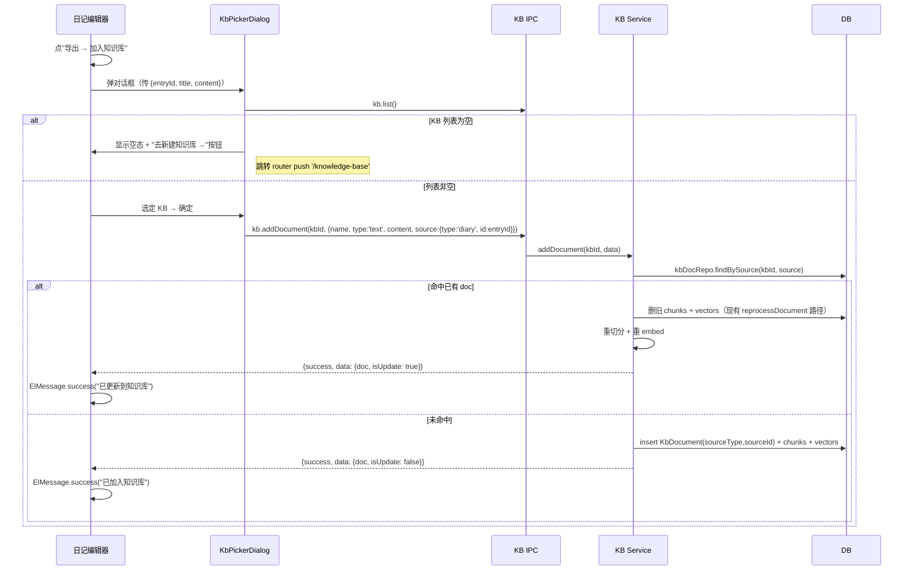

# 日记导出到知识库 设计

- 日期：2026-05-07
- 范围：双端等价（Electron + Web），无平台分支
- 影响文件：
  - 新增：`src/renderer/src/components/diary/KbPickerDialog.vue`
  - 修改：`src/renderer/src/components/diary/DiaryEditor.vue`
  - 修改：`src/shared/types/knowledge-base.types.ts`
  - 修改：`src/core/database/entities/kb-document.entity.ts`（加 `sourceType` / `sourceId` 列）
  - 修改：`src/core/database/repositories/kb-document.repository.ts`（加 `findBySource`；扩展 `create` 入参）
  - 修改：`src/core/services/knowledge-base.service.ts`（`addDocument` 改 upsert 语义）
  - 新增：`src/core/database/migrations/<timestamp>-add-kb-document-source.ts`（加列 + 索引）
  - 同步更新：旧 `addDocument` 调用点（KB 管理页"添加文本文档"按钮、`addWebpage` 内部）的返回值解构
- 平台限制：无
- 数据库 migration：**有**——`kb_documents` 表新增 `source_type` (varchar 32 nullable) + `source_id` (varchar 64 nullable)，加复合索引 `idx_kb_documents_source (knowledge_base_id, source_type, source_id)`

---

## 1. 目标 & 非目标

**目标**：在日记编辑器里允许用户把当前日记的 markdown 内容作为一篇文档导入到指定的知识库（KB），后续参与 RAG 检索。

**非目标**：
- 不做批量导入（多选日记一次入库）—— 后续可由列表层增量提供
- 不在导入对话框里支持新建知识库 —— 建库是另一个完整流程，跳转到知识库管理页
- 不做导入历史 / 取消导入 —— KB 现有"删除文档"已能覆盖回退
- 不做日记 [[backlinks]] 的关系入库 —— RAG 走文本相似度，链接图不参与

## 2. 责任边界

| 模块 | 职责 |
|---|---|
| **diary（前端）** | UI 入口（导出下拉新增"加入知识库"）、收集 `{entryId, title, content}`、调 KB 通道 |
| **knowledge-base（service）** | "按来源查重 → upsert"逻辑；日记侧不感知 KB 内部如何持久化来源 |
| **shared/types** | 定义 `DocumentSource` 类型，预留多来源扩展 |

理由：「API 设计自顶向下」+「模块边界优先」——查重是 KB 内部职责，不能让日记侧 list KB 文档再判断匹配，那会泄露 KB 内部表达。

## 3. 数据流



## 4. 数据契约

### 4.1 新增类型 `DocumentSource`

`src/shared/types/knowledge-base.types.ts`：

```ts
/**
 * 文档来源标识：用于 KB 内文档去重与回溯。
 * 同一 KB 中 (type, id) 二元组唯一对应一篇文档。
 */
export interface DocumentSource {
  /** 来源类型；后续可扩展 'character' / 'long-writing-chapter' 等 */
  type: 'diary' | 'manual'
  /** 来源在所属模块内的稳定 ID（如 diaryEntry.id） */
  id: string
}
```

### 4.2 扩展 `addDocument` 入参

```ts
// 原签名
addDocument(kbId: string, data: { name: string; type: 'text'; content: string })
// 扩展（向下兼容，source 可选）
addDocument(kbId: string, data: {
  name: string
  type: 'text'
  content: string
  source?: DocumentSource
})
```

返回值同步扩展：

```ts
// 原 { success: boolean; data?: KbDocument; error?: string }
// 扩展
{
  success: boolean
  data?: { doc: KbDocument; isUpdate: boolean }
  error?: string
}
```

向下兼容做法：旧调用点（KB 管理页的"添加文本文档"按钮）不传 `source`，service 走原创建路径，前端拿 `data.doc` 即可——需要同步修改旧调用点的解构。

### 4.3 `KbDocument` Entity 新增列

不复用 `metadata` JSON 列，原因：
- 现有 `metadata` 类型是 TypeORM `simple-json`（序列化为字符串），不能用 PG JSON 操作符做索引查询
- 现有 `kbDocuments.create()` 硬编码 `metadata: null`，扩展 metadata 路径需要重写 create 链
- 第三范式：`source_type` / `source_id` 是会被频繁查询用于去重的属性，应该作为正经列+索引，不应藏在 JSON 里

`src/core/database/entities/kb-document.entity.ts` 新增两列：

```ts
@Column({ name: 'source_type', type: 'varchar', length: 32, nullable: true })
sourceType!: string | null

@Column({ name: 'source_id', type: 'varchar', length: 64, nullable: true })
sourceId!: string | null
```

复合索引（migration 中创建）：

```sql
CREATE INDEX idx_kb_documents_source
  ON kb_documents (knowledge_base_id, source_type, source_id);
```

无 source 的文档（用户手动上传的文件 / 网页）两列均为 `NULL`，行为不变。

### 4.4 Migration

新文件 `src/core/database/migrations/<timestamp>-add-kb-document-source.ts`（实际 `<timestamp>` 在实现阶段按项目现有 migration 命名规范生成；类名同步）：

```ts
export class AddKbDocumentSource<timestamp> implements MigrationInterface {
  async up(queryRunner: QueryRunner): Promise<void> {
    await queryRunner.query(`ALTER TABLE kb_documents ADD COLUMN source_type VARCHAR(32)`)
    await queryRunner.query(`ALTER TABLE kb_documents ADD COLUMN source_id VARCHAR(64)`)
    await queryRunner.query(`CREATE INDEX idx_kb_documents_source ON kb_documents (knowledge_base_id, source_type, source_id)`)
  }
  async down(queryRunner: QueryRunner): Promise<void> {
    await queryRunner.query(`DROP INDEX IF EXISTS idx_kb_documents_source`)
    await queryRunner.query(`ALTER TABLE kb_documents DROP COLUMN source_id`)
    await queryRunner.query(`ALTER TABLE kb_documents DROP COLUMN source_type`)
  }
}
```

实现时按项目 `src/core/database/migrations/` 现有命名/注册风格生成时间戳和类名。

### 4.5 Repository 新方法

`KbDocumentRepository`：

```ts
async findBySource(kbId: string, source: DocumentSource): Promise<KbDocument | null> {
  return this.findOneByWhere({
    knowledgeBaseId: kbId,
    sourceType: source.type,
    sourceId: source.id,
  } as any)
}
```

同时 `create(request)` 入参 `CreateDocumentRequest` 扩展（向下兼容）：

```ts
export interface CreateDocumentRequest {
  knowledgeBaseId: string
  name: string
  filePath: string
  fileType: FileType
  fileSize: number
  source?: DocumentSource   // 新增
}
```

repo 内部把 source 解构成 `sourceType` / `sourceId` 写入实体，不传则两列保持 NULL。entity → DTO 映射函数也要补一行，把 sourceType/sourceId 还原成 `source: DocumentSource | undefined`。

## 5. UI 改动

### 5.1 `DiaryEditor.vue`

- 下拉菜单插入新项：
  ```vue
  <el-dropdown-item command="kb">加入知识库</el-dropdown-item>
  ```
- `handleExport(format: string)` 增加 `case 'kb'` 分支：弹 `KbPickerDialog`，不走原 saveFile/导出文件逻辑
- 当 `content.value` 为空时，"加入知识库"选项 `disabled`（避免空文档入库）

### 5.2 新组件 `KbPickerDialog.vue`

约 100~150 行；位置 `src/renderer/src/components/diary/KbPickerDialog.vue`。

Props：

```ts
interface Props {
  modelValue: boolean      // v-model 控制显示
  entryId: string          // 用作 source.id
  title: string            // KB doc name
  content: string          // 日记 markdown 全文
}
```

Emit：

```ts
defineEmits<{
  'update:modelValue': [boolean]
  'imported': [{ kbId: string; isUpdate: boolean }]   // 成功后通知，可选
}>()
```

UI 状态：

- **加载态**：拉取 KB 列表中
- **空态**：列表为 0 条 → 显示"还没有知识库"图文 + 主按钮"去新建知识库"（点击 `router.push('/knowledge-base')` 并关闭对话框）
- **正常态**：el-radio 风格的 KB 列表项，每项展示：
  - 名称（粗体）
  - 描述（次级文字，截断）
  - 文档数 / embedding 模型名（footer 灰字）
- **错误态**：列表加载失败 → el-alert 显示错误，提供"重试"按钮

底部按钮：取消 / 确定（确定按钮在未选时 disabled）。

主题适配：所有色彩走 `var(--el-*)` 主题变量（按用户 feedback「UI 必须支持主题切换」）。

### 5.3 双端等价

- IPC 通道 `knowledge-base:add-document` 在 `src/web/client/channel-map.ts` 已映射，preload 已暴露
- 前端调用统一 `window.electronAPI.knowledgeBase.addDocument(...)`，不做平台分支
- 不依赖任何 Electron-only API（不像 PDF 那样需要 `BrowserWindow.printToPDF`）

## 6. KB Service 改动

### 6.1 `addDocument` upsert 改造

现状（`src/core/services/knowledge-base.service.ts:240`）的关键步骤：
1. 写 content 到 `<kbDataDir>/<docId>.txt`
2. `db.kbDocuments.create({...})` 入库
3. `db.knowledgeBases.incrementDocumentCount/incrementTotalSize` 更新统计
4. `emitKnowledgeBaseStats` 发推送
5. 异步 `processDocument(doc, kb)` 跑切分+embed
6. 返回 `{ success: true, data: doc }`

改造后（伪代码）：

```ts
async addDocument(kbId, data: { name; type:'text'; content; source?: DocumentSource }) {
  // ... db / kb 校验同原 ...
  const kb = await db.knowledgeBases.findById(kbId)
  if (!kb) return { success: false, error: '知识库不存在' }

  // 1. 命中已有同源文档 → upsert 路径
  if (data.source) {
    const existing = await db.kbDocuments.findBySource(kbId, data.source)
    if (existing) {
      // 覆盖文件内容
      const newBuf = Buffer.from(data.content, 'utf-8')
      await fs.promises.writeFile(existing.filePath, newBuf)

      // 更新 doc 元信息（name 可能变了；fileSize 一定变；状态重置）
      const sizeDelta = newBuf.length - existing.fileSize
      await db.kbDocuments.update(existing.id, {
        name: data.name,
        fileSize: newBuf.length,
        status: 'processing',
        progress: 0,
        chunkCount: 0,
        errorMessage: null,
      })

      // 同步 KB 统计：totalSize 按 delta 加减；vectorCount 暂减（旧 chunkCount 个），
      // processDocument 完成后会重新 increment
      if (sizeDelta !== 0) await db.knowledgeBases.incrementTotalSize(kbId, sizeDelta)
      if (existing.chunkCount > 0) {
        await db.knowledgeBases.incrementVectorCount(kbId, -existing.chunkCount)
      }

      // 删旧 chunks / vectors / inverted-index（沿用 reprocessDocument 的清理顺序）
      await db.kbVectors.deleteByDocumentId(existing.id)
      await db.kbInvertedIndex.deleteByDocumentId(existing.id)
      await db.kbChunks.deleteByDocumentId(existing.id)

      this.emitKnowledgeBaseStats(kbId)
      this.processDocument({ ...existing, fileSize: newBuf.length }, kb)
        .catch(e => console.error('[KB] 处理失败:', e))

      return { success: true, data: { doc: existing, isUpdate: true } }
    }
  }

  // 2. 未命中（或未传 source）→ 走原新建路径，把 source 一并持久化
  // ... 写文件、kbDocuments.create({ ..., source: data.source }) ...
  // ... 原有 increment / emit / processDocument 调用保持不动 ...
  return { success: true, data: { doc, isUpdate: false } }
}
```

实现要点：
- 文件写入路径**复用** existing.filePath（同 docId 下的 .txt）——不新建文件，避免文件孤立
- 清理顺序：vectors → invertedIndex → chunks（和 `reprocessDocument`/`deleteDocument` 保持一致，避免外键违反）
- 统计同步：upsert 路径不动 documentCount（数量不变），但 totalSize / vectorCount 必须 delta 同步——否则 KB 头部统计会偏差
- `processDocument(doc, kb)` 签名是 `(doc, kb)` 不是 `(doc, content)`——内部通过 `parseFile(doc.filePath, doc.fileType)` 读文件
- 失败语义：`processDocument` 异常会把 status 置为 'failed'（沿用现有路径），错误信息写入 `errorMessage`

### 6.2 抽取共享私有方法（推荐）

`reprocessDocument` 和 upsert 路径都在做"删旧三表 → 重新跑流水线"。抽 private helper：

```ts
private async clearDocumentArtifacts(docId: string): Promise<void> {
  await db.kbVectors.deleteByDocumentId(docId)
  await db.kbInvertedIndex.deleteByDocumentId(docId)
  await db.kbChunks.deleteByDocumentId(docId)
}
```

`reprocessDocument` 和 `addDocument` upsert 分支都改为调这个 helper——按用户 feedback「严禁复制粘贴代码」。

### 6.3 旧调用点同步

由于 `addDocument` 返回值从 `KbDocument` 变为 `{ doc: KbDocument; isUpdate: boolean }`，需要同步：

| 文件 | 改动 |
|---|---|
| `src/electron/ipc/handlers/knowledge-base.handler.ts` `handleAddDocument` | 透传新返回结构；前端如需 `isUpdate` 可访问 |
| `src/web/client/channel-map.ts` | 无需改（透明转发） |
| `src/preload/index.ts` `knowledgeBase.addDocument` | TS 返回类型同步 |
| KB 管理页（"添加文本文档"按钮的现有调用点，搜索 `addDocument(`） | 解构 `result.data.doc` 而非 `result.data` |
| `addWebpage` 内部如果走 addDocument 链 | 检查并同步 |

## 7. 错误处理

| 场景 | 行为 |
|---|---|
| KB 列表加载失败 | 对话框内 el-alert + 重试按钮，不关闭对话框 |
| 日记内容为空 | 下拉项 disabled，根本不进入对话框 |
| addDocument 业务失败（如 embedding 模型不可用 / 配额耗尽） | ElMessage.error 显示后端 `error` 字段原文 |
| addDocument 网络/IPC timeout | 通用错误提示 "导入失败，请重试" |
| 用户中途关闭对话框 | 静默取消，不发请求 |
| upsert 时旧 chunks 删除成功但 embed 失败 | doc.status = 'failed'，前端提示"更新失败，旧版本已被清除"（明确告知不一致状态）；下次重试可恢复 |

## 8. 测试计划

### 8.1 KB Service 单测（`knowledge-base.service.spec.ts` 扩充）

| 用例 | 断言 |
|---|---|
| addDocument 无 source | 走原新建路径；返回 `isUpdate: false`；sourceType/sourceId 为 NULL |
| addDocument 有 source + DB 中无匹配 | 新建 doc；sourceType/sourceId 持久化；返回 `isUpdate: false` |
| addDocument 有 source + DB 中已有匹配 | 复用旧 doc.id；旧 chunks/vectors 全部被删；新 chunks/vectors 写入；返回 `isUpdate: true` |
| addDocument 有 source 命中后 embed 失败 | 旧 chunks 已删；doc.status = 'failed'；sourceType/sourceId 仍存在；下次重试 findBySource 仍能命中 |

### 8.2 Repository 单测

| 用例 | 断言 |
|---|---|
| findBySource 不存在 | 返回 null |
| findBySource 命中 | 返回正确 doc；不跨 KB（同 source 不同 kbId 不会误命中） |
| findBySource 同 KB 同 source 误存在多条 | 抛错或返回首条（按现有 repo 风格定）+ 写日志告警 |

### 8.3 DiaryEditor 组件测

- 内容为空时下拉项 disabled
- 选择"加入知识库" → KbPickerDialog 显示
- 对话框 mock 返回 KB 列表 → 选中 + 确定 → 调用了正确的 IPC

### 8.4 KbPickerDialog 组件测

- 加载态显示
- 列表为空时显示空态 + 跳转按钮
- 列表加载失败显示错误 + 重试
- 选中 KB 后 emit 正确事件

### 8.5 e2e 冒烟（可选）

- PC 端：日记 → 导出 → 加入知识库 → 选 KB → 成功 toast → 去 KB 页能看到该文档
- Web 端：同上路径走一遍

## 9. 文档同步

按用户 feedback「架构/设计调整必须同步文档」：

- 本设计 spec：`docs/superpowers/specs/2026-05-07-diary-export-to-kb-design.md`
- 用户手册：在日记功能介绍里增加"加入知识库"操作章节（`docs/manual/diary.md` 如不存在则在合适的现有手册里增补）
- DoD：`KnowledgeBaseService.addDocument` 的 JSDoc 注释更新（增加 source 参数说明）

## 10. 验收标准（Definition of Done）

- [ ] 日记编辑器下拉菜单出现"加入知识库"项
- [ ] 双端（PC + Web）都能完整跑完导入流程
- [ ] 同一篇日记编辑后再次导入同一 KB，KB 中只保留最新版本（chunks/vectors 已重建）
- [ ] 同一篇日记导入到不同 KB 互不影响
- [ ] KB 列表为空时空态展示正确，跳转链接可达
- [ ] 内容为空的日记菜单项 disabled
- [ ] 错误场景（embed 失败 / 网络断）有明确提示，不静默
- [ ] 单测全部通过
- [ ] 已删除文档相关：旧 KB doc 被删后再次导入同一日记 → 新建（不会因 metadata 残留误判）
