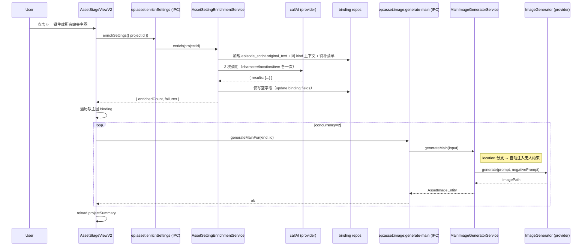

# 剧集制作 · 资产缩略图修复 + AI 设定反推 + 地点无人约束 设计

- **日期**：2026-05-07
- **作者**：daoge（与 Claude 协作）
- **范围**：episode-production / ② 资产盘点 stage
- **关联代码**：`src/core/modules/episode-production/assets/`、`src/renderer/src/components/episode-production/stage-asset*/`、`src/renderer/src/api/main-image-generator.ts`

---

## 1. 背景与问题

② 资产盘点 stage 当前存在三个用户体验缺陷：

1. **缩略图被裁切**：`asset-card-v2.scss` 把 `.thumb-image` 写成 `object-fit: cover`，又把 `.card-thumb` 钉死在 130px 高，导致竖图角色（全身像）头/脚被裁，看不到完整人物。横图地点、方图物品也存在同类问题。

2. **"一键生成主图"质量低、且会失败**：`main-image-generator.ts::buildPromptFromEffective` 直接拿 binding 的 effective 字段拼 prompt，如果用户没在设定卡填外貌/服装/描述等字段，要么抛"请先填名称或描述"硬错，要么生成 prompt 极简、出图质量极差。① 内容识别阶段已经把角色/地点/物品的名字识别出来了，但**没人帮用户把"应该长什么样"补出来** —— 用户被迫一个个手填几十个字段才能用"一键生成"。

3. **地点图里出现人物**：`location-constraints.ts` 当前只有"角度变体光照锁"约束，对"地点不应有人"零防御。`MainImageGeneratorService` / `GalleryDerivationService` / `PanoramaGeneratorService` 在 location 分支也都没注入"无人"硬约束 —— 导致 AI 频繁在街道、房间、广场图里塞路人。用户业务上**强制要求地点图必须无人**。

---

## 2. 目标

- 修缩略图裁切，所有资产卡完整可见。
- 让"一键生成"真的"一键"：用户从 ① 拿到 binding 列表 → 直接点 ② 的"一键生成所有缺失主图"，AI 同时充当"角色 / 场景 / 道具设计师"先把缺失的设定卡字段补齐落库，再调原有主图生成流程。
- location 域所有图（主图 + 派生 + 全景）强制无人。

---

## 3. 整体设计

### 3.1 概念定位

> "AI 设定反推"不是"信息抽取器"。它是 **AI 角色 / 场景 / 道具设计师**：
> - 原文已有的细节必须忠实遵循（"老者" → 不能反推为青年）。
> - 原文未明说但生成图必需的字段（外貌、服装、年龄精度、人种、风格等），允许 AI 基于原文整体氛围 + 同项目已有同类资产**合理设计**，目标是产出**和谐自洽、不与原文矛盾**的方案。
> - 没有充分线索的字段允许保持空缺，不强行编造。

### 3.2 触发与流程

仍然挂在 `AssetStageViewV2 → ✨ 一键生成所有缺失主图（N）` 按钮，扩展为两阶段流水线：

```
点击"一键生成所有缺失主图（N）"
    ▼
[Stage 1] 设定反推（AssetSettingEnrichmentService）
    输入  ：episode_script.original_text
            + 同项目已有同 kind binding 的已填字段（上下文）
            + 待补 binding 的 (id, name, alias) 清单
    分组  ：character / location / item 各发 1 次 AI 调用
    输出  ：每个 binding 的 { 字段名 → 值, _evidence: 设计依据 }
    落库  ：仅写入空字段（用户已填的不覆盖），写到对应 *_binding 表的
            standalone_*/override_*/role/gender/age/race/appearance/outfit/
            styleAnchors/outfitsExtra 等列
    错误  ：三次调用各自独立 try/catch；任意一次失败仅记录 + 跳过该 kind 的落库，
            不影响其他 kind；本批整体抛错的唯一情形是"未配置 AI provider"。
    审计  ：AI 给出的"设计依据"原句不入主表，仅 console.info + 写到
            progress/asset-enrichment-<runId>.log（人查问题用）
    ▼
[Stage 2] 主图批量生成（沿用现有 generateMainFor）
    遍历同样的 binding 集合 → buildPromptFromEffective 这次能拿到补齐后的字段
    并发 = 2，单条失败不阻塞其余
    （注：stage 1 失败那一类的 binding 因 prompt 仍空可能在此再次失败 ——
      可接受降级，UI 在末尾汇总"成功 X / 失败 Y"提示用户去手填后重试）
    ▼
reload projectSummary → 卡片刷新主图 + 状态
```

**用户体验语义**：用户不会看到"反推预览"对话框，反推是隐式的、自动的；他事后在每个资产编辑抽屉里能直接看到 AI 设计的字段并自由修改。

### 3.3 反推字段范围

| Kind | 反推字段（仅当当前为空时写入） |
|---|---|
| character | description / appearance / outfit / role / gender / age / race / styleAnchors（数组）/ outfitsExtra（数组） |
| location | description |
| item | description |

`character` 字段较多是因为图像生成对其依赖最强；`location/item` 描述性字段一个就够，再多反而约束 AI 风格。

### 3.4 AI 调用契约

**system prompt**（核心）：

```
你是这部剧的 {kind} 设计师。已经有一份原文片段，以及一些待设计的 {kind} 名字清单。
请为每个 {kind} 推断出生成图所需的字段。

强制规则：
1. 原文里明确提到的细节必须忠实遵循，不能改写或反对。
2. 原文未明说但生成图必需的字段（外貌、服装、年龄、人种、风格等），
   请基于原文整体氛围和已有同类资产设计一个和谐、自洽、不与原文矛盾的方案。
3. 你判断某字段没有充分线索且无合理设计依据时，可以输出 null 或空字符串，
   切勿编造完全脱离原文的细节。
4. 输出严格 JSON，结构与示例一致。
5. 同项目已有的同类资产代表了"已经定下来的世界观"，新设计必须与之相容。
```

**user prompt 结构**：

```json
{
  "originalText": "<episode_script.original_text>",
  "existingContext": [
    { "name": "少年", "fields": { "age": 16, "race": "east_asian", "appearance": "..." } },
    ...
  ],
  "todo": [
    { "id": "<bindingId>", "name": "老者", "alias": null },
    ...
  ],
  "schemaHint": { "字段说明... 对应 3.3 表" }
}
```

**AI 返回结构**：

```json
{
  "results": [
    {
      "id": "<bindingId>",
      "fields": {
        "description": "...",
        "appearance": "...",
        "age": 60,
        "...": "..."
      },
      "_evidence": {
        "appearance": "原文片段：'身着粗布麻衫'",
        "age": "设计：与'老者'称谓一致"
      }
    }
  ]
}
```

JSON 解析失败 → fallback 到 `extractJsonFromResponse`（沿用 narrative/ai/_helpers）；仍失败时该 kind 视为反推失败（见 3.2 错误处理）。整批 stage 1 唯一会让"一键生成"中止的情形是"未配置 AI provider"——其它情况都进 stage 2，由 stage 2 决定单条 binding 是否能出图。

### 3.5 落库规则

- **只填空**：读 binding 当前值，仅当 `value === null || value === ''` 时写入；非空字段一律不动。
- **数组字段**（styleAnchors / outfitsExtra）：当前为 null/空数组才覆盖。
- **age**：当前为 null 才写。
- **写入路径**：通过 typeorm Repository 直接 `update`（保留 `updatedAt` 维护），遵守"DB 必经 Repository"原则；不直接 raw SQL。
- **多用户**：走 BaseRepository 的 user_id 注入，service 接收 userId 参数（与现有 service 一致）。

### 3.6 location 全域无人约束

新增 `assets/prompts/location-constraints.ts` 导出：

```ts
export const LOCATION_NO_HUMAN_SUFFIX =
  '场景中不能有任何人物，仅环境本身（no people, empty scene, environment only, uninhabited landscape, no characters present）'

export const LOCATION_NO_HUMAN_NEGATIVE = [
  'person','people','human','character','figure','portrait','crowd',
  'silhouette','body','man','woman','child','pedestrian',
].join(', ')

export function appendLocationNoHumanConstraint(prompt: string): string { ... }
export function mergeLocationNoHumanNegative(userNegative?: string | null): string { ... }
```

**注入收口**：约束追加由 service 层主动负责，renderer 业务 prompt 不再分散管：

| Service | 注入位置 |
|---|---|
| `MainImageGeneratorService.generateMain` | 检测 `assetType === 'location'` → 自动 append + merge |
| `GalleryDerivationService.deriveSingle` | 同上（兼容已有的 angle 光照锁，与无人约束并存） |
| `PanoramaGeneratorService` | 同上 |
| `main-image-generator.ts (renderer)::buildPromptFromEffective` | location 分支不再特殊处理，约束让 service 加 |

收口的好处：未来增加新的 location 派生途径不会忘加约束。

### 3.7 缩略图修复

`asset-card-v2.scss`：

```diff
.thumb-image {
  position: absolute;
  inset: 0;
  width: 100%;
  height: 100%;
- object-fit: cover;
+ object-fit: contain;
  display: block;
}
```

V1 同步修：`stage-asset/CharacterAssetCard.vue` / `LocationAssetCard.vue` / `ItemAssetCard.vue` 中 `.asset-card .thumb img` 的 `object-fit: cover` → `contain`。

容器高度 130px 不变，留白用现有渐变背景填底，character/location/item 的色调差异保留。

---

## 4. 文件改动清单

| 域 | 文件 | 动作 |
|---|---|---|
| UI | `src/renderer/src/components/episode-production/stage-asset-v2/asset-card-v2.scss` | `cover` → `contain` |
| UI | `src/renderer/src/components/episode-production/stage-asset/CharacterAssetCard.vue` | 同步修 |
| UI | `src/renderer/src/components/episode-production/stage-asset/LocationAssetCard.vue` | 同步修 |
| UI | `src/renderer/src/components/episode-production/stage-asset/ItemAssetCard.vue` | 同步修 |
| AI prompt | `src/core/modules/episode-production/assets/prompts/setting-enrichment-prompt.ts` | 新建（system + user prompt 模板 + JSON schema 定义） |
| 设计 service | `src/core/modules/episode-production/assets/services/asset-setting-enrichment.service.ts` | 新建 |
| 约束 | `src/core/modules/episode-production/assets/prompts/location-constraints.ts` | 加无人约束导出 |
| 主图 service | `src/core/modules/episode-production/assets/services/main-image-generator.service.ts` | location 分支自动注入无人约束 |
| 派生 service | `src/core/modules/episode-production/assets/services/gallery-derivation.service.ts` | location 域自动注入无人约束 |
| 全景 service | `src/core/modules/episode-production/assets/services/panorama-generator.service.ts` | location 域自动注入无人约束 |
| IPC | `src/main/ipc/handlers/episode-production/asset-handlers.ts`（或现有同等文件） | 新增 `ep:asset:enrichSettings` channel |
| IPC channel 常量 | `src/shared/types/ipc.types.ts` | 加 channel 名 |
| renderer api | `src/renderer/src/api/asset-setting-enrichment.ts` | 新建（包装 IPC 调用） |
| renderer api | `src/renderer/src/api/main-image-generator.ts` | location 分支删掉 negative 拼接（让 service 加） |
| renderer 流程 | `src/renderer/src/components/episode-production/stage-asset-v2/AssetStageViewV2.vue` | `onGenerateAllMissing` 改为"先 enrichment IPC → 再 generateMainFor 批量" |
| 测试 | `src/core/modules/episode-production/assets/services/__tests__/asset-setting-enrichment.service.spec.ts` | TDD |
| 测试 | `src/core/modules/episode-production/assets/prompts/__tests__/location-constraints.spec.ts` | 加无人约束单元测试 |
| 测试 | `src/core/modules/episode-production/assets/services/__tests__/main-image-generator.location-no-human.spec.ts` | 验证 location 走主图时 prompt + negative 自动注入 |

---

## 5. 数据流（mermaid）



---

## 6. 测试策略（TDD）

### 6.1 单元测试

- `asset-setting-enrichment.service.spec.ts`
  - mock `callAI` 返回固定 JSON → 验证 落库只写空字段、已填字段不动
  - mock 返回缺字段 → 验证 partial 落库不抛
  - mock 返回非 JSON → 验证抛 Error 且不写库
  - 验证三次调用按 kind 分组
- `location-constraints.spec.ts`
  - `appendLocationNoHumanConstraint` 已含约束的字符串幂等
  - `mergeLocationNoHumanNegative` 用户 negative 与无人 negative 拼接顺序正确
- `main-image-generator.location-no-human.spec.ts`
  - 调 `generateMain({ assetType:'location', prompt:'古风茶馆' })` → 验证下游 imageGen.generate 收到的 prompt 含无人约束、negative 含人物词
  - `assetType:'character'` 不注入

### 6.2 手测

- 启动本地 dev（test@local.dev / the_bot_test），① 生成一份内容识别 → 进 ②
  - 检查所有缺主图 binding 卡片缩略图占位完整、有图后图整体可见（重点：竖图角色头不被裁）
- 点"✨ 一键生成所有缺失主图"
  - 观察 console / progress 日志：3 次 enrichment AI 调用、binding 字段被填充
  - 等待主图生成完毕，刷新后地点图**确实无人**
- 暗主题切换：缩略图留白底色仍走 `var(--el-color-*-light-*)`，无写死颜色
- 在编辑抽屉打开 AI 反推过的资产，确认字段值符合预期、可手动改

---

## 7. 风险与权衡

| 风险 | 缓解 |
|---|---|
| AI 编造与原文矛盾的细节 | system prompt 明确"忠实优先 + 允许空缺"；evidence 字段事后可查 |
| AI 调用慢/失败导致用户等待 | 三次调用（按 kind 分组）已是最少，UI 显示 loading；任意 kind 失败可让用户重试，不阻塞已成功的 kind 落库 |
| 已填字段被错误覆盖 | 落库前判空，单测 case 1 强校验 |
| location 无人约束误伤"应该有人"的特殊场景 | 当前业务规则就是"强制无人"；如果未来需要 override，再加 `allowPeople` binding 字段（YAGNI 不在本 spec） |
| `object-fit: contain` 导致缩略图视觉信息密度下降 | 实测后如视觉差，可在 follow-up 加点击放大；本 spec 不引入额外交互 |
| 多用户隔离 | enrichment service 走 typeorm Repository + BaseRepository userId 注入，与现有 service 一致 |

---

## 8. 不在本 spec 范围内（YAGNI）

- 反推预览对话框 / 用户审阅再确认（用户明确选 a 选项）
- 单 kind / 单 binding 的"重新反推"按钮（先看有没有真实需求）
- `allowPeople` 等 location 例外字段
- character 卡片 9:16 比例容器 / 不同 kind 不同高度
- 反推日志的 UI 浏览器（先用文件 + console，问题真出现再做）

---

## 9. DoD（提交前自查）

- [x] 所有新建/改动测试本地通过：`location-constraints` (6) / `main-image-generator.location-no-human` (4) / `gallery-derivation.location-no-human` (4) / `panorama-generator.location-no-human` (1) / `setting-enrichment-prompt` (4) / `asset-setting-enrichment.service` (4) / `asset-setting-enrichment` renderer (3)
- [x] 全量回归：`SKIP_PG_TESTS=1 npm run test:unit` — **91 文件 / 678 用例 PASS（1 skipped）**
- [ ] PC 端 dev 跑 ② 一键生成路径 → 缩略图、反推、无人约束三件事都肉眼验过 — **留 user 手测**
- [x] 文档：本 spec DoD 勾选；plan + spec 已 commit；service 内联 jsdoc 已写
- [x] commits（实施过程）：T1 `cc4ec9b` / T2 `670c2ee`+`96a926c` / T3 `b1b66bd`+`e4e9d8f` / T4 `e31b1b7`+`006d4b6`+`83a523a` / T5 `d458795` / T6 `39de966` / T7 `adb0f8b` / T8 `9ee6092` / T9 `84fc203` / T10 `f8e29ee`
