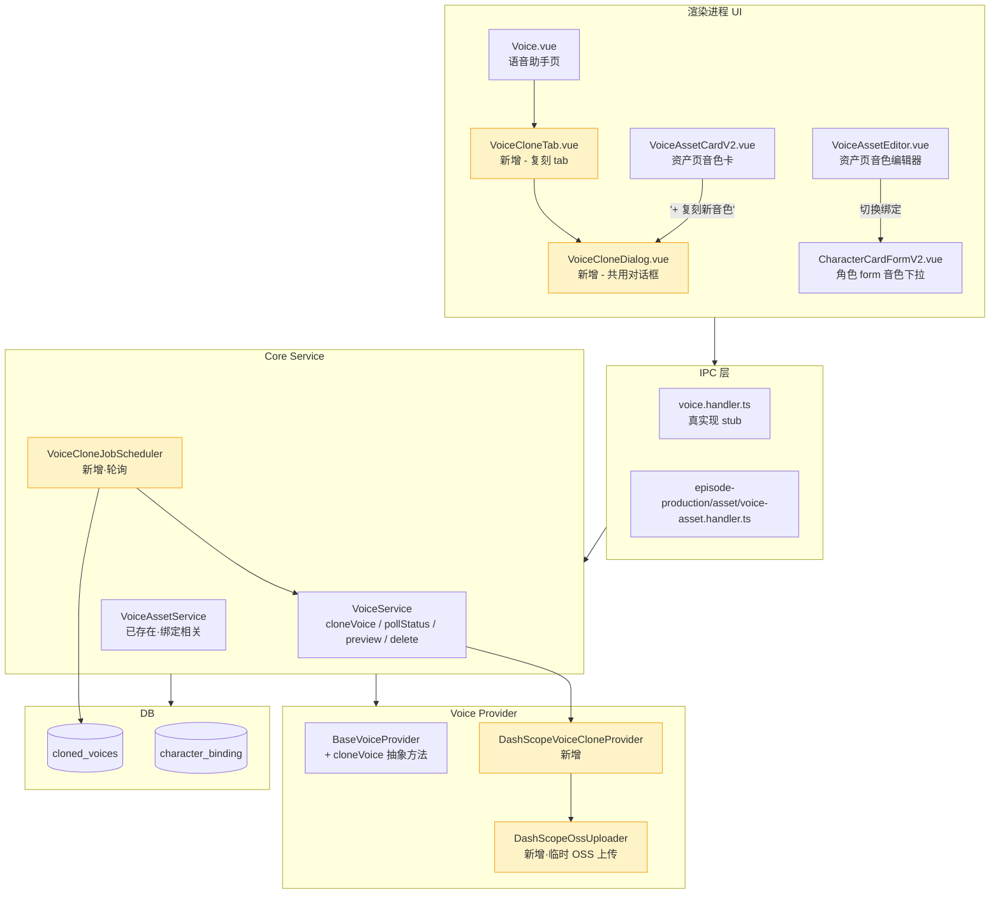
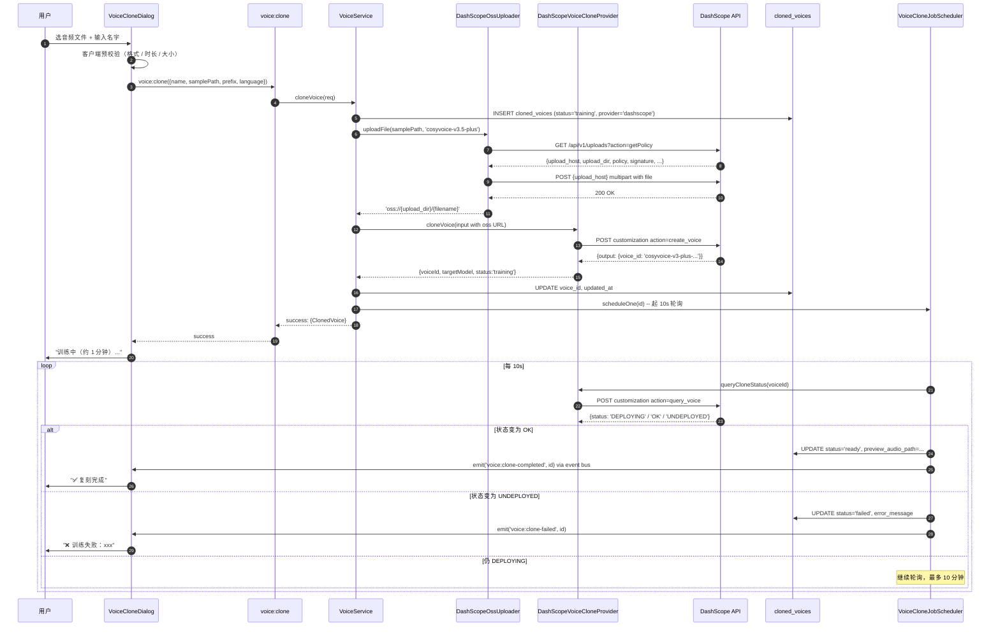
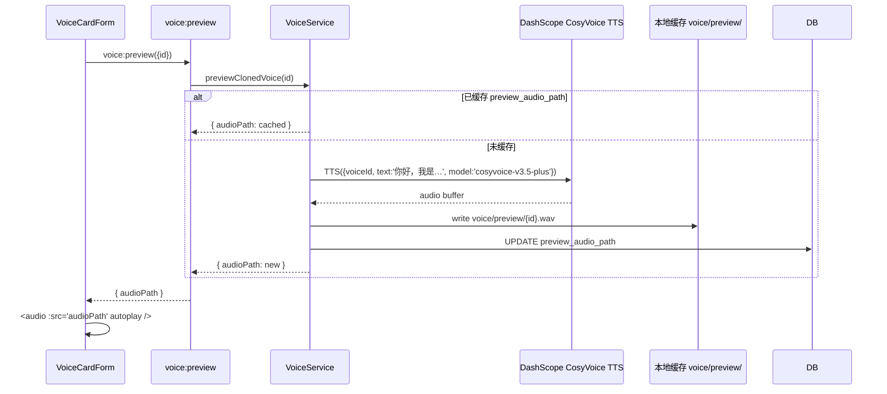
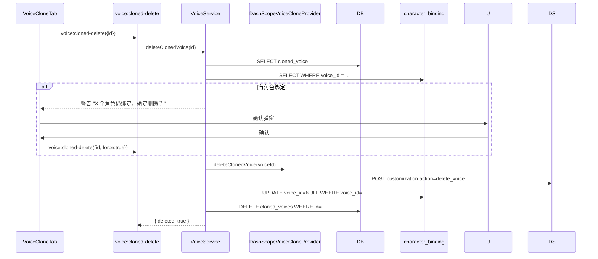
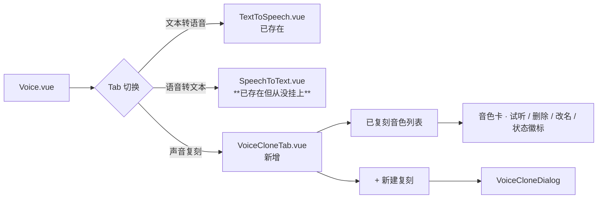

# 语音助手 · 声音复刻 端到端实现设计

- **日期**：2026-05-07
- **作者**：daoge（与 Claude 协作）
- **范围**：语音助手模块 + 剧集制作 ② 资产盘点 voice 区
- **关联代码**：
  - `src/core/services/voice.service.ts`
  - `src/core/voice-providers/`
  - `src/electron/ipc/handlers/voice.handler.ts`
  - `src/renderer/src/views/Voice.vue`
  - `src/renderer/src/components/voice/`
  - `src/renderer/src/components/episode-production/stage-asset-v2/VoiceAssetCardV2.vue`
  - `src/renderer/src/components/episode-production/stage-asset/voice/`

---

## 1. 背景与问题

### 1.1 现状摸底（2026-05-07 调研结论）

代码层 **声明实现 = 实际未实现**：

| 组件 | 声明 | 实际 |
|---|---|---|
| `voice.service.ts` JSDoc | "处理…语音复刻等核心功能" | service 里**没有 clone 方法**，只有未被调用的 `getCloneDir()` |
| `voice:clone` IPC | 注册为 handler | `return { success: false, error: '语音复刻功能暂未实现' }` |
| `voice:cloned-list` IPC | 注册为 handler | 直接 `return { success: true, data: [] }`，根本不查表 |
| `voice:cloned-delete` IPC | 注册为 handler | `return { success: false, error: '功能暂未实现' }` |
| `BaseVoiceProvider` 抽象类 | TTS provider 基类 | **没有 clone 抽象方法** |
| `Voice.vue` 主区 | "语音助手"页 | **只挂了 TextToSpeech**，连 SpeechToText 都没挂上 tab |
| `voice:preview` IPC | （根本没注册）| `VoiceCardForm.onPreview` 走 `electronAPI?.voice?.preview` 但该方法不存在 |

数据表已就位：`cloned_voices` 表 + `ClonedVoiceEntity` + `ClonedVoiceRepository` 完整。**因为复刻 IPC 是 stub，表永远是空的**。

### 1.2 假指引污染

代码 6 处 toast 写"请去 语音助手 → 声音复刻"，但点过去那里没东西：
- `composables/use-workbench-stage-navigation.ts:148`
- `stage-asset/AssetStageView.vue:253`
- `stage-asset-v2/AssetStageViewV2.vue:561` + 注释 502 行
- 以及若干 README 和注释

### 1.3 业务需求

剧集制作场景下，每个角色需要绑定一个音色（`character_binding.voice_id`）。系统音色（DashScope 内置 10 个）能覆盖 80% 场景，但用户希望：
- 自己录一段样本 → 复刻出"作者本人声音"或"用户指定 NPC 声音"
- 复刻音色和系统音色无差别地用在角色 → 台词渲染流程里

---

## 2. 调研结果（三家 provider）

### 2.1 对比表

| 维度 | **DashScope CosyVoice** | **火山引擎 豆包** | **MiniMax 快速复刻** |
|---|---|---|---|
| 服务名 | CosyVoice 声音复刻 | 大模型声音复刻（Mega TTS / ICL）| Voice Clone |
| 音频时长 | 10-20s（推荐 15s）| 5s 即可 | 10s ~ 5min |
| 音频格式 | WAV(16bit) / MP3 / M4A，单声道 | wav/mp3/ogg/m4a/aac/pcm | mp3 / m4a / wav |
| 上传方式 | 公网 URL（项目里走 dashscope OSS 临时桶）| base64 直接塞 payload | `/v1/files/upload` 拿 file_id |
| 单文件大小 | ≤ 10MB（OSS 凭证限制）| ≤ 10MB | ≤ 20MB |
| 协议 | REST POST + 异步轮询 | REST POST + 异步轮询 | REST POST，**同步返回** |
| 训练耗时 | 数十秒 ~ 数分钟 | 1-3 分钟 | 秒级 |
| 状态枚举 | `DEPLOYING` → `OK` / `UNDEPLOYED` | `Training`(1) → `Success`(2)/`Failed`(3) | 同步无状态机 |
| voice_id 来源 | 用户给 prefix(≤10) + 系统拼 | **必须先在控制台购买 speaker_id** ❌ | 用户完全自定义 |
| 复刻费用 | **完全免费** | ¥88/音色/年 + 模型存储 ¥12/月起 × 最低 12 月 = ~¥232/音色/年起 | ¥9.9/音色（首次合成时扣费）|
| TTS 单价 | ¥2/万字符 | 复合计费 | 按字符 |
| 数据保留 | 1 年未使用自动清理 | 长期（按购买周期）| **168h 未合成则删除** ⚠️ |
| 多语支持 | 中/英/日/韩/法/德/俄/葡/泰/印尼/越 | 中/英/日 | 中/英 |
| 项目已接入 | ✅ 已有 DashScope TTS/STT provider | ❌ 全新 | ❌ 全新 |

### 2.2 各家硬约束

- **DashScope**：必须公网 URL — 但 DashScope 自带临时 OSS 桶（`/api/v1/uploads`），300s 凭证 + 48h URL 有效期，**用户无感**。
- **火山引擎**：speaker_id 必须先去控制台手动购买槽位，**自动化不了**，破坏"app 内一气呵成"。
- **MiniMax**：168h 临时窗口，复刻完没合成就删 — 需在 app 侧加"自动激活"防护，工程复杂度上升。

### 2.3 决策：DashScope CosyVoice

三大理由：
1. **省一个 provider 的接入工**：apiKey 配置 + secureStorage 解密链路 + provider 工厂全复用
2. **零费用门槛**：复刻免费 → 用户测试不心疼，只在真合成时按 ¥2/万字符付费
3. **状态机和我们 cloned_voices.status 字段完美对齐**：DEPLOYING/OK/UNDEPLOYED ↔ training/ready/failed

唯一的工程点：本地音频 → 公网 URL，复刻 DashScope SDK 内部的"临时 OSS 上传"逻辑（`/api/v1/uploads?action=getPolicy` → POST 到 OSS → 拿 `oss://...` URL → 调 enrollment 时带 `X-DashScope-OssResourceResolve: enable` 头）。**用户无感**。

---

## 3. 三家 API 技术规格（落地参考）

### 3.1 DashScope CosyVoice 声音复刻

**Voice Enrollment API**

| 操作 | endpoint | action |
|---|---|---|
| 创建音色 | `POST https://dashscope.aliyuncs.com/api/v1/services/audio/tts/customization` | `create_voice` |
| 查询状态 | 同上 | `query_voice` |
| 列出音色 | 同上 | `list_voice` |
| 删除音色 | 同上 | `delete_voice` |

**Headers**:
- `Authorization: Bearer ${api_key}`
- `Content-Type: application/json`
- `X-DashScope-OssResourceResolve: enable`（用 oss:// URL 时必带）

**Create payload**:
```json
{
  "model": "voice-enrollment",
  "input": {
    "action": "create_voice",
    "target_model": "cosyvoice-v3.5-plus",
    "prefix": "myvoice",
    "url": "oss://dashscope-instant/.../sample.wav",
    "language_hints": ["zh"]
  }
}
```

**Status enum**: `DEPLOYING` / `OK` / `UNDEPLOYED`

**音频要求**:
- 时长 10-20s（推荐 15s）
- 采样率 ≥ 16kHz
- WAV (16-bit) 优于 MP3
- 单声道
- 语音占比 > 60%

**配额**: 单账号 1000 个音色；1 年未使用自动清理。

**计费**: 创建 / 查询 / 列出 / 删除全部免费；只在合成时按 ¥2/万字符。

### 3.2 临时文件上传（dashscope-oss）

| 步骤 | endpoint |
|---|---|
| 1. 获取上传凭证 | `GET https://dashscope.aliyuncs.com/api/v1/uploads?action=getPolicy&model={target_model}` |
| 2. 上传文件到 OSS | `POST {upload_host}` (multipart with policy/signature/key/file) |

**凭证响应字段**:
- `upload_host`: OSS endpoint
- `upload_dir`: OSS 目录前缀
- `oss_access_key_id`, `signature`, `policy`: 上传凭证
- `x_oss_object_acl`, `x_oss_forbid_overwrite`: OSS 标记

**multipart 字段**（按 OSS PostObject 协议）:
- `OSSAccessKeyId`
- `Signature`
- `policy`
- `x-oss-object-acl`: `private`
- `x-oss-forbid-overwrite`: `true`
- `key`: `{upload_dir}/{filename}`
- `success_action_status`: `200`
- `file`: 二进制文件

**上传成功后 URL**: `oss://{upload_dir}/{filename}`

**有效期**: 凭证 300s；URL 48h。

**QPS**: 100，单账号 + 模型维度。

### 3.3 火山引擎（备选 — 不选）

仅作未来切换备份记录。

`POST https://openspeech.bytedance.com/api/v1/mega_tts/audio/upload` + `POST .../api/v1/mega_tts/status` + V3 双向流式 TTS。模型版本 model_type 0-5（推荐 ICL V3 = 5）。speaker_id 必须先在控制台购买。

### 3.4 MiniMax（备选 — 不选）

仅作未来切换备份记录。

`POST https://api.minimax.io/v1/files/upload`（multipart, purpose=voice_clone）拿 file_id → `POST https://api.minimax.io/v1/voice_clone`（JSON）传 file_id + 用户自定义 voice_id。168h 内必须合成一次否则删除。

---

## 4. 整体架构

### 4.1 模块边界



### 4.2 设计原则

1. **BaseVoiceProvider 加 cloneVoice 抽象方法**，不为 DashScope 单独搞特例
2. **DashScopeOssUploader 作为独立 service**，未来其他 DashScope 多模态接入也能复用（image / file / video）
3. **VoiceCloneJobScheduler 独立**，不嵌在 VoiceService 里 — 可单独单测
4. **VoiceCloneDialog 作为共用组件**，Voice.vue tab 和资产页 + 按钮指向同一个对话框
5. **资产页 voice 区跟语音助手页 voice 列表共享一个 IPC 数据源**（`voice:cloned-list` 和 `episodeProduction.asset.voice.list*` 都从 `cloned_voices` 表读，做"哪些被本剧集角色绑了"的反向投影由 `VoiceAssetService` 负责）

---

## 5. 接口契约（自顶向下）

### 5.1 BaseVoiceProvider 扩展

```ts
// src/core/voice-providers/base-voice-provider.ts

export interface VoiceCloneInput {
  /** 用户给的音色名（用于内部展示，非 voice_id 主键）*/
  name: string
  /** 本地音频文件路径（绝对路径，已校验存在）*/
  samplePath: string
  /** 音频长度（秒），用于客户端预校验 */
  sampleDurationSec: number
  /** 用户给的 prefix（≤10 字符；仅字母数字），DashScope 用作 voice_id 前缀 */
  prefix: string
  /** 语种 hint，影响特征提取 */
  language?: VoiceLanguageCode
}

export interface VoiceCloneCreateResult {
  /** provider 端真实 voice_id（如 'cosyvoice-v3-plus-myvoice-xxxxxxxx'）*/
  voiceId: string
  /** provider 端目标 TTS 模型，TTS 调用必须用同一个 */
  targetModel: string
  /** 当前状态（创建后第一次返回常常是 'training'）*/
  status: ClonedVoiceStatus
}

export interface VoiceCloneStatus {
  status: ClonedVoiceStatus
  /** 试听音频（可选；OK 状态时 provider 给一个）*/
  previewAudioUrl?: string
  /** 失败原因（仅 failed 状态有）*/
  errorMessage?: string
}

export abstract class BaseVoiceProvider {
  // … 已有方法
  /** 创建音色 — 返回 voice_id，状态可能仍在 training */
  abstract cloneVoice(input: VoiceCloneInput): Promise<VoiceCloneCreateResult>
  /** 查询音色训练状态 */
  abstract queryCloneStatus(voiceId: string): Promise<VoiceCloneStatus>
  /** 删除音色 */
  abstract deleteClonedVoice(voiceId: string): Promise<void>
  /** （可选）provider 是否原生支持复刻 */
  supportsCloning(): boolean { return false }
}
```

DashScopeTTSProvider 不实现 cloneVoice（保持纯 TTS 角色）。**新增 `DashScopeVoiceCloneProvider`**（也继承 BaseVoiceProvider），其 `synthesize` 直接抛 NotImplementedError — 复刻和合成是不同 endpoint，做两个 provider 更清晰。

### 5.2 DashScopeOssUploader（新模块）

```ts
// src/core/voice-providers/dashscope-oss-uploader.ts

export class DashScopeOssUploader {
  constructor(private apiKey: string) {}

  /**
   * 上传本地文件到 DashScope 临时 OSS 桶。
   * 返回 oss:// URL（48h 有效）。
   *
   * @param filePath  本地绝对路径
   * @param model     目标模型（决定凭证作用域），如 'cosyvoice-v3.5-plus'
   * @returns         oss://{upload_dir}/{filename}
   */
  async uploadFile(filePath: string, model: string): Promise<string>
}
```

实现两步：(1) `GET /api/v1/uploads?action=getPolicy&model=...` 拿凭证；(2) 用凭证 `POST` multipart 到 `upload_host`；(3) 组装 `oss://{upload_dir}/{filename}`。

### 5.3 DashScopeVoiceCloneProvider

```ts
// src/core/voice-providers/dashscope-voice-clone-provider.ts

export class DashScopeVoiceCloneProvider {
  static readonly DEFAULT_TARGET_MODEL = 'cosyvoice-v3.5-plus'
  static readonly ENROLLMENT_URL = 'https://dashscope.aliyuncs.com/api/v1/services/audio/tts/customization'

  constructor(
    private apiKey: string,
    private uploader: DashScopeOssUploader,
    private targetModel: string = DashScopeVoiceCloneProvider.DEFAULT_TARGET_MODEL,
  ) {}

  async cloneVoice(input: VoiceCloneInput): Promise<VoiceCloneCreateResult>
  async queryCloneStatus(voiceId: string): Promise<VoiceCloneStatus>
  async deleteClonedVoice(voiceId: string): Promise<void>
}
```

`cloneVoice` 流程：
1. 调用 `uploader.uploadFile(input.samplePath, this.targetModel)` 拿 oss URL
2. POST enrollment endpoint（带 `X-DashScope-OssResourceResolve: enable`），action=create_voice
3. 解析返回，返回 `{ voiceId, targetModel, status: 'training' }`

`queryCloneStatus` 把 DashScope 的 `DEPLOYING/OK/UNDEPLOYED` 映射回 `training/ready/failed`。

### 5.4 VoiceService 新增方法

```ts
// src/core/services/voice.service.ts

/** 创建复刻任务：上传 → 创建 enrollment → 入库 cloned_voices(status='training') */
static async cloneVoice(req: VoiceCloneCreateRequest): Promise<IpcResponse<ClonedVoice>>

/** 查询某个复刻音色的最新状态（同步调一次 provider 并刷新 DB）*/
static async refreshClonedVoiceStatus(id: string): Promise<IpcResponse<ClonedVoice>>

/** 试听复刻音色 — 用 voice_id 走 CosyVoice TTS 跑一段 demo 文本，返回 audioPath */
static async previewClonedVoice(id: string, text?: string): Promise<IpcResponse<{ audioPath: string }>>

/** 列出所有复刻音色（按 status 过滤可选）*/
static async listClonedVoices(status?: ClonedVoiceStatus): Promise<IpcResponse<ClonedVoice[]>>

/** 删除复刻音色 — 同步调 provider 删除 + DB 清理 + 解绑相关角色 */
static async deleteClonedVoice(id: string): Promise<IpcResponse<{ deleted: boolean }>>
```

### 5.5 VoiceCloneJobScheduler

```ts
// src/core/services/voice-clone-job-scheduler.ts

/**
 * 后台轮询：扫 cloned_voices WHERE status='training'，每条调 provider 查状态。
 * - 启动时：boot 后自动起一次扫描（捕获上次开机训练中的）
 * - 创建时：立即起一个 10s 轮询，直到终态（最多轮询 10 分钟，超时标记 failed）
 * - 间隔：10s（DEPLOYING 多数 30-60s 完成）
 *
 * 双端透明：PC 走主进程定时器；Web 走 Node 定时器（同一份代码）。
 */
export class VoiceCloneJobScheduler {
  start(): void  // 注册到 boot 流程
  scheduleOne(id: string): void  // 创建后立即起单条任务
  stop(): void   // 测试用
}
```

### 5.6 IPC 真实现（voice.handler.ts）

| Channel | 入参 | 出参 | 实现 |
|---|---|---|---|
| `voice:clone` | `VoiceCloneCreateRequest` | `ClonedVoice` | 调 `VoiceService.cloneVoice` |
| `voice:cloned-list` | `{ status?: ClonedVoiceStatus }` | `ClonedVoice[]` | 调 `VoiceService.listClonedVoices`，**不再返空** |
| `voice:cloned-delete` | `{ id: string }` | `{ deleted: boolean }` | 调 `VoiceService.deleteClonedVoice`，**不再 stub** |
| `voice:clone-refresh-status` | `{ id: string }` | `ClonedVoice` | 新增 — UI 立即刷新某条状态 |
| `voice:preview` | `{ id: string, text?: string }` | `{ audioPath: string }` | 新增 — 试听 |

### 5.7 episodeProduction.asset.voice.* 沿用

`VoiceAssetService` 不变，但 `previewClonedVoice` IPC 共用同一个底层。`VoiceCardForm.onPreview` 改调真实 IPC。

---

## 6. 数据模型

`cloned_voices` 表无需变更。字段映射：

| DB 字段 | 含义 | 触发更新 |
|---|---|---|
| `id` | 主键（randomUUID）| 创建时 |
| `name` | 用户起的展示名 | 创建时 |
| `status` | training/ready/failed | 创建后立即 = training；轮询命中 OK → ready；UNDEPLOYED 或超时 → failed |
| `sample_audio_path` | 本地样本相对路径（toRelativeAssetPath）| 创建时 |
| `sample_duration` | 样本秒数 | 创建时（前端预解析）|
| `voice_id` | DashScope 返回的真 voice_id | 创建后立即写入（即使还在 training）|
| `preview_audio_path` | 试听音频缓存路径（本地）| 第一次试听后缓存 |
| `provider_id` | `dashscope` | 创建时 |
| `error_message` | 失败原因 | failed 时 |
| `created_at` / `updated_at` | ISO 时间 | 创建/更新时 |

---

## 7. 数据流（关键场景）

### 7.1 创建复刻音色



### 7.2 试听



### 7.3 删除（含解绑）



---

## 8. UI 设计

### 8.1 Voice.vue 改造（语音助手页）

新增二级 tab 切换主区：



`VoiceSidebar` 保留为 TTS/STT 历史侧栏，复刻 tab 切换时隐藏侧栏（或用空状态占位）。

### 8.2 VoiceCloneDialog（共用核心组件）

```
┌─────────────────────────────────────────┐
│ 复刻音色                          [×]  │
├─────────────────────────────────────────┤
│  音色名称  *                            │
│  [_________________________________]    │
│                                         │
│  音色 prefix（≤10 字母数字）  *          │
│  [_____________]                        │
│                                         │
│  样本音频  *                            │
│  ┌───────────────────────────────────┐ │
│  │ 拖拽 / 点击选择                    │ │
│  │ WAV/MP3/M4A · 10-20s · ≤10MB     │ │
│  │ 单声道 · ≥16kHz                    │ │
│  └───────────────────────────────────┘ │
│  ✅ recording.wav · 14.5s · 1.2MB      │
│                                         │
│  语种 hint                              │
│  [中文 ▾]                               │
│                                         │
│  💡 系统将自动追加：直立全身、纯色背景   │
│  ─────                                 │
│  样本要求：清晰人声、无背景音、语速稳定  │
├─────────────────────────────────────────┤
│              [取消]  [开始复刻]         │
└─────────────────────────────────────────┘

提交后切到状态视图：
┌─────────────────────────────────────────┐
│ 复刻进行中…                     [×]    │
├─────────────────────────────────────────┤
│  ⏳ 训练中（已耗时 0:42）               │
│  Voice ID: cosyvoice-v3-plus-myvoice-x  │
│  [关闭] — 后台继续，完成后通知您        │
└─────────────────────────────────────────┘

完成：
┌─────────────────────────────────────────┐
│ ✅ 复刻完成                     [×]     │
│  [▶ 试听]  [完成]                      │
└─────────────────────────────────────────┘
```

### 8.3 资产页改造

`VoiceAssetCardV2` 卡上 `[设定]` 按钮 → 打开 VoiceAssetEditor（现有）。VoiceAssetEditor 增强：
- 「绑定的角色」section 增加 `+ 添加绑定` / 每条 `[解绑]` 按钮
- 调 `episodeProduction.asset.voice.bindToCharacter(charBindingId, voiceId)` 双向操作

资产页 `[+ 复刻新音色]` 按钮 → 直接打开 `VoiceCloneDialog`（**不再 toast 跳走**），完成后 `summary.voices` 自动 reload。

### 8.4 角色页 voice 下拉

`CharacterCardFormV2` 第④节"声音"下拉项 — 不变，但底层数据源会自然包含新复刻的 ready 音色（`api.voice.listReady` 已经查 cloned_voices.status='ready'）。增加视觉区分：复刻音色显示 🎤 图标 + "复刻" 标签。

### 8.5 假指引清理

替换 6 处 `ElMessage.info('请去 语音助手 → 声音复刻…')`：
- 4 处资产页/工作台 → 直接打开 `VoiceCloneDialog`
- 2 处注释/README → 改为引用本设计文档

---

## 9. 错误处理与边界

| 场景 | 行为 |
|---|---|
| 用户音频时长 < 10s 或 > 20s | 客户端预校验拦截，明确文案 |
| 音频不是单声道 | 客户端用 Web Audio API 检测，提示用户重选 |
| 上传 OSS 失败（网络 / 配额）| 整条 cloneVoice 抛错，cloned_voices 不入表 |
| Enrollment 创建失败 | 回滚 DB 行（DELETE）+ 抛错 |
| 轮询超时 10 分钟 | 标记 failed，error_message='训练超时' |
| Provider 端删除失败但 DB 删了 | 不致命，记录到 progress/voice-clone-orphan-{id}.log，下次启动 reconcile |
| 同 prefix 重复 | DashScope 返回 409 → 客户端可读错文案 "该 prefix 已被占用" |
| 删除时仍有角色绑定 | 二次确认 + 自动解绑 |
| API key 没配置 | 复刻按钮 disable，hover tooltip "请先在设置中配置 DashScope API Key" |

---

## 10. 测试策略

| 层 | 测试对象 | 覆盖点 |
|---|---|---|
| Unit (vitest) | `DashScopeOssUploader` | mock fetch，验证 getPolicy + multipart 拼装 + URL 组装 |
| Unit | `DashScopeVoiceCloneProvider` | mock fetch，create/query/delete 三个动作的 payload + 状态映射 |
| Unit | `VoiceService.cloneVoice` | mock provider + uploader，验证 DB 落库时序 + 失败回滚 |
| Unit | `VoiceCloneJobScheduler` | fake timer 测轮询周期、终态停止、超时降级 |
| Integration | voice.handler IPC 三个真实现 | 调起来 → DB 真写 → mock provider 返回 → 验证响应 shape |
| E2E (smoke) | Voice.vue → 上传 sample → 等 ready → 试听 | 用 mock provider，跑通 UI 主路径 |

复刻无幂等保证（同样的 prefix 第二次会 409），所以测试时每条都用 random prefix。

---

## 11. 风险与回滚

**主要风险**:

1. **DashScope API 限流（100 QPS getPolicy）** — 单用户场景几乎不可能触发；万一触发，scheduler 会用指数退避
2. **轮询期间用户关 app** — 重开后 boot 钩子 `VoiceCloneJobScheduler.start()` 自动接续
3. **CosyVoice TTS 模型切换** — 当前项目 TTS 用 qwen3-tts-flash，复刻音色必须用 cosyvoice-v3.5-plus 合成。需要在 TTS provider 路由层做判断：检测到 voiceId 是 cloned → 走 CosyVoice provider；否则走 qwen-tts。这是后续 P5 渲染域的工作（本设计文档不实现 TTS 路由，只确保复刻 voice_id 能存对、试听走 CosyVoice）
4. **OSS URL 48h 过期** — enrollment 一旦创建成功，DashScope 服务端已经把样本提取成模型，不再依赖原 URL，所以过期无影响

**回滚**:
- IPC 三个 stub 是从 stub → 真实现，回滚直接 `git revert`
- 数据库无 schema 变更，无须迁移
- 已落库的 cloned_voices 行不会因回滚消失，只是新建不可用而已

---

## 12. 实施任务清单

按 task 拆分（顺序对应依赖关系）：

| # | Task | 依赖 |
|---|---|---|
| T1 | 扩展 `BaseVoiceProvider` 抽象类，加 cloneVoice / queryCloneStatus / deleteClonedVoice 抽象方法 + 类型定义到 voice.types.ts | — |
| T2 | 实现 `DashScopeOssUploader`（独立模块）+ 单测 | T1 |
| T3 | 实现 `DashScopeVoiceCloneProvider` + 单测（mock uploader + fetch）| T1, T2 |
| T4 | `VoiceService` 加 cloneVoice / refreshClonedVoiceStatus / previewClonedVoice / listClonedVoices / deleteClonedVoice 五个方法 + 单测 | T3 |
| T5 | 实现 `VoiceCloneJobScheduler` + 单测（fake timer）| T4 |
| T6 | `voice.handler.ts` 把 4 个 stub channel 改真实现 + 新增 voice:clone-refresh-status / voice:preview channel | T4 |
| T7 | preload `electronAPI.voice` 暴露新方法（preview / cloneRefreshStatus）| T6 |
| T8 | 实现 `VoiceCloneDialog.vue` 共用组件（含 Web Audio API 时长/单声道预校验 + 状态视图）| T6 |
| T9 | 实现 `VoiceCloneTab.vue` 复刻音色列表 + 改 Voice.vue 加 tab（声音复刻）+ 把 SpeechToText 也挂回去 | T8 |
| T10 | 资产页 V2「+ 复刻新音色」按钮接通 VoiceCloneDialog；完成后 reload summary | T8 |
| T11 | VoiceAssetEditor 双向绑定增强（添加 / 解绑角色）+ 试听接通真实 IPC | T6 |
| T12 | 杀掉 6 处假指引 toast，全替换为打开 VoiceCloneDialog | T8 |
| T13 | boot 流程注册 `VoiceCloneJobScheduler.start()`（PC + Web 双端）| T5 |
| T14 | 文档同步（CLAUDE.md / database-structure.md 不变；progress/ 加完成日志）| 全部 |

---

## 13. 验收标准

每个 task 完成后必走的 7 项硬验收：

1. **新建路径**：从 Voice.vue → 「声音复刻」tab → 上传一段 15s 中文 wav → 等 1-2 分钟 → 状态变 ready → 试听有声音
2. **资产页路径**：剧集制作 → 资产 → 语音 → 「+ 复刻新音色」 → 同上对话框 → 完成后语音卡列表自动刷新
3. **角色绑定**：上述 ready 音色出现在角色设定卡音色下拉 → 选中保存 → 入库 character_binding.voice_id
4. **试听 — 资产页**：资产 voice editor → 「试听」按钮 → 出声
5. **轮询续接**：复刻进行中关 app → 重开 → 状态自动从 training → ready
6. **删除清理**：删除复刻音色 → 已绑该音色的角色自动解绑（character_binding.voice_id=NULL）
7. **0 假指引 toast**：grep 全代码不再有 `ElMessage.info('请去.*声音复刻')` 字样

附加 7 红线（参考 docs/superpowers/dod/2026-05-05-task-completion-checklist.md）：
- typecheck 0 新增错误
- lint 0 新增错误
- 影响域单测全过
- 全量测试套（最后一个 task 完成时跑一次）
- 双端验证（PC + Web）
- 主题切换不破（虽然本工作多为后端，但 VoiceCloneDialog 必须 var(--el-*)）
- 无写死配置 / 假数据

---

## 14. 进度追踪

每个 task 完成时在 `progress/2026-05-07-voice-cloning-{taskId}.md` 写完成日志，含：
- 改了哪些文件
- 单测结果
- 手测/E2E 验证步骤记录
- 发现的副作用 / follow-up

最终所有 task 完成后写 `progress/2026-05-07-voice-cloning-final.md` 总结。

---

## 来源

- [CosyVoice 声音复刻 API 完整文档](https://www.alibabacloud.com/help/en/model-studio/cosyvoice-clone-design-api)
- [DashScope 临时文件上传接口](https://help.aliyun.com/zh/model-studio/get-temporary-file-url)
- [百炼计费规则](https://help.aliyun.com/zh/model-studio/product-billing)
- [火山引擎 豆包语音 API（备选）](https://www.volcengine.com/docs/6561/1096680)
- [MiniMax Voice Clone（备选）](https://platform.minimax.io/docs/guides/speech-voice-clone)
