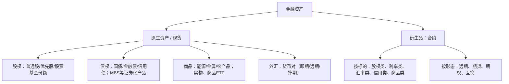

# 金融资产的基本类型（股权/债权/商品/外汇/衍生品）

> 领域：金融理财 · 学习目标：工作应用
> 类型：概念 · 掌握度：待学 · 讲义：v1（草稿） · 本质：概念
> 一句话定义：按「你持有它拥有什么权利」把可交易金融资产分成股权、债权、商品、外汇、衍生品五类，是听懂任何财经名词的第一层分类。
> 前置：实物资产与金融资产的区别
> 导出于 2026-09-15 10:59

## 学习前必读

### 前置
- 需先掌握：**实物资产与金融资产的区别**（实物资产是能直接使用或消耗的东西，如自住房、原油、黄金；金融资产是「对未来现金流的一份权利凭证」）。本卡全篇都在问同一句话：*你持有它，拥有的是什么权利？*
- 本卡只做「分箱」，不深入单个产品的定价。学完本卡后，空间里会依次展开：利率与收益率：钱的时间价格 → 一级市场与二级市场 → 股票 / 债券 / 期货 / 汇率 各自的概念。

### 记号热身（看一遍即可，后面反复用）
- **百分比**：跌 5% 就是价格 ×0.95。10000 元的资产跌 5% → 10000×0.05 = 500 元亏损。
- **名义本金（notional）**：合约上写着的、用来算钱的「记账金额」。如「名义本金 100 万元的原油期货」。
- **保证金与杠杆**：保证金 = 你实际掏的钱；杠杆倍数 = 名义本金 ÷ 保证金。10 万名义本金、1 万保证金 → 10 倍杠杆。
- **面值与票息**：债券「面值 100 元、票息 3%」= 每年按面值付 100×3% = 3 元利息。
- **报价方向**：USD/CNY = 7.10 读作「1 美元 = 7.10 元人民币」，数字变大 = 美元升值、人民币贬值。

### 学完能做到
拿到任何一个财经名词（股票、10 年期美债、布伦特原油、美元指数、原油期货、MBS、可转债），都能用三句话拆开：**它属于哪一类 → 我买到的是什么权利 → 钱从谁那里、靠什么来。**

## 本质

金融资产的分类标准**不是「它长什么样」，而是「它给你什么权利、这份权利对应谁的钱」**。

| 类型 | 你持有的是什么 | 对方/对应方是谁 | 你的钱从哪来 |
| --- | --- | --- | --- |
| 股权 | 公司的一小部分所有权（剩余索取权 + 投票权） | 公司（发行人） | 分红 + 股价价差 |
| 债权 | 一份约定好利息与还本时间的借条 | 发行人（政府/金融机构/公司） | 利息 + 债券价差 |
| 商品 | 实物本身（或其实物凭证） | 没有「发行人」 | 只有价格变动（无现金流） |
| 外汇 | 一种货币对另一种货币的兑换比率 | 无发行人（是两种货币的相对价） | 汇率变动 + 两种货币的利差 |
| 衍生品 | 一份关于「某个标的未来价格」的合约 | 合约的另一方（对手方） | 标的变动 × 方向 × 杠杆 |

**一句关键话**：前四类（股权/债权/商品/外汇）是**原生（现货）资产**——你直接持有某种东西；衍生品是**关于原生资产的合约**——你持有的是一份权利或义务。所以只有衍生品天生带三样东西：**到期日、杠杆、零和（你赚的正是对手亏的，且没有发行主体给你「创造」价值）**。

## 为什么学它

### 为什么听不懂财经内容
绝大多数「听不懂」不是词汇量不够，而是**没有先分箱**：把股票、债券、期货当成同一种「会涨会跌的东西」来听，于是「美联储加息 → 美元走强、美债下跌、美股估值承压」这类三段式新闻就听不进去——它需要你先知道三类资产各自被什么驱动。

### 对「工作应用」的用处
1. **听懂新闻**：任何一句财经话都先归到某一类，再问「这类资产的收益从哪来」。
2. **读数据不读错**：知道自己在读的是「股权数据（股价/成交量/PE）」还是「债权数据（收益率/净价/信用利差）」，才不至于把债券的「收益率上行」误读成「赚钱了」。
3. **拆产品说明书**：银行理财、基金、结构性产品都是「载体」，要看穿它里面装的是哪几类资产。
4. **对齐术语**：和同事讨论时，先说清「我们说的是哪一类资产、哪种载体」。

## 示例

### 示例 1：把一条新闻拆成五类
> 「隔夜美股三大指数收跌，10 年期美债收益率上行至 4.5%，美元指数走强，布伦特原油跌 1%。」

| 新闻里的词 | 属于哪一类 | 为什么这么归类 |
| --- | --- | --- |
| 美股三大指数收跌 | 股权 | 指数 = 一篮子股票的价格加权，代表「拥有一批公司的一部分」 |
| 10 年期美债收益率 4.5% | 债权 | 政府借钱的借条，约定利息与还本；收益率是债权资产的「价格语言」 |
| 美元指数走强 | 外汇 | 美元对一篮子货币的加权汇率，是「货币之间的相对价格」 |
| 布伦特原油跌 1% | 商品 | 可交割的实物（能源），本身不产生现金流 |

注意：这句话里**一个「衍生品」都没出现**，但上面每一项背后都有对应的期货、期权、互换在场内或场外交易。这就是「原生资产」与「衍生品」的关系。

### 示例 2：同一家公司同时出现在三类资产里
- 你买它的**股票** → 股权（你是股东，排最后分钱）。
- 你买它发的**公司债** → 债权（你是债主，先拿利息和本金）。
- 你和它签一份**原油远期** → 衍生品（你持有的是合约，不是公司的一部分）。

### 示例 3：生活版
- 自住房 = 实物资产；房贷 = 你的负债（你按约定付息还本，是从「债主视角」被收利息）。
- 把人民币换成美元 = 外汇敞口。
- 货币基金/余额宝类 ≈ 债权类（装的是短期货币市场工具）。

### 示例 4：MBS（房贷支持证券）的定位
银行把一批房贷打包，投资者买入的是「以房贷利息与本金为现金流」的证券：法律上属于**债权/证券化类**，但它额外带一个风险——**房子持有人可以提前还款**，相当于这份证券里嵌了一个期权。这也是为什么后面会有独立分支「MBS 与资产证券化」。

## 定义

### 三问判据（不用背，用问的）
1. 你持有的是**对某物的所有权**、**对某人的索取权**，还是**一份合约**？
2. 现金流是**约定的**（有金额和时间表）还是**不确定的**？谁先拿？
3. 有没有**到期日**？有没有**杠杆**？

第 1 问定大类，第 2 问分股权/债权，第 3 问抓住「是不是衍生品」。

### 五类的一句话定义
- **股权 Equity**：公司的所有权凭证，索取顺序在债权人之后，没有到期日。
- **债权 Fixed income / Debt**：对发行人的债权凭证，约定了利息与还本时间，清偿顺序在股东之前。
- **商品 Commodities**：可交割的实物（能源、金属、农产品）；**本身不产生现金流**，价格来自供需。
- **外汇 Foreign Exchange (FX)**：两种货币之间的兑换比率，本质是「货币这种资产」之间的相对价格。
- **衍生品 Derivatives**：价值来自另一个资产（**标的**）的合约，包括远期、期货、期权、互换；可能是权利（期权买方），也可能是义务（期货双方）。

> 一个常被混淆的点：**共同基金 / ETF 是「载体」，不是「类别」**。一个 ETF 属于股权、债权还是商品，取决于它里面装的是什么。SEC 投教页面把投资产品按「股票 / 债券 / 共同基金与 ETF / 期权」等逐项列出，正是这个道理：同一份权利可以有多种买卖方式。

## 组成/结构

### 分类骨架

### 五类的「载体」对照（同一权利，可以有多种买法）
| 类别 | 常见载体 | 载体带来的额外差异 |
| --- | --- | --- |
| 股权 | 直接买股票 / 股票基金或 ETF | 基金是分散化，ETF 可盘中交易 |
| 债权 | 直接买债 / 债券基金 / 存款 | 基金有久期与净值波动，存款有保险与利率约定 |
| 商品 | 实物 / 商品 ETF / 商品期货 | 实物有仓储运费，期货有杠杆与到期 |
| 外汇 | 外币存款 / 即期换汇 / 远期 | 存款有利息，远期锁定汇率 |
| 衍生品 | 交易所标准化合约 / 场外合约 | 交易所带保证金与逐日结算，场外带对手方风险 |

### 交叉地带（现实里的高频考点）
- **可转债** = 债权 + 一个「按约定价格换成股票的权利」（本质是嵌入的看涨期权）。
- **优先股** = 股权的外形、债权的现金流手感（约定股息、无投票权常见）。
- **MBS** = 债权 + 提前还款（类期权）风险。
- **商品 ETF / 黄金 ETF** = 你持有的是基金份额（金融资产），法律上**不是**直接拥有实物金条。

## 规则

### 五条可直接用的规则
**R1 先问权利，再看名字。** 名字会骗人：「黄金 ETF」听起来是商品，载体上是基金份额；「原油」在新闻里可能是现货，也可能是期货价。

**R2 三条解码式（背下来就能拆名词）**
> ___ 属于（哪类）资产；我买到的是（什么权利）；钱从（谁/什么）来；我要盯（哪个数据）。

例：原油期货 —— 衍生品；我买到的是「到期按合约价买卖原油的义务」；钱从「油价变动 × 方向 × 杠杆」来；我要盯近月合约价、保证金与到期日。

**R3 遇到衍生品必问四件事：标的、方向（多/空）、到期与结算方式、保证金与杠杆。** 少问任何一件，你都不知道自己在承担多大风险。

**R4 同一敞口可以有多种载体，类别不变，但风险会变。** 「看多原油」可以通过实物、ETF、期货、看涨期权实现，四者杠杆、到期、最大亏损完全不同。

**R5 三种收益来源要分清。** 利息（债权/存款）、分红（股权）、价差（所有可交易资产）；**商品与外汇没有现金流**，只靠价格变动与（外汇的）利差。

## 适用与局限

### 用在哪
- **听新闻 / 读研报**：给每句话里的资产先贴标签，再判断它在讲「现金流」还是「价格」。
- **读行情页**：先确认这一页是股权数据（价格、涨跌幅、成交量）还是债权数据（收益率、净价、利差），再看数字。
- **拆产品**：拿到任何理财/基金/结构性产品，问「它装的是哪几类资产、有没有杠杆、有没有到期」。
- **盘点自己**：你的资产表其实横跨五类——房产（实物）、股票与基金（股权）、存款与货基（债权）、外币（外汇）、以及含期权的房贷（衍生结构）。

### 做不到（局限）
- 分类是**盒子**，不是**光谱**：现实里大量混合体（可转债、优先股、MBS、结构化产品），分类只给第一层。
- 分类**不含估值**：知道一类资产是什么，完全推不出「现在该不该买、能赚多少」。
- 分类**不替代合同**：判断风险最终要看合同里的现金流、期限、杠杆与顺位。

## 反例/边界

### 四个常见反例
1. **「银行理财是一种资产类别」——错。** 它只是法律/销售载体，里面可能装债券、非标资产、衍生品。
2. **「黄金是商品，所以安全」——推理无效。** 商品没有现金流，价格由供需决定，波动可以很大；安不安全不来自分类。
3. **「期货就是买现货的另一种方式」——错。** 期货是合约：有到期日、有保证金、逐日结算，价格反向变动时亏损可能等于甚至超过你投入的保证金。
4. **「外币存款不算投资」——错。** 它是外汇敞口，汇率一变动，你的本币价值就变。

### 两条边界
- **货币本身不产生现金流**，但持有外币时你同时获得「汇率变动 + 两种货币的利率差」两个来源。
- **衍生品的「零和」**：不考虑手续费，场内衍生品多空双方的盈亏相互抵消，没有发行主体在给你创造价值——这与股权的分红、债权的利息有本质区别。

## 辨析

| 对比 | 关键差别 |
| --- | --- |
| 股权 vs 债权 | 股权是**剩余索取权**（先给债主和员工，剩下的才是股东的）、收益浮动、通常无到期日；债权是**优先索取权**、收益约定、有到期日 |
| 商品 vs 股权 | 商品**没有现金流**，价格来自供需；股权有分红与盈利现金流 |
| 外汇 vs 商品 | 两者都只看价格，但外汇是**两种货币的相对价**（永远成对出现），且背后有两国利率 |
| 衍生品 vs 原生资产 | 原生是「持有某物」，衍生是「一份合约」：有到期、有杠杆、零和、通常只需付一小部分钱 |
| 股票 ETF vs 股指期货 | 同一个敞口（一篮子股票），但 ETF 无杠杆、无到期；股指期货有保证金、逐日结算、必须展期 |
| 债券 vs MBS | 债券现金流基本确定；MBS 的现金流取决于**房贷会不会提前还**，多一层不确定性 |

## 详解

### 每一类资产都按「载体 / 权利 / 价格驱动」三层看

**股权**
- 载体：股票（A 股/美股）、股票基金、ETF。
- 权利：按持股比例的所有权 + 投票权 + 剩余索取权。
- 价格驱动：盈利（EPS）、估值倍数（PE/PB）、资金面与利率水平 → 后续「股价涨跌从哪来」展开。

**债权**
- 载体：国债、金融债、信用债、债券基金、存款。
- 权利：约定利息 + 到期还本 + 破产清算时排在股东之前。
- 价格驱动：无风险利率、信用利差、剩余期限、流动性 → 后续「债券价格与收益率的反向关系」「到期收益率 YTM」展开。

**商品**
- 载体：实物、商品 ETF、商品期货、商品生产商股票（间接）。
- 权利：实物所有权，或一份买卖实物的合约。
- 价格驱动：供需、库存、仓储与运输成本、**期限结构**（近月贵于远月叫 backwardation，反过来叫 contango）→ 后续「主要期货品种」展开。

**外汇**
- 载体：外币存款、即期换汇、远期结售汇、外汇期货。
- 权利：两种货币按比率互换的权利。
- 价格驱动：两国利差、贸易与资本流动、央行政策与外汇储备 → 后续「美元与汇率」分支展开。

**衍生品**
- 载体：交易所标准化合约（期货/期权）、场外合约（远期/互换）。
- 权利：**期权买方是权利**（最大亏损 = 权利金），**期货双方是义务**。
- 价格驱动：标的 + 波动率 + 时间价值 + 资金成本与保证金 → 后续「期货」「做多与做空」两个分支展开。

### 为什么这个分类值得先学
它是全空间 49 个概念的**共同分母**：利率、报表、行情数据、MBS、美元，每一个后续话题都要先说清「我们在讲哪一类资产、哪种载体」。

## 常见坑

1. **按名字分类，不按权利分类。** 「黄金 ETF」当商品、「xx 宝」当债权，都跳过了「合同里我到底持有什么」。
2. **把载体当类别。** 理财产品、基金、保险都不是类别，它们是装资产的盒子。
3. **把「做空 / 杠杆」当类别。** 它们是**头寸与交易方式**，可以施加在任何一类资产上。
4. **忽略到期与再投资。** 债券会到期、期货会到期、期权会作废——「持有」这件事会变。
5. **报价方向搞反。** 说「美元涨」之前先看报价是 USD/CNY 还是 CNY/USD；USD/CNY 从 7.10 到 7.20 = 美元升值。
6. **把 MBS 只当普通债券。** 提前还款（类期权）+ 分层结构，让它的风险不同于一条普通债。
7. **把「没有现金流」当成「没有价值」。** 商品与外汇就靠价格变动，不能用「有没有利息」来判断值不值得持有。

## 自测

### 一、判断对错
1. MBS 本质上属于债权/证券化类资产，并且额外带一个「提前还款」风险。
2. 黄金 ETF 的份额代表你直接拥有一块实物黄金。
3. 期货合约和现货一样，没有到期日。
4. 你把手里的人民币换成美元现金后，就持有了一个外汇敞口。
5. 只要知道一个资产属于哪一类，就能推断出它未来收益的高低。

### 二、用解码式拆名词
6. 拆解这句话：「某公司发行的可转债今天涨了 2%。」请写出：它属于哪一类（或哪两类）、我买到的是什么权利、钱从哪来。

### 三、同敞口不同载体
7. 同为「看多原油」，持有实物原油、买入原油 ETF、买入原油期货、买入原油看涨期权，四者风险差别在哪？至少说出两点。

### 四、算一算（写出中间量）
8. 你用 1 万元保证金买入名义本金 10 万元的原油期货。价格上涨 5% 时，保证金账户权益增加多少、占保证金百分比多少？价格下跌 10% 时呢？（提示：先算名义本金上的盈亏，再除以保证金）

### 五、辨析与应用
9. 为什么「债券价格与收益率反向」这件事，不能直接照搬到股票上？
10. 把下面名词各归入五类（可多选），并写出你会盯的一个数据：黄金、标普 500 指数、10 年期美债、美元指数、原油期货、MBS、可转债。

## 参考答案

**1.** 对。它是把房贷现金流打包成的证券，法律上归债权/证券化，但多了提前还款（相当于一个期权）这层风险。

**2.** 错。你持有的是基金份额（金融资产），基金再去持有黄金或黄金相关合约；法律上你不是实物金条的所有人。

**3.** 错。期货有交割月与到期日，必须平仓或交割/展期。

**4.** 对。持有外币就承担了汇率变动的敞口，另外还有两种货币的利差。

**5.** 错。分类只回答「是什么、钱从哪来」，不含估值与收益预测。

**6.** 可转债 = **债权 + 嵌入衍生品（转股权，本质是一个看涨期权）**。你买到的是：「按约定收利息、到期拿本金」的权利 + 「在约定条件下按约定价格换成股票」的权利。钱从三处来：利息、债券本身的价格变动、以及正股价格与转股价之间的价差。

**7.**（答出两点即可）① **杠杆与爆仓**：期货只交保证金（例如 10 倍杠杆），价格反向 10% 就能把保证金亏光；实物与 ETF 无杠杆，跌幅多大亏多大。② **到期与持有成本**：期货有到期日、逐日结算、需要展期；实物要仓储与运输成本，ETF 有管理费与跟踪偏差。③ **最大亏损**：看涨期权买方最大亏损 = 权利金（有限），但有时间价值衰减；实物理论上跌到接近 0。

**8.** 名义本金 10 万元，价格涨 5% → 盈亏 = 100000×5% = **5000 元**；占保证金 10000 元的 5000/10000 = **50%**。价格跌 10% → 盈亏 = 100000×10% = **10000 元**，正好亏光 10000 元保证金（**-100%**），触发追加保证金/强平。结论：**10 倍杠杆把 5% 的价格波动放大成 50% 的保证金波动。**

**9.** 债券有**约定的现金流与到期日**，价格由「把未来现金流按市场利率折现」决定，利率一变价格必然反向变，方向与机制是确定的；股票**没有约定现金流**，价格取决于盈利预期、估值倍数与资金面，利率只是众多影响因素之一，方向与幅度都不确定。

**10.** 参考归类：黄金 = 商品（黄金 ETF 份额在法律上是基金权益）；标普 500 指数 = 股权（一篮子股票的加权）；10 年期美债 = 债权；美元指数 = 外汇（美元对一篮子货币的相对价）；原油期货 = 衍生品（标的为商品）；MBS = 债权/证券化（标的为房贷现金流，含提前还款风险）；可转债 = 债权 + 衍生品（转股期权）。
盯的数据示例：黄金 → 金价（美元/盎司）；指数 → 点位与涨跌幅、成交量；美债 → 10 年期收益率；美元指数 → DXY 点位；原油期货 → 近月合约价、持仓量与保证金比例；MBS → 收益率/久期与提前还款速度；可转债 → 转股溢价率与正股价格。

## 编写注记（学习者可跳过）

- **取材**：五类划分与「投资产品可以有多种载体（股票、债券、共同基金与 ETF 等）」这一层意思，取自美国 SEC 投资者教育页面 Investor.gov「Investment Products」（本卡 evidenceSources 引文为其页面导语）；分类框架与实物/金融资产之分另与 Bodie/Kane/Marcus《Investments》、Mishkin《货币金融学》的主干一致。
- **取材失败记录**：Investopedia「Asset classes」页返回 403，未能取得正文；arXiv API 与 Wikipedia 多次超时；本轮 web_extract/http_get 额度用尽，故未再补充来源。
- **需核验（先验部分）**：MBS 的提前还款/分层风险、商品期限结构（contango/backwardation）、可转债与优先股的混合性质、外汇收益 = 汇差 + 利差，属本轮按主干编写的先验内容，待「MBS 与资产证券化」「期货」「美元与汇率」分支采到资料后回填出处。
- **衔接**：本卡刻意不展开估值与定价；下一步建议学「资产的三属性：收益、风险与流动性」把分类用到比较上，再进入「利率与收益率：钱的时间价格」。

## 相关著作

- **Investments** · Zvi Bodie, Alex Kane, Alan J. Marcus · 2014 · [教科书] — 资产类别的经典划分依据：实物资产 vs 金融资产，金融资产内部再分股权/固定收益/衍生品
- **货币金融学（The Economics of Money, Banking, and Financial Markets）** · Frederic S. Mishkin · [教科书] — 货币、外汇与利率的入门框架，用于本卡外汇与债权部分的对照

## 证据来源

- [监管机构投资者教育页面] Investment Products — Investor.gov（美国 SEC 投资者教育） · https://www.investor.gov/introduction-investing/investing-basics/investment-products
  > A wide variety of investment products exist to help you achieve your financial goals. Learn about many investment products in the menu on the left. Some examples of investment products are:
