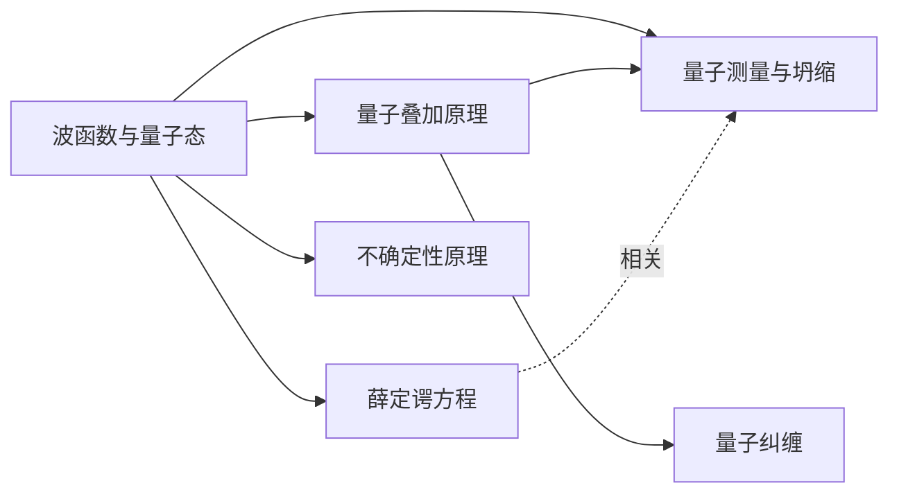

# 学习空间: 量子物理 (id=82acc691-2e01-40fc-9601-b10240e20742)

- 目标: 入门
- 绑定知识库: 无
- 状态: active
- 概念: 7 | 关系: 7 | 讲义卡: 1 | 已答问答: 1

## 概念清单

| 名称 | 类型 | 掌握度 | 研究态 | 一句话定义 |
| --- | --- | --- | --- | --- |
| 量子物理·领域根 | group | untouched | unresearched | 我希望了解量子物理的基本概念，这个领域的著名理论和著名人物，反正历程，当前量子物理领域热门研究方向以及进展 |
| 波函数与量子态 | concept | untouched | extracted | 量子力学描述系统状态的数学对象：复值函数 ψ(r,t)，|ψ|² 关联找到粒子的概率密度，是全套理论的'状态语言'。 |
| 不确定性原理 | principle | untouched | 待研究 | 成对共轭量（如位置-动量）无法同时任意精确：Δx·Δp ≥ ħ/2，源于态的统计宽度而非测量扰动。 |
| 薛定谔方程 | theory | untouched | 待研究 | 量子力学的动力学定律：iħ·∂ψ/∂t = Ĥψ，决定波函数随时间的确定性演化。 |
| 量子叠加原理 | principle | untouched | 待研究 | 若系统可处于多个量子态，则其线性组合仍是可能的态；叠加是干涉、纠缠等量子效应的源头。 |
| 量子测量与波函数坍缩 | concept | untouched | 待研究 | 测量叠加态时系统以概率得到某本征结果并'投影'到对应本征态（坍缩），由此引出诠释分歧（测量问题）。 |
| 量子纠缠 | concept | untouched | 待研究 | 复合系统整体态不能分解为各子系统态之积时产生的非经典关联；贝尔不等式检验证实其存在，是现代量子信息的基础资源。 |

## 关系(学习顺序)

- 量子叠加原理 → 量子测量与波函数坍缩 (prerequisite, verified=0)
- 波函数与量子态 → 薛定谔方程 (prerequisite, verified=0)
- 波函数与量子态 → 量子叠加原理 (prerequisite, verified=0)
- 波函数与量子态 → 不确定性原理 (prerequisite, verified=0)
- 波函数与量子态 → 量子测量与波函数坍缩 (prerequisite, verified=0)
- 薛定谔方程 → 量子测量与波函数坍缩 (相关, verified=0)
- 量子叠加原理 → 量子纠缠 (prerequisite, verified=0)

# 讲义: 波函数与量子态

- 概念 id: d82f363b-14e5-49c3-b4f2-619df9f0d177
- 本质类型: K-concept
- 状态: draft | version: 1
- 更新时间: 2026-09-09 02:47:29.268

## [区:definition] 它是什么（标准定义）

量子力学中，一个系统在某时刻的**全部可描述信息**都编码在一个复值函数——**波函数** ψ(x,t)——里（更一般的表述称**量子态** |ψ⟩）。以单粒子一维情形为例：ψ 把每个位置 x 映到一个复数。

- **概率诠释（Born 规则）**：|ψ(x,t)|² 是 t 时刻在位置 x 附近（单位长度内）**发现粒子的概率密度**；归一化条件 ∫|ψ(x,t)|² dx = 1（全空间积分）对应“粒子必然在某处”。
- ψ 本身通常是复数，**不是直接可测的量**；实验能测到的是 |ψ|² 这类“振幅平方”及其统计量。

> ⚠️ **待核验**：本节为教材标准表述（Born 规则、归一化等）。本轮采集阶段 Wikipedia / 费曼讲义等站点超时或被拒，尚未从已读一手原文直接引证，故整体标 needs_verification——地图人审通过或后续补录教材/词条证据后可转正。

## [区:role] 在量子力学中的地位（已有证据支撑）

先看一份可引证的一手定位——Stanford Encyclopedia of Philosophy《Quantum Mechanics》(J. Ismael)：

> 量子力学“**是一种预测微观粒子行为（或至少是我们用于探测这些行为的测量仪器行为）的数学机器**，并且在这方面极其成功——其效力与精度远超我们曾有过的任何理论”。

> 但“**它描述的是一个什么样的世界，是有争议的**”——物理学家与哲学家对量子力学所刻画的世界图景几乎没有共识。

**由此得到的入门第一认知**：波函数/量子态正是这套“数学机器”用来**描述单个微观系统状态的通用语言**（推论，待核）；后续要学的叠加、演化、测量、不确定性、纠缠，全部是围绕“这个状态对象”展开的——所以它排在整张学习图的最前面。

## [区:map] 在本领域中的位置（学习依赖图）

本图首批 6 个概念中，本概念是唯一的根前置（其余 5 个均以其为直接或间接前提）：

> 依赖说明：叠加=态的线性组合；薛定谔方程=态随时间的演化律；不确定性=态在位置/动量上的统计宽度；测量=对态施加的“投影+概率”规则。先把“态”说清楚，其余才有立足点。

## [区:gap] 已读来源与本轮缺口

**已实际读到并作证据**：
- SEP《Quantum Mechanics》词条导言（网页正文），用于“数学机器 + 诠释争议”的定位断言。

**本轮未取得、建议下一步补采**：
1. 波函数定义的权威词条/教材正文（计划源：Wikipedia 的 Wave function / Quantum superposition 词条——本轮连接超时/被拒，可稍后重试）；
2. 费曼物理学讲义 Vol.III 第 1 章“量子行为”与第 16 章（官网被防火墙拒绝，建议换镜像或 arXiv 讲义补读）；
3. 双缝实验等入门例证材料（用于把“叠加→干涉”讲具体）。

补采完成前，本讲义凡涉及定义性内容均已标待核验，不冒充已有出处。

## 证据来源

- [web] Quantum Mechanics, Stanford Encyclopedia of Philosophy (J. Ismael) (https://plato.stanford.edu/entries/qm/)
  引文: Quantum mechanics is, at least at first glance and at least in part, a mathematical machine for predicting the behaviors of microscopic particles — or, at least, of the measuring instruments we use to explore those behaviors — and in that capacity, it is spectacularly successful: in terms of power and precision, head and shoulders above any theory we have ever had.
- [web] Quantum Mechanics, Stanford Encyclopedia of Philosophy (J. Ismael) (https://plato.stanford.edu/entries/qm/)
  引文: The question of what kind of a world it describes, however, is controversial; there is very little agreement, among physicists and among philosophers, about what the world is like according to quantum mechanics.

## 相关著作

- The Feynman Lectures on Physics, Vol. III: Quantum Mechanics — Richard P. Feynman, Robert B. Leighton, Matthew Sands (1964)

## 已答问答(答疑历史)

### Q: 量子物理有哪些基本概念  [来源:ai_verified]

入门导览（本空间暂未落库概念，讲义区为空，以下为通用知识）：1 量子化（能量一份一份，E=hν）；2 波粒二象性；3 态与叠加；4 波函数 ψ（|ψ|² 为概率密度）；5 测量与坍缩（投影到本征态）；6 不确定性原理（Δx·Δp≥ħ/2）；7 纠缠；8 量子隧穿；9 概率诠释/哥本哈根诠释。待地图人录概念与讲义后可逐条对照展开。

